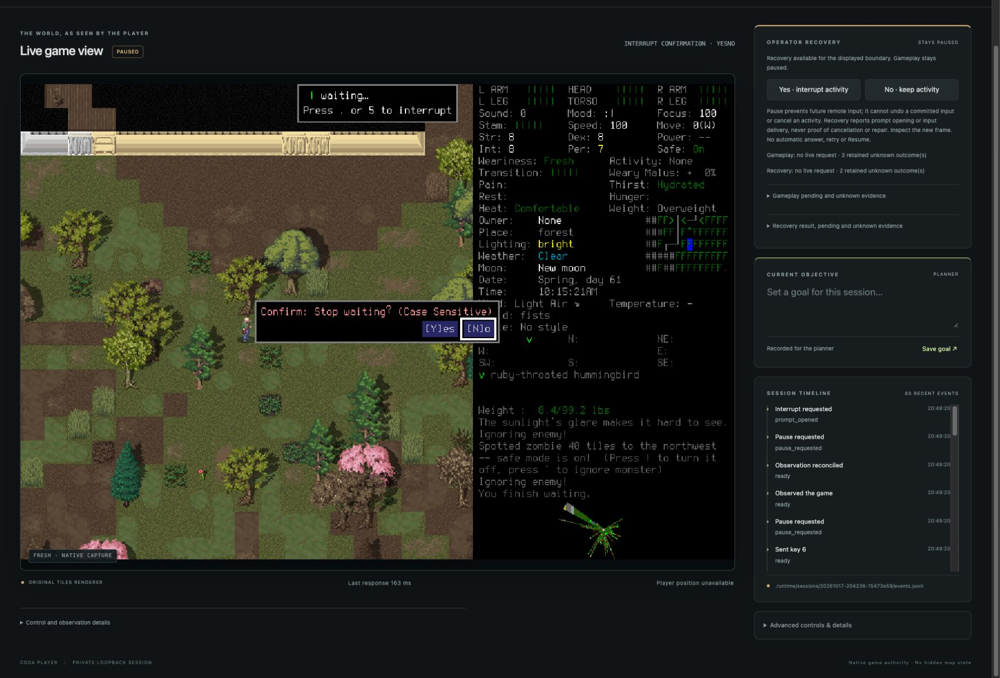

# Public recovery, evaluation and monitoring design

The spectator and CLI expose explicit operator recovery. A passive recorder now
retains complete outcome/cost measurements with missing values and failed runs.
The reviewed monitoring design specifies how future gameplay can handle unexpected
outcomes beyond exact movement; that monitor is not implemented by this round.

Scope is #31, #18 and #41 in [PR #45](https://github.com/CVX-Hull/cdda-player/pull/45).
The [brief](../changes/007-recovery-evaluation-monitoring.md) owns the selected
interfaces and experiment protocol. Runtime source is commit
`9ad6856601168f1727b9cb5f820252b46b6b12c3` (verify against the manifest); later
checkpoints add this evidence and guidance without changing runtime behavior.
The [manifest](2026-10-17-public-recovery-evaluation-manifest.json) identifies
retained bytes. Local artifacts are unavailable in a fresh clone unless transferred.

## What the operator can review

This is an actual native frame in the spectator, not a mock or generated game
scene. The later Yes delivery returned to paused normal play. A separate CLI No
delivery continued waiting and eventually reached an unrelated zombie distraction.
Input delivery never established cancellation by itself.

| Lane | Evidence and result | Limit |
| --- | --- | --- |
| Portable | 207 Python tests, viewer regressions and common controls passed on the runtime candidate | Synthetic transports cannot prove engine behavior or model skill |
| Native provenance | Installed binary and seven native/controller/evidence source hashes match the prior accepted receipt | No new build was needed; this is reuse verification, not a fresh compilation |
| Public graphical recovery | Real debug continuation through spectator and CLI; HTTP/CLI interrupt opening; spectator Yes; CLI No; old-generation and unrelated-prompt rejection | Only these supported boundaries; no broad recovery guarantee |
| Native measurement | One north input, one verified tile and one game turn; 182.24 ms admission-to-final recording | Partial instrumentation probe, not the full waypoint task or a model comparison |
| Design | Independent source/contract/diagram review; completion precedence and future provider dependency corrected | #42–#44 remain future implementation and evaluation |
| Narrow layout | Exact source HTML/CSS in static 640×900 and 375×900 fixtures; controls and text wrap without clipping | Static layout evidence, not native behavior; game text is small at phone width |

## Portable review and repairs

Two workers used separate worktrees at brief commit `3932476`, with eight recovery
paths and three evaluation paths respectively. The lead integrated and reviewed
the actual files. Independent clean-context reviews found and closed:

- A late Observe response could clear newer recovery uncertainty. An authority
  epoch now prevents this; a delayed-response regression covers the ordering.
- Session and realized model-call sets fragmented repeated-run cohorts, including
  pre-call failures. Grouping now uses the declared full configuration; session
  provenance and actual per-call identities remain visible inside each cohort.
- A first-useful-action reference could name an undispatched attempt. It now
  requires known dispatch; useful menu actions may still have zero displacement.
- Native game turns retain their signed 32-bit identity contract; nonnegative
  measurement schemas still reject negative usage, cost or elapsed time.
- Monitor routing needed explicit completion precedence, conflict handling and an
  actual future provider owner. Completion blocks further stage actions; #22 owns
  the proposed provider prerequisite. A final issue-title read corrected an early
  mistaken #20 reference before acceptance.

Initial integration failed because the bounded governance checker still searched
for the old viewer protocol expression. It now recognizes both explicit displayed-
frame guards, and its mutation fixture changed with the representation. The full
lane then passed, including the pre-commit run. Earlier sandbox browser/socket
denials and worker fixture repairs are not native failures or passing evidence.
Retained output under `.runtime/evidence/round007/` distinguishes these cases.
The initial manifest used an unsupported availability label for the tracked
screenshot. It was corrected to index its retained local original under the
existing schema, with no validator relaxation.

## Native sequence and unsuccessful attempts

The installed binary SHA-256 is
`838f924e9228999625462ec3465c8d85b6321dc43c7a6e1f84aa7de4b4255433`.
All launches used the prepared project wrapper and explicit userdir. Native windows
were 960×672 including title bar, never fullscreen. Only the lead owned game,
controller, ports and saves. Public probes used HTTP or CLI, not Python recovery
calls. CUA handled spectator clicks and native-only prompts.

1. Startup retained prior gameplay/control unknowns. Explicit Observe reconciled
   transport without erasing their history. Loading the saved tutorial exceeded
   the ordinary deadline and exposed missing tutorial terrain/special/trap IDs.
   Each of seven continued diagnostics was inspected individually. The first
   spectator attempt rejected a stale frame; a deliberate fresh observation and
   new click delivered one Space. CLI also delivered one Space. No error-ignore
   option, save edit or validation bypass was used. Further missing-content errors
   caused this load to be abandoned; the tutorial remains unresolved.
2. The H world loaded through its normal character menu. Its initial load also
   exceeded the ordinary five-second deadline; Observe showed normal play, without
   replay or retroactively proving the old load outcome. The recorder retained
   before/after evidence for one northward move. The full waypoint task was not
   run, so the artifact is deliberately `partial`. Harms, deaths and external
   planning cost remain unassessed/unavailable, not zero.
3. A short WAIT finished before interruption applied (`not_applicable`). Another
   reached an unrelated zombie distraction. Two immediate interruption attempts
   rejected because the activity's rendered revision was no longer current.
   Source inspection shows native Pause can increment revision before the recovery
   capture check. No guard was weakened. The current workaround is deliberate
   Pause → Observe → inspect eligibility → request interruption; #8 tracks the
   native timing defect and broader acceptance.
4. Direct executable launches could not be bound by native UI automation. The
   first H probe was stopped at its unsupported prompt, preserving its evidence
   and original save; those unsaved probe steps were not retained in the save.
   After verifying no game remained, the same prepared app wrapper was launched
   through CUA. The H save loaded normally. Native Yes handled an unrelated
   distraction; the game's normal ignore action and one visible eastward step
   moved away from a distant zombie. These were ordinary engine inputs.
5. Probe 66 opened an owned WAIT confirmation through public HTTP after explicit
   Pause/Observe. The spectator displayed both choices; its deliberate Yes returned
   `answer_delivered`, and probe 68 observed paused normal play. Probe 69's CLI
   answer against old generation/prompt authority rejected. Probe 77 opened another
   owned query through CLI. Probe 78 delivered NO; probe 80 showed a later unrelated
   distraction after game time advanced. Probe 81 rejected recovery for that prompt.
   Native Yes handled it. Normal Save and quit returned to the main menu (probe 86),
   and normal Quit closed the game.

No new native recovery-timeout injection was performed. Timeout, duplicate-writer,
missing-capture, stale-owner and concurrent ordinary/recovery/Pause ordering are
covered in the portable lane; historical unknowns were visibly retained in this
native session. In particular, these WAIT attempts returned ordinary transport at
an activity poll: they do not independently prove an HTTP ordinary request stayed
pending throughout recovery. The prior native lane and current portable concurrency
tests remain separate evidence.

The native measurement uses `EvidenceStore` and `RunRecorder` with real snapshots;
offline validation passed. Its first driver invocation failed on Python import
context before any dispatch, then ran from the project root. The passive recorder
does not independently assess outcomes or instrument external Codex. Its measured
interval excludes this conversation's planning and setup.

Independent final acceptance review verified all 178 indexed artifact hashes,
seven reused source hashes, installed binary identity, 164 stopped-journal records
and the measurement summary. It inspected the native/spectator/layout/diagram
images, reran 16 evaluation tests and found no material acceptance blocker.

## Documentation, maintenance and remaining work

The [evaluation guide](../evaluation.md) links the authoritative schema and frozen
experiment protocol. The [monitor design](../design/outcome-monitoring.md) and
[evidence matrix](../research-outcome-monitoring.md) distinguish exact facts,
fallible interpretations, unknowns, calibration limits and bounded escalation.
The diagram was rendered with pinned local tooling and inspected by lead and
independent reviewer; logical responsibilities do not imply additional model tiers.

Current operator guidance explicitly retains the native timing limitation. #8
owns timing, broad recovery and existing tutorial-load problems; #24 owns actual
model-baseline experiments; #42–#44 own monitor implementation, response policy
and non-movement evaluation. No provider, API spend or learned router is enabled.
Monitor/provider/observer changes and false-success incidents trigger review;
#26 owns the active research checkpoint, not an automatic timestamp renewal.

The final native session saved normally. Both owned loopback servers were stopped
with SIGINT; process inspection found no remaining game or acceptance server.
The stopped journal was copied before hashing. Saves, admissions, prior unknowns,
builds and curated evidence remain. Only owned source worktrees/branches are
eligible for post-merge cleanup. Hosted CI/protected merge and live issue status
are recorded in the PR and GitHub Project, not inferred from these local checks.
