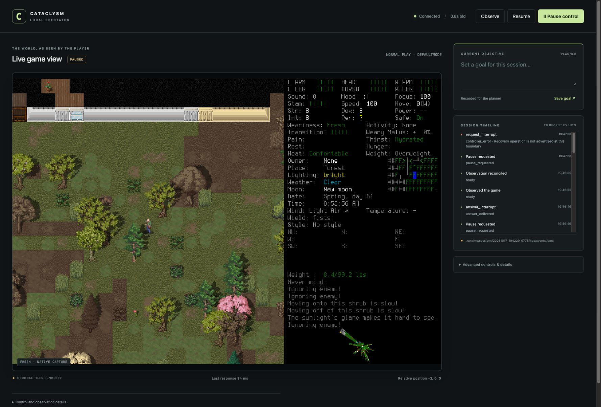

# Recovery transport and passive memory acceptance

The Python operator interface can request CDDA's own interruption confirmation,
answer that exact prompt and continue one visible raw debug error. Recovery keeps
remote gameplay paused. The new passive memory distinguishes current facts,
history, interpretations and plan candidates; it grants no action authority.
Public spectator/CLI recovery controls (#31), broad integrated recovery (#8),
waypoint execution and model planning remain outside this acceptance.

The lead integrated two isolated workers from `c673b980bea1165e2423563ce69ca91cc8caf8fe`
after an independently reviewed interface checkpoint. This report and its
[manifest](2026-10-17-recovery-memory-manifest.json) identify runtime source hashes,
build identity, local artifacts and limits. Runtime source checkpoint `0ea61ecc7406490a4296cff16bae2b990f0d7007` matches all seven final
source-receipt hashes. The enclosing protected PR identifies subsequent
acceptance-only changes and hosted verification. GitHub owns live delivery status.

## What the operator can review

| Observed result | Meaning and limit |
| --- | --- |
| WAIT → owned confirmation → NO | The engine continued waiting, then opened a separate zombie distraction. NO did not cancel WAIT. |
| WAIT → owned confirmation → YES | Fresh observation returned to normal play with Activity: None, paused. An answer acknowledgement alone did not establish this. |
| Unrelated distraction and finished activity | Recovery was not advertised and the host rejected interruption. The native keyboard handled the unrelated prompt. |
| Natural tutorial-load errors | One requested Space advanced to the next authentic error; consecutive errors received different boundary IDs. The tutorial remains broken; no error was suppressed or declared fixed. |
| Timeout and restart | Gameplay and control envelopes retained their identities and unknown outcomes. Fresh observe cleared live slots while preserving durable uncertainty. |
| Passive memory | Portable tests establish bounded retention, provenance, disputes and candidate invalidation. They do not establish live gameplay competence. |

The dated spectator image shows the real paused native scene after the final YES.
Its timeline records the Python API calls; it does not imply public recovery buttons.

## Candidate and migration

Pinned CDDA 0.I-1 source and FreeType hashes remain unchanged. A fresh owned
extraction at `/private/tmp/cdda-player-build-8cyhfag6` supplied the build; no global
package/profile/application settings changed. Final build SHA-256:
`2cfc9409a80bb7ff140c1e89f4e0c95ee5fbd57177e556ca530407eac4d3caf5`.
Installed/signed binary:
`838f924e9228999625462ec3465c8d85b6321dc43c7a6e1f84aa7de4b4255433`.
Build logs retain the existing deployment-target warning: bundled FreeType targets
macOS 15 while the game targets 13. This Mac ran it; older hosts are unverified.

Wire 2 was replaced by wire 3 across native, controller, discovery, CLI, viewer,
evidence validation, tests, checker and current documentation. There is no old
runtime reader or downgrade. The offline cutover stopped both writers, acquired
both locks and archived 730 bridge files with hashes. Original unresolved request
`7f4aa377-503a-49b3-8e7b-d7702b696bf9` remains an opaque, hash-checked incident reference.
Its old bytes were not parsed as current requests or replayed. Saves were preserved.
Evidence-store format 2 retains disputes; task memory is process-local, with no new
persistent memory format. A rollback needs a coherent prior system and explicit
state transition, never mixed producers/consumers.

The manifest retains both candidate receipts. Probes 01–21 used the reviewed build
`ad5b849d…e484`; a real probe exposed reused identity across consecutive raw debug
errors. The lead fixed scope entry/exit rotation and rebuilt. Probes 22–50 used the
final `838f924e…5433` binary. Final WAIT and negative probes were repeated on it.
The earlier orphan-claim probe is explicitly earlier-candidate evidence; that path
was unchanged by the debug identity repair.

## Portable and review lane

Focused integrated checks passed: 64 memory/evidence/record tests and 86
controller/setup/governance tests. The common lane passed 181 Python tests plus
viewer, syntax, import boundaries, documentation, governance and diagram checks.
The final common command and checkpoint hook both passed; exact logs are in the manifest.
Mocks and synthetic source records are not native acceptance.

Independent agents reviewed design, implementation and changed expectations:

- `recovery_memory_design_review` found that transient evidence errors could hide
  earlier disputes. Public sticky source status and reopen/corruption regressions
  were added and independently verified (38 evidence tests).
- `memory_implementation_review` reproduced A→B→rejection→A revalidating an old plan.
  A process-local generation now catches every authority invalidation; memory
  checks it around retrieval. Historical undisputed facts remain available.
  The misleading total-I/O bound was renamed to retained image footprint and
  additional integrity reads documented. The repaired 14 memory tests passed.
- `recovery_implementation_review` found expired control claims blocked observe,
  and expiry was checked too early before binding work. Observe/pause now remain
  available and the commit gate rechecks expiry/frame freshness. The reviewer
  independently accepted these repairs and the later debug identity fix.
- Documentation review found stale overview claims and a diagram that excluded
  supported-menu resume. Current guidance and the rendered diagram were corrected.
  The lead inspected the 1000-pixel rendering; labels are readable and unclipped.

Preserved failures include obsolete worker fixtures, an invalid frame-name fixture,
a sandbox-denied headless renderer (rerun with permission), and a temporary preview
helper that tried to parse its PNG as SVG. The proper renderer succeeded; the PNG
error was tooling misuse, not a diagram pass. A temporary negative-probe driver
also initially assumed Controller was a context manager; explicit close repaired it.
Neither temporary-driver error changed production code or acceptance expectations.
The manifest validator rejected an initially drafted shape; it was corrected to
the existing strict schema without changing the schema or production behavior.

## Real native lane

All game launches used the prepared project wrapper, explicit userdir and a normal
960×672 window. Only the lead touched game, saves, bridge, build and port 8766.
Native keyboard movement/menus and the explicit local Python recovery API were
used. No save editing, direct activity cancellation or engine-validation bypass.
Temporary acceptance drivers are retained as local evidence, not shipped APIs.

Final probes 37–44 establish WAIT semantics. Request `ba8b05cb…3f20` opened an owned
confirmation; answer `2ca20108…3022` delivered NO. Time advanced from 08:31:33 to
08:51:14 before a separate brainless-zombie distraction. That unsupported prompt
rejected remote interruption. Native YES stopped the distraction; three visible
westward steps removed the creature from sight. Request `a1283ad4…cc3a` opened a
new confirmation; answer `801090e0…5a16` delivered YES. Probe 43 observed paused
normal play, position (-3,0,0), turn 5216036 and Activity: None. Probe 44 rejected
interruption after WAIT finished. H was saved through the ordinary save-and-quit UI.

Probes 24–34 preserve a real short-wait load timeout `dd60a0f1…d47f`. Debug recovery
`a4ff9256…6573` delivered one Space while that original gameplay identity remained
pending. A later observation showed the next natural error with boundary b7
instead of b5. An immediate post-delivery snapshot still showed b5; delivery does
not mean the engine has already reached its next boundary. Control `acecc097…0c84`
timed out and was retired **before claim**. Probe 30 had both live identities;
restart moved gameplay to unknown history and restored control pending. Probe 33's
fresh paused observe cleared both live slots while retaining exact envelopes in
unknown history and durable admissions. This does not simulate two lost dispatched
responses, establish the original load's success or authorize replay.

The earlier probes 17–20 deliberately suspended the identified native PID and
renamed a real published control inbox to simulate an orphan claim. After timeout,
controller restart retained its identity. Resuming that exact PID and explicitly
observing succeeded despite the orphan claim; expired reconciliation retired the
live slot but retained uncertainty. This is a labelled host fault injection, not
proof that the engine itself claimed the request.

Final direct-wire negative probes 46–50 sent deliberately invalid envelopes at an
authentic raw debug prompt. Native rejected stale generation, prompt, frame, wire 2,
and host authority revoked by a later Pause; the same error remained visible.
The Pause probe revoked a prepared envelope before publication. Narrower races
between claim and commit are covered by portable/source review, not claimed as
precisely timed native observations. Earlier stale-frame host rejections and
activity-to-distraction races remain recorded, without automatic retry.

## Maintenance, retention and remaining work

Current overview, protocol, architecture, runbook, design and recovery diagram
separate Python support from future UI/CLI and autonomous gameplay. Control review
updated the current wire agreement and runtime/native scopes; old reports retain
old-version observations. No scheduled maintenance or automatic native runner was
added. Reviewer findings show why source agreement and passing mocks cannot replace
native and semantic review.

Local artifacts under `.runtime/evidence/recovery-memory-round`, archived incident
bytes, normal saves and useful build output must remain available for reconciliation.
The small manifest and spectator image are versioned; large logs/frames are local
only and absent on a fresh clone. Preserve their hashes and incident obligations
before cleanup. Implementation worktrees/branches may be removed after protected
integration with handoffs retained. Game and acceptance server were stopped after
these probes. GitHub records publication, final CI, closure and cleanup outcomes.
