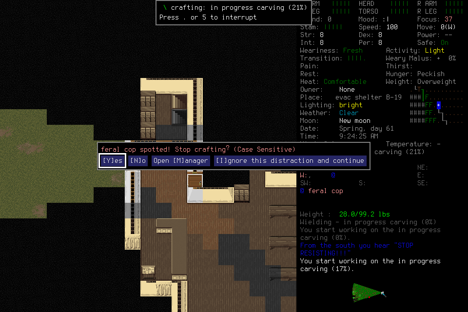

# Ordinary activity distraction handled through the bridge

The real game interrupted the preserved carving job with **“feral cop spotted!
Stop crafting?”**. The exact query was a supported menu; ordinary bridge Yes
stopped crafting and returned to fresh normal play. No user keys, native UI
fallback, save editing, hidden state or game signal. **This verifies one query
path, not a survival day or general combat/recovery policy.**

The public image is byte-identical to native11. The
[manifest](2026-10-18-activity-distraction-manifest.json) indexes original local
receipts, frames, finite brief, ledger and spectator proof. Private originals
are unavailable in a fresh checkout. The [stopped005](2026-10-18-activity-distraction-stop.md)
and its inspection overrun remain separate; this repair does not reopen005.

## Candidate and admission

Candidate4f2ea830eb704b27dd506d85c74bfafa09e26e3d passed exact push39187360591
and PR39187386920.451 common tests/viewer,21 setup tests, native incremental
build and independent source review passed separately from this proof. Built
binary1a470cc9…67df was installed/signed as a053adb0…3e0a in the project app.
No global install. Source/native stayed frozen through the live proof.

The independently reviewed prospective probe inherited362whole/337day1/
102lifecycle inputs and4044.463697lifecycle seconds,74v3+1archived gameplay
unknowns/control2, original whole3813670.588570708/day3823241.166884125 clocks.
Its35input/15minute limit reserved five inputs/final two minutes for cleanup;
investigation30inputs/13minutes and at most one existing job/one game hour.
Original shared/daily/whole limits also applied. Lead alone owned input.

## Actual sequence

| Rows | Result and limit |
| --- | --- |
| 1–4 | Two actual stable-CLI passive status calls had no recurring review, then fresh Observe/Resume at MAIN_MENU. Actual windowed spectator retained Pause; no task lease or other operator. |
| 5–8 | Belgium/Ned labels selected normally. Selected Load6 timed out at the prospectively allowed15s; Pause7/freshObserve8 reconciled without replay. Normal5217709 / Spring61 09:21:49 and the same room/17%carving verify the005 save. Load acknowledgment remains unknown. |
| 9–11 | Explicit Resume; Activate menu10 highlighted the actual unfinished carving with “Work on craft”. Enter11 resumed it and the real feral-cop distraction appeared at09:24:25. Native category CANCEL_ACTIVITY_OR_IGNORE_QUERY, boundary menu, original bindings. |
| 12–15 | Ordinary Y12 returned ready normal5217866. Pause13/freshObserve14 confirmed cancellation at09:24:26, carving21%, no activity progress after cancellation; status15 had no live request/control/lease. Cop visible west; no safety inference. |
| 16–22 | Cleanup-only Resume, semantic Save17, visible Save-and-quit/Y18 timeout; fresh19 MAIN_MENU. Resume20, q21 Really quit, Y22 timeout, native73173 absent. Owned controller72939 SIGINT exit0, port8766 absent. Save18/Quit22 remain unknown, not inferred ACKs. |

The query marker ends before callbacks and preserves native key validation. The
actual probe covers Yes after a spotted hostile; No/Manager/Ignore and nested
negative contexts were not exercised natively. Source review checked unchanged
empty-stack/exact-category/in-game restrictions and the separate owned YESNO
recovery. Patch fixtures establish anchors/repeatability, not those native outcomes.

## Costs and next work

**22rows/nine inputs =two load +three play +four cleanup.**195.831395seconds
through closeout,157new game seconds. Cumulative371whole/346day1/108lifecycle
inputs and4148.431055lifecycle seconds;77current-v3 plus one archived-v2 gameplay
unknown/control2. All original clocks/caps/costs remain. Last normal5217866 is
5066seconds (1h24m26s) after originalT0=5212800. No daily target is reached.

Full raw receipts are retained. Derived capture category fields initially read
the wrong field and were null; after shutdown they were corrected from untouched
raw `category` values. No native result or historical acknowledgment was changed.
The prior005 save is reloaded; the final proof Save18 still needs an actual reload.

[#120](https://github.com/CVX-Hull/enactive/issues/120) owns independent evidence
review and protected exact/merged-main publication before closure. #82/#100 own
the prospective full campaign and actual day1. The stable CLI allowance worked
without a new recorder rule or Codex restart. Further play needs a complete useful
remaining-day plan and actual budget check; this successful probe grants no new
campaign input allowance or automatic Resume.

Independent review verified all67 manifest references, raw receipts/controller
journal, copied frame hashes and public image, native question/answer/fresh-normal
sequence, costs and unknowns. Two P2 provenance/historical-wording findings were
corrected and re-reviewed with no remaining P1/P2. The controller completion is
a transparently attributed copy of the lead’s primary terminal result; process/port
checks retain exact commands. Agent review did not independently witness that
terminal tool return. Protected publication remains a separate gate.
