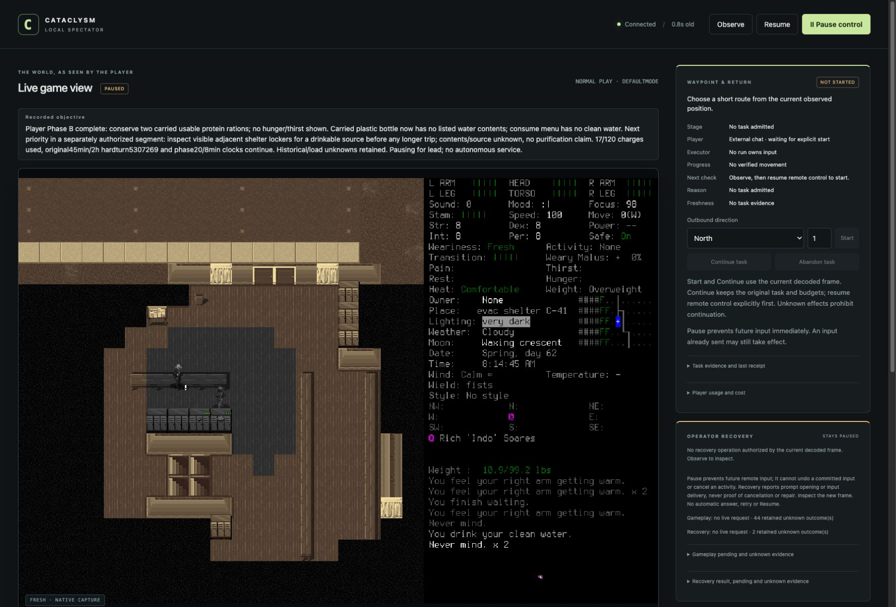

# A player sub-agent with explicit handoff

One designated general-purpose player performed **13 ordinary gameplay/menu inputs**
across two bounded phases. It inspected carried supplies, drank clean water to
address actual thirst, then conserved the remaining rations. Both phases ended
with Pause, terminal tool calls and explicit quiescence; the lead inspected fresh
paused state between them and separately authorized the return. This establishes
this operating procedure on one saved development character, not an unattended
survival service, security isolation or seven-day readiness.

[Brief021](../changes/021-operator-access-preflight.md) inherited the original finite
limits after [probe001 failed before input](2026-10-18-operator-access-stop.md).
Its9charges/744.317wall seconds remain separate history; the failed run was never
resumed. The [manifest](2026-10-18-campaign-operator-manifest.json) identifies
selected local originals. No new native build, dependency, paid API or global
permission setting was used.

## Decisions and actual evidence

| Boundary | Actual evidence and limit |
| --- | --- |
| Access before admission | The actual player made one successful explicitly escalated passive status call while no game ran. It proved connection only: stale native state/expired historical recovery were retained. Lead then verified the prepared normal window, project userdir, fresh paused menu and no live current-session request/recovery/lease. Rule matching remains distinct from live activation. |
| Identity and load | Lead selected Hotevilla/Rosendo once; original0003/0007 frames showed world/name and character sheet. Actual0005 state matched Spring62 08:14:29/turn5300069. Load0004 ACK remains unknown; it was not replayed. Old relative coordinates were invalidated. |
| Phase A | Fresh0011, explicit Resume0013, consume/inventory0014/0018 and actual0021/0022 show carried clean water, ordinary consumption, “You drink your clean water.”, cleared Thirsty label and08:14:45/turn5300085. Two rations remained; no surrounding supply quantity was established. |
| Lead inspection | Player Pause/status0024/0025, terminal-handle checkpoint and explicit quiescence preceded lead Pause0026/fresh paused Observe0027. No live pending/recovery/lease/gameplay. Lead also inspected original inventory/outcome images before new phaseB assignment. |
| Phase B | Fresh0028/Resume0029, carried inventory0030 and consume0032 showed two usable protein rations, a bottle without listed water contents and no clean water. No hunger/thirst label was shown. The player conserved food rather than consuming needlessly; it proposed inspecting visible adjacent lockers next, whose contents remain unknown. No movement, waiting, sleep or resupply expedition occurred. |
| Final handoff | Player Pause/status0035/0036 and terminal-handle checkpoint preceded lead Pause0037/fresh paused endpoint0038. Normal Play, no thirst/hunger label, Comfortable/Fresh, speed100 and green visible health at the same08:14:45/5300085. No general safety or internal-needs guarantee. |
| Cleanup | Normal Save0040/0041, actual main menu0042, normal Quit0044/0045. Ordinary deadlines stayed5seconds. Save0041/Quit0045 ACKs remain unknown. Exact owned native75922 was absent; controller5588 exited0 normally and port8766 closed. Native exit code is unavailable under LaunchServices. |

No human keys, unlock or rescue; no native-CUA input, hidden-state/save inspection,
save editing, debug advantage, new character/world or reroll. All player runtime
calls explicitly used the available reviewed escalation route with narrow reasons,
without prefix rules. No approval denial occurred. Files alone do not authenticate
the external actor or prove permission parameters/terminal handles; those also rely
on the actual tool/agent transcript. The controller does not authenticate sub-agent
names. No competing waypoint lease or source writer was active.

## Accounting and uncertainty

**46rows/21charges =17investigation+4cleanup**: lead load/identity4, playerA9,
playerB4 and lead cleanup4. The declared envelope remained120charges/2700wall
seconds/2game hours, investigation100/2400 with20/final300cleanup reserve.
PlayerA's last status was154.165phase seconds/235.972original seconds; playerB's
88.051phase seconds/384.771original seconds. These nested clocks are **not added**
to the original clock. Native cleanup was recorded at541.579original seconds;
review/publication still consume the original envelope, with formal terminal
closeout recorded locally afterward. Final native Pause was at525.823seconds.

Game time advanced **16seconds**, from5300069 to5300085; both phases and cleanup
remained within their original caps. No post-drink needs change was forced to
make a demonstration. Two rations are not a demonstrated day's food supply; a
bottle without listed contents is not verified refill capacity. Water source,
purification, medical efficacy, combat, travel and next-day survival remain
unexercised. The same development character now has24h14m45s observed progression
from its earlier origin; it is not the fresh deciding seven-day campaign.

Three lifecycle acknowledgments remain unknown: load0004, Save0041, Quit0045.
There were43 inherited gameplay unknowns and2control unknowns before this probe;
through the two player handoffs the gameplay total was44, including this load.
A lead phaseB summary incorrectly called44 historical in addition to the load;
the player flagged the ambiguity. `summary-count-correction.json` retains the
correction without rewriting that summary or originals. Later cleanup unknowns
are separate. Fresh state never repairs an old ACK or authorizes replay.

Local originals live under `.runtime/campaigns/player-operator-002/`: admission,
append-only commands, indexed receipts/captures/images, both player/lead checkpoints,
count correction and cleanup closeout. `artifacts-prefix27.json` freezes135files;
`artifacts-prefix46.json` freezes225files. The published JPEG is byte-identical to
the original spectator capture; Git owns that asset's source history. Retain these
originals for campaign readiness/review under the runbook's owned retention rules.

## Review, maintenance and next gate

Independent frozen-prefix review verified all135hashes,13charges, actual carried
water consumption and paused takeover with no material finding. Final supplement
review verified phaseB, all225final hashes,52manifest references, byte-identical
published JPEG, unknowns and normal cleanup with no material finding.
Common/source checks and protected publication are separate lanes, recorded with
this change; they do not replace actual graphical evidence. Native binary remains
`9cf1f76db19d6b401582bd7e6768422b653f6204069bd544804b8a5490e95273`, frozen execution
source `d57f8214be0097af71ef792b567cd3f30f7c5d7a`, whose
[main CI passed](https://github.com/CVX-Hull/enactive/actions/runs/39159755616).
No rebuild is claimed.

The lead accepts the qualified operator procedure; [#97](https://github.com/CVX-Hull/enactive/issues/97)
closes only after protected publication/CI verification. [#81](https://github.com/CVX-Hull/enactive/issues/81)
still must freeze the fresh deciding scenario, actual capability matrix, finite
whole-run/segment/attempt/activity/overshoot/evidence limits and independent
readiness. [#82](https://github.com/CVX-Hull/enactive/issues/82) remains gated.
Neither generic memory/monitoring nor another model tier is justified by this probe.

The finding loop retained the failed permission invocation and summary-count drift.
Actor-specific access preflight and explicit tool mode corrected the former;
original-ID-based count reconciliation corrected the latter. Review reused the
CLI/controller, parser, original journals, existing one-off capture and bounded
checkpoints; no new agent/permission/history framework. Approval/model usage and
separate approval latency remain unmeasured, not zero. Sustained operating,
maintenance and cost benefits are unproven. Revisit on actor/tool/authority change,
failed access/capture/handoff, summary drift or the existing maintenance trigger.
