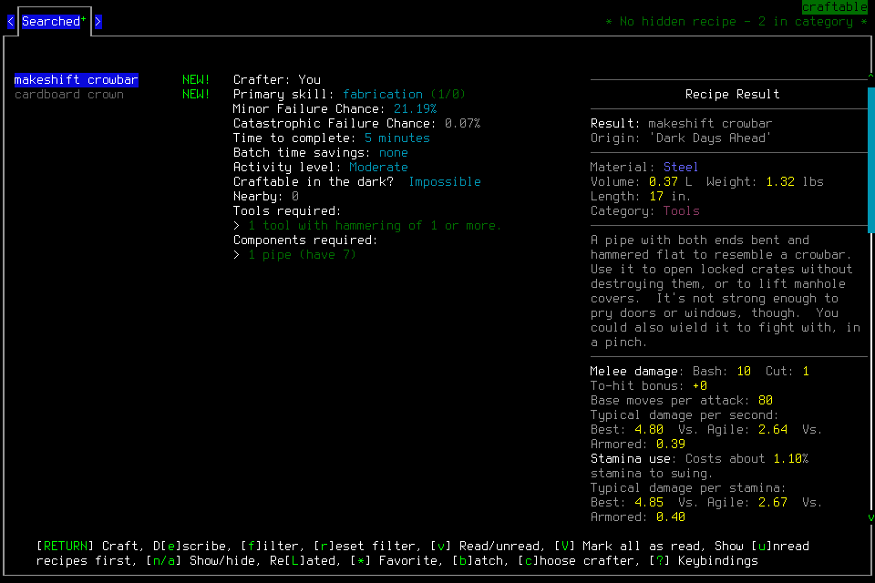

# Crafting transition stopped the continuation

Integrated004 stopped without beginning a recipe or advancing the game clock.
The player obeyed the frozen unsupported-state stop and relinquished authority.
The lead used normal Save and application Quit. **No first-day or seven-day
survival acceptance.** No user rescue, save editing, forced game keys or game signal.

This is the byte-identical native row25 image. It followed an unsupported receipt;
it cannot retrospectively repair that receipt. The [manifest](2026-10-18-crafting-transition-manifest.json)
indexes original local evidence and the public image. Private originals are not
available in a fresh checkout. The separate spectator preflight verified a windowed
view; this image alone does not establish viewer controls or crafting success.

## Actual sequence

[Scope030](../changes/030-setup-and-sustained-survival.md) admitted the same Ned
Meyers/Belgium after protected PR116. Source `d01d4f04087c0943479bd287c86b4c5e9c790d62`,
installed native `297b443a235af6e4803bb6d2a15bd595f0461124f7fe87c297a59b2382d5f704`
and recorder `351f0852821bbebc411b7527a3afbdd7a36f95d08d94201b6c6a3664bd6fa493`
remained frozen. Exact39179716082/39179717888 and merged-main39179947396 passed;
29offline recorder checks and450hook checks were separate from gameplay.
Both real actors passed passive access checks; only E received day1 input authority.

| Rows | Actual evidence and limit |
| --- | --- |
| 1–13 | Normal same-character load and sheet verified Ned/Belgium, original calendar and prior003 location/plank; carried supplies were checked at15. Load4 acknowledgment remains unknown. Four load/identity inputs. |
| 14–22 | E resumed, verified inventory and opened crafting/filter. Eight carried rations,2L clean water, can/matches/first aid and active phone54/56 were visible. No consumption or craft. |
| 23 | Filter ENTER returned ready, lowercase `default`, boundary unsupported, with a normal-world image. A normal-looking image does not authorize input. |
| 24–25 | Player Pause/status showed an actual supported paused CRAFTING menu with available makeshift crowbar, HAMMER1/seven nearby pipes,5min and21.19%minor/0.07%catastrophic failure chances. Player stopped; all tools terminal, no live slots, authority relinquished. |
| 26–37 | Cleanup-only fresh observation/Resume, Escape to normal, semantic Save/Y30 timeout, actual MAIN_MENU31; application Quit/Y35 timeout, terminal Pause/status. Final37 was stale with pendingY and unavailable frame, not a fresh paused/empty native endpoint. Native54702 absence, controller8464 exit0 and port8766 absence were separately verified in primary tools. |

The prior003 save was actually reloaded. Final004 Save30 has not been verified by
a subsequent reload. Save and Quit acknowledgments stay unknown despite the later
menu and process observations. No recipe began, no new game time advanced and no
new heat, treated-water, sleep or survival result was established.

## Costs and disposition

**37rows/18new inputs =4load +9player +5cleanup;277whole/252day1.** Shared lifecycle
is93inputs/3,654.020461seconds. Load4/Save30/Quit35 add three unknowns: cumulative
71current-v3 plus one archived-v2 gameplay unknown; two control unknowns remain.
The bounded live list of60 is not the cumulative history.

Latest supported normal remains5212919 / Spring61 08:01:59,119seconds after original
T0=5212800. Closeout monotonic3828041.144328375 was14,370.555758seconds from original
whole3813670.588570708 and4,799.977444seconds from original day3823241.166884125.
All preparation/publication time continues to count. No closed allowance reopens.

Independent review checked all37indexed records, actual images, charges and unknowns.
Pinned-source inspection found exact context classification, scope teardown and
side-effect-free Observe support; it did not prove a missing native hook, harmless
transition or unsupported blocking prompt. Globally admitting `default` would
weaken the boundary. No native repair or new build is justified by this evidence.

The observed process gap belongs to #82/#100 and maintenance #75: an unsupported
receipt followed by fresh support currently requires an entire stopped-run lifecycle.
The [prospective continuation](../changes/031-bounded-reassessment-continuation.md)
uses existing Pause, Observe and explicit reassignment with finite investigation
limits. It does not amend004's strict stop, infer an old acknowledgment or claim a
general outcome monitor. Model comparisons and generalized learning remain separate.
