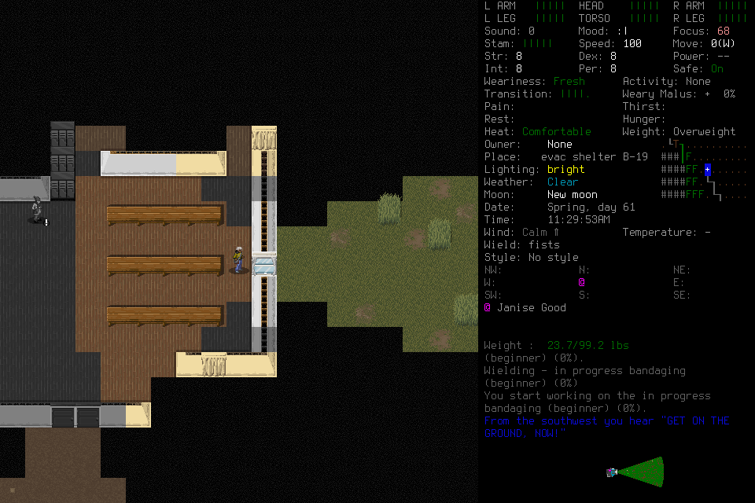

# Daylight verified; the medical work plan remained incomplete

Ned Meyers/Belgium reached **Spring61 11:29:53**, turn5225393, alive and without
displayed thirst or hunger.007 advanced18m25s; original elapsed time is3h29m53s.
**No survival day is accepted.** Discovery stopped after47of60player inputs because
Wound Care remained39%, advanced practice was unverified and the acquired resources
did not support the complete remaining20h30m07s. Independent review rejected Stage2.

This image is byte-identical to native67. The[manifest](2026-10-18-daylight-practice-manifest.json)
indexes private original receipts, frames, costs and closeout evidence. Private
originals are unavailable in a fresh checkout. No save or private machine path is
published; no new native build, runtime feature or permission change occurred.

## Actual sequence

Clean source9a140a07dcbd29a0108a8ac7da6133f18d3aaf43 and installed nativea053adb0…3e0a
remained frozen. Protected PR122 exact push39192539237/PR39192542815 and merged-main
39192749053 passed. Actual E/F passive preflights, windowed native and connected
spectator passed. Admission retained every original clock, cost and failed attempt;
6462.650258day-investigation seconds remained against5760forecast seconds.

| Rows | Actual outcome |
| --- | --- |
| 1–7 | Normal Belgium/Ned selection. Selected Load4 timed out; fresh normal6 at5224288 and empty7 actually verified the prior006save. Load acknowledgment stays unknown. |
| 8–38 | E checked8rations/2Lclean, phone38/56 and Wound Care30%/Carving6%. E reached the east window, opened its curtain and verified Bright daylight with phoneOFF. The hostile-facing west curtain stayed closed; Janise Good was nonhostile. No exterior clearance is claimed. |
| 39–48 | Recraft39 produced the ordinary “Craft something first” popup. Later filter44 returned unsupported; E Pause45/status46 relinquished authority. Lead Observe47 actually viewed supported CRAFTING and status48 verified empty live slots. Explicit fresh reassignment followed; no filter replay. One reassessment took15.790583seconds. |
| 49–61 | One-hour beginner practice started53. At23%, a cop shout interrupted; E chose ordinary StopYes55, then drank one clean-water portion. Actual sheet61 showed Wound Care37%. Apply-wielded60 had no effect because no craft was wielded; it remains charged. |
| 62–69 | New one-hour practice63 was interrupted at4%; E again chose StopYes65. Actual sheet66 showed39%. Neither job completed:874+199actual game seconds,1073total. Final67 normal5225393; Pause68/status69 supported, empty live slots, all tools terminal and authority relinquished. |
| 70–81 | Lead verified fresh normal/empty live slots. Cleanup Save73 rejected a stale revision before dispatch; charge retained. Fresh74/Save75/Yes76 then actual MAIN_MENU78; Quit80/Yes81 followed. Save76/Quit81 timed out and remain unknown. Native12452 exited; owned controller11026 was stopped through its terminal, both PIDs and listener8766 absent. |

The player checkpoint was1097.215397seconds from its original discovery clock;
the phase closed1147.917959seconds from that clock, including handoff/lead time.
Source inspection afterwards explains that cancelling component-free practice
removes its in-progress item while earned proficiency remains. Recraft created a
new job. This is normal upstream behavior, not a harness defect.

## Costs and findings

**81rows/54new charges =2initial lifecycle +47E +5final lifecycle.** Cumulative
473whole/448day1/121lifecycle inputs and4358.093552lifecycle seconds remain.
Initial lifecycle54.365287s and cleanup71.629099s are included. Before cleanup,
81current-v3 gameplay outcomes were unknown; Save76/Quit81 add two unknowns,
including any unresolved durable admission until next startup. One archived-v2
and two control unknowns remain. Neither a later scene nor process absence creates
an acknowledgment or proves persistence of the final save. Actual reload is next.

| Finding | Disposition and required next evidence |
| --- | --- |
| Phone-off daylight was established; Wound Care30→37→39% was measured. | Retain actual campaign facts in[#100](https://github.com/CVX-Hull/enactive/issues/100). Recheck after reload; neither nominal Expert14h nor hypothetical wood is acquired coverage. |
| Repeated cancellation discarded practice jobs and left insufficient prerequisite benefit within the three-job discovery cap. | Fix tactics next / lead and player in#100: meet needs first, assess ordinary No for this finite job against current threat evidence, measure useful benefit. Audible warnings are not automatically harmless or mandatory cancellation. Never Ignorefuture. |
| Remaining61percentage points, one allowed job and unverified advanced practice did not ground a whole-day schedule. |007closed incomplete; no third job, Stage2 or unused-allowance transfer. A prospective smaller complete-day route needs actual admission and resource/benefit acceptance. |
| Stable CLI inputs worked without recurring approval; filter-return reassessment worked. | No new allow rule, Codex restart, menu patch or broad monitoring framework. Reuse the verified scoped setup and existing finite reassessment. |
| Extra lifecycle work now leaves121spent against127ordinary. | Reforecast prospectively in[#82](https://github.com/CVX-Hull/enactive/issues/82) before that limit; retain cleanup reserves and unchanged time ceilings. |

Independent review verified the47Echarges, final frames, missing coverage and
quiescent handoff; it accepted the failed-gate disposition, not a survival result.
Shutdown is evidenced by retained lead tool results; no numeric controller exit
code was reported, and the same terminal handle was subsequently missing. No
human keys, forced native kill, hidden state, save editing or debug advantage.

The[next scope](../changes/037-medical-day-plan.md) addresses the tactical and
planning gap without changing the engine. Full seven-day acceptance remains open.
