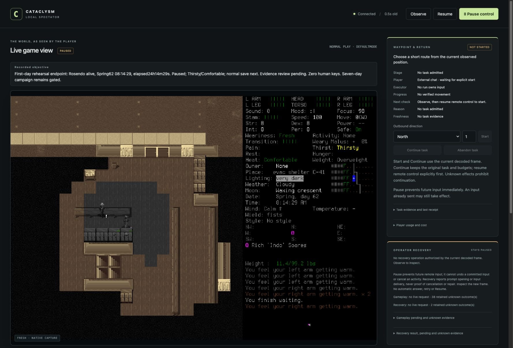

# First day reached without human rescue

Rosendo Carter/Hotevilla reached **24h14m29s alive**, from Spring61 08:00 to
Spring62 08:14:29. The lead paused at the first ordinary boundary after the target,
then used normal Save/Quit. Zero user keys, unlocks or routine rescue were needed.
This is a functional first-day rehearsal with the qualifications below, not a
seven-day result or an unattended survival service.

The endpoint displayed **Thirsty, Comfortable, Fresh**, speed100 and green visible
health bars. Thirst first appeared in the final interval and was retained at the
declared endpoint; there was no post-endpoint treatment to improve the picture.
Earlier actual consumption supported needs management, not continuously absent
warning labels. Exact sleep onset/duration remains unknown. Review also found
two cleanup deadlines outside the admitted policy; this is not a fully conforming
protocol execution.

## Frozen candidate and cumulative limits

The [original partial report](2026-10-18-first-day-rehearsal-002.md) remains intact.
[PR95](https://github.com/CVX-Hull/enactive/pull/95) prospectively admitted the
[continuation](../changes/019-first-day-continuation.md), preserving the same
character, original clock/ledger and source. Its candidate73168bc passed CI
39155137970/39155140999; mergeafc8fde passed main CI39155448751. The publication
changed documentation only. Execution stayed at72c8b9c13f53999457fc58c25db53e360121d0fc;
installed native SHA2569cf1f76db19d6b401582bd7e6768422b653f6204069bd544804b8a5490e95273
was unchanged. No new build, dependency, global setup or paid API.

Original500charged inputs/10800wall seconds/26game hours never reset. Continuation
added stricter64inputs/45minutes, investigation49/40minutes, preserving15remaining
cleanup inputs. The frozen290-row ledger reconciles **227charges=218play+9cleanup**,
including two agent-native CUA keys. Continuation used19charges, four for final
cleanup. At closeout recording,4376.178original wall seconds/721.802continuation
seconds had elapsed; review/publication continued counting afterwards. The target
overshoot is869game seconds;6331seconds remained below the26-hour ceiling.
Prior93development inputs/1176.089seconds and five separate menu operations remain
historical overhead; failures and prior characters were preserved.

## What the actual continuation established

| Evidence | Observation and limits |
| --- | --- |
| Load255–263 | Load acknowledgment timed out. Fresh frame256, actual name258 and inventory263 separately matched Rosendo, saved06:14:25 and supplies. New relative origin was reset; no old coordinate authority restored. |
| Inventory263 | Phone remained off54/56 after overnight play, first-aid box18drug/21items retained, two ration portions and one carried clean-water portion. Reachable selector items are not all carried. |
| Clothing265/266 | Removed one excess blanket through the actual menu. One blanket plus jacket remained worn; actual later frames273/281 showed Comfortable/speed100. No causal or universal insulation rule follows. |
| Wait267–273 | One-hour activity interrupted by unseen groaning at06:21:05. Pause271, actual native screenshot, precharged ordinary Shift+I272, then fresh bridge273 showed completed07:14:29/paused. Native source says Ignore applies to the current activity/backlog's distraction type; no global distraction settings changed. Unseen sound is not clearance. |
| Endpoint278–282 | Final displayed one-hour wait completed at08:14:29/turn5300069. First normal frame279, immediate Pause280 and paused confirmation281, dated spectator282. No further investigation. |
| Cleanup284–290 | Save confirmation284, unknown acknowledgment285, actual main menu286, ordinary Quit confirmation288, unknown acknowledgment289. Owned game50979 absent, controller exited0 and port8766 had no listener in separate lead checks. LaunchServices supplied no native exit code. |

Earlier original evidence supplies the real five clean-water portions,
2400kcal day61/800day62, medical-kit basement excursion and return, northeast
zombie retreat/closed door, summary-only advisory player handoff and actual
application restart. The failed early sleep, overnight wake messages, cold/warmth
and encumbrance, navigation correction, partial stop and unknowns remain visible.
No combat, purification, medical efficacy, surface-house expedition, exact sleep
duration, general monitoring or learned-memory efficacy was demonstrated.

Nine lifecycle acknowledgments remain unknown: rows23,121,125,129,244,248,255,285,289.
No uncertain action was replayed. Later scenes cannot repair those receipts.
Native inputs240/272 have actual before/after screenshots and separately labeled
CUA receipts with no bridge acknowledgment. All inputs were charged before dispatch
in the lead tool sequence; persisted files alone do not independently prove ordering.

## Review and disposition

The independent reviewer rechecked the unchanged741-file original index and all
200continuation artifact hashes, the frozen290-row ledger, original endpoint,
inventory, native prompt and cleanup images. Charges, calendar, frame hashes and
nine unknown IDs reconciled. Process absence/controller exit remain separate lead
evidence. Both bounded advisory checkpoints05/06 preserve stale-versus-current
facts, limits and unknowns; the current pointer was refreshed before reuse/closeout.
The [manifest](2026-10-18-first-day-completion-manifest.json) binds selected local
originals and both full private indexes. Saves and full images remain local.

**Confirmed procedural deviation:** final Save285 and Quit289 requested15-second
deadlines. Brief018/019 reserved that extension for creation/loading, with ordinary
deadlines otherwise unchanged. Both timed out and remain unknown. The larger wait
did not change game outcomes or renew any cap, but it violated the frozen cleanup
policy. Retain originals; use ordinary5-second Save/Quit deadlines in the next
protocol and validate the capture command before dispatch. Do not retrospectively
amend the old brief or erase this deviation.

| Finding | Decision and next owner |
| --- | --- |
| First-day survival, supplies/rest and continuity observed, with endpoint thirst and uncertain exact sleep | #79/#80 functional evidence supports the next readiness review with these qualifications. No fully conforming-protocol or seven-day claim. Lead adjudicates acceptance; #81 must explicitly consume the exceptions. |
| Unsupported sound prompt | Existing CUA handled two ordinary prompts with zero human rescue. Preserve Pause/actual-image/precharge/Observe/Resume; failure stops. No blanket bridge-category admission or global unlock. |
| Stale advisory, depletion and clothing changes | Source-linked checkpoint refresh remains required; route trace benchmark questions to #70/#71, practical handoff to #79. No new memory backend justified. |
| Deadline-scope deviation | #81 must freeze and check timeout classes before campaign admission; no repeat justified solely to obtain a cleaner screenshot. Repeated control drift becomes bounded blocker work. |
| Approval and player-context friction | The [permission audit](../operator-permissions.md) distinguishes sandbox approval from game authority and tests narrowly scoped CLI rules. Dedicated player execution is a proposed follow-up; the existing role remains planning-only until explicitly redesigned and verified. |

The ordinary1778×1207 spectator showed the dated objective, paused state, actual
needs and an inactive waypoint card separate from raw lead play. Other window
sizes/hosts remain unverified. Semantic and aggregate/microcap checks remain
lead-enforced; the literal helper checks original primitive/wall/ledger/frame
integrity. Portable checks, unchanged prior native build and this actual graphical
run remain separate evidence lanes. Common checks and protected publication of this
report are recorded in its PR; no new native build claim is made.

Publication checks caught missing inherited manifest fields and an invalid artifact
availability label. Fixed using the existing schema without weakening it; the
tracked screenshot is the original JPEG bytes with a corrected public extension.
The first sandboxed renderer launch failed; approved rendering ran separately.
