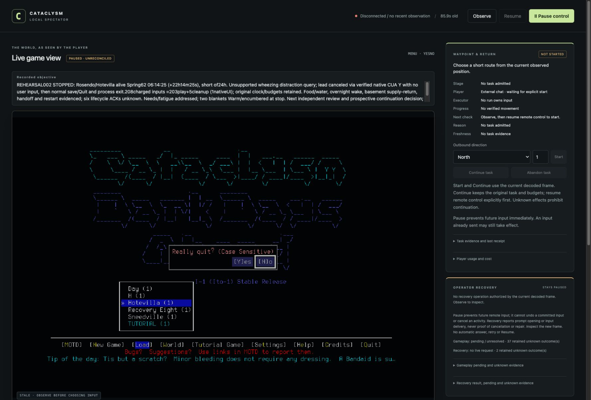

# Rosendo rehearsal: autonomous recovery, partial day

The [first-day brief](../changes/018-first-day-rehearsal.md) reached **22h14m25s**,
then stopped investigation at an unsupported sound-distraction prompt. Rosendo
Carter/Hotevilla remained alive, was normally saved and the game/controller exited.
**This is not a completed first day or seven-day readiness.** No human key, unlock
or routine rescue was required. An existing native-window binding supplied one
ordinary cleanup input after remote Pause; it did not make the unsupported bridge
boundary supported.

## Candidate and original envelope

Source `72c8b9c13f53999457fc58c25db53e360121d0fc`, protected [PR94](https://github.com/CVX-Hull/enactive/pull/94),
passing merged-main CI `39150811534`. Installed native SHA256
`9cf1f76db19d6b401582bd7e6768422b653f6204069bd544804b8a5490e95273`,
unchanged from the [direction probe](2026-10-18-native-direction-menu.md).
No production changes, rebuild, new dependency, global install or paid API.

Admission was October18 17:44:58.054UTC: 500 charged inputs/10800wall seconds/
26game hours; investigation480/10500, cleanup20/final300seconds. Creation,
reasoning, pauses, planning and restart all consumed that original envelope.
The stopped prefix used **208charges =203play +5cleanup**; cleanup includes
**one agent-operated native CUA input**, plus four normal save/Quit keys.
There were 207 charged CLI primitives, with full requested walk expansions and
rejected/unknown requests charged. Charges are not a count of successful native
dispatches. Partial closeout recorded2669.132wall seconds; its clock continues
for any prospectively authorized continuation rather than being renewed.

The earlier93campaign-development inputs/1176.089seconds remain: pilot18,
assisted rehearsal57 and direction probe18. This prefix brings charged development
history to301inputs, plus the separate five menu-operation inputs. Prior failures,
Ramiro/Sneedville and all saves remain preserved. No favorable reroll or hidden
save/map reading supplied this play.

## Actual visible play

| Evidence | Observation and limit |
| --- | --- |
| Creation/identity, rows4–29 | First legitimate default Hotevilla, one generated name Rosendo Carter, ordinary Evacuee/Survivor, attributes8 and unchanged displayed backgrounds/mods. Origin Spring61 08:00/turn5212800. Spawn acknowledgment unknown; subsequent actual name/world/calendar separately verified. |
| Consumption51/54/162/170/178/186/188/221/223 | Five actual clean-water portions, with messages/count decreases; meals2400kcal on day61 and800 on day62. Initially frozen carried water later appeared cold/usable; possession alone was not counted as consumption. Reachable selector items were not all carried. |
| Clothing68/150/217/234 | Jacket worn; phone flashlight deactivated before long waits, last inspected54/56battery. Blanket worn after a chilly night; another layer later added. Body became Warm, with substantial encumbrance. Timing confounds attributing warming to the second layer alone. |
| Threat79–84 | Exterior view revealed zombie/tough/decayed zombies about40tilesNE. Safe mode prevented attempted retreat. Ordinary ignore-enemy acknowledgment enabled retreat inside; door closed. No combat, clearance or invisible-threat guarantee. |
| Supply excursion92–117 | Descended actual shelter stairs, inspected basement/bathroom, picked up first-aid box18drug/21items and returned upstairs. Left bleach; no unsupported purification or medical-effect claim. |
| Handoff63–66 | Pause and bounded5618byte/23reference advisory; replacement explorer explicitly inspected only the summary, not originals. Lead checked applicability and retained execution. This is summary-based planning advice, not independent evidence validation or a transferred lease. |
| Restart120–138 | Normal Save/Quit reached actual main menu, application exited, exact bundle relaunched. Actual Hotevilla/Rosendo name,08:01:54calendar, needs and inventory matched pre-save. New-session relative origin reset; inspection-only @/ESC then Pause/fresh Observe/Resume. No restored command or uncertain replay. |
| Rest195–207 | Early20:03sleep attempt failed at20:30 and was stopped through the keep-trying menu. Midnight showed Tired. Fresh eight-hour alarm selection was visually corrected before confirmation. Next normal frame05:53:53had wake-before-alarm/“You wake up” messages and no Tired warning. Exact sleep onset/duration was not retained; filtering sleep found no retained matching line. No eight-continuous-hours or sleep-quality claim. |
| Stop238–248 | At06:14:24, heard wheezing triggered unsupported `CANCEL_ACTIVITY_OR_IGNORE_QUERY`. Investigation stopped. Remote Pause, actual bound-window inspection, one charged native Shift+Y closed the query. Fresh bridge241was normal/paused,06:14:25/turn5292865. Normal save/main menu and application Quit followed; process absence checked. |

The real source was unseen when moaning/wheezing was heard. Warmth, rest, warning
labels and visible health bars were assessed from rendered UI, not hidden state.
Chilly-leg messages, unsuccessful early sleep, numeric8 merely moving the alarm
highlight, an incidental unexplained faction-mission failure and conservative
walk stops remain evidence. The game was windowed with the project userdir.

Six acknowledgment timeouts remain unknown: spawn23, save121, applicationQuit125,
load129, finalsave244 and finalQuit248. Exact IDs/errors are retained in the
manifest-linked closeout. Later scenes/process absence do not repair old receipts.
Native CUA240has its own before/after images and an explicitly non-bridge receipt;
it is not represented as a CLI acknowledgment. LaunchServices provided no native
process exit code; controller exit0 and game process absence are distinct facts.

## Review, UI and disposition

The initial independent review reconciled174ledger/capture/receipt rows and157PNG
hashes, and inspected identity, restart, meals, retreat and medical-return images.
It caught a stale designated-current advisory. Checkpoints02–04 refreshed that file
while retaining checkpoint01. A frozen250-row prefix and741original file hashes
were then independently checked, all matching sizes/hashes and208charges. Original
sleep/wake, thermal, CUA-before/after and fresh paused-bridge frames supported the
bounded claims above. Process absence/controller exit remain operator evidence;
files alone do not independently establish CUA precharge ordering. The [manifest](2026-10-18-first-day-rehearsal-002-manifest.json)
selects inspectable originals. Originals are local evidence, not shipped save data.

The ordinary1778×1207 spectator viewport showed the dated objective above the
native frame, visible Pause and a separately labeled inactive waypoint card.
After game exit, stale/disconnected/paused state remained explicit. Narrow/other
host layouts remain unverified. Recorded objectives require lead updates; no
automatic survival supervisor or campaign-wide budget guarantee is claimed.

| Finding | Disposition |
| --- | --- |
| Unsupported sound-distraction query | Reuse demonstrated existing CUA binding for readable ordinary prompts after Pause, with charged before/after evidence. App discovery's lock/access report did not establish that the existing binding failed. No global unlock/security workaround or new native code selected. In-game source confirms ordinary Y cancels; OS Quit/signals are not safe-save substitutes. |
| Early sleep and chilly night | Preserve failure; inspect actual fatigue, insulation and elapsed thermal response before sleep. Extra layers impair movement; do not generalize a two-blanket policy from this confounded trial. Route practical context into #79/#80; broader learning remains #70/#71. |
| Current advisory drift | Refresh at meaningful transitions and before reuse, keep dated checkpoints/unknowns/budgets. This is a procedural correction, not implemented learned memory. |
| Remaining1h45m35s to24hours | #79/#80 remain open. A [prospective continuation](../changes/019-first-day-continuation.md) retains the original absolute envelope, source/runtime and same saved character. No silent restart or allowance renewal; #81/#82 remain gated. |

Review and the first common-check run caught missing date/scope metadata on two
historical documents. Both were corrected without changing or weakening the
schema; the failed log remains local. Final common checks and publication CI are
recorded in the publishing PR.

Portable tests, prior native build and this real graphical run are separate lanes.
No source change was admitted during play. Further gameplay needs its own reviewed
prospective decision and fresh identity/control evidence; this report grants none.
