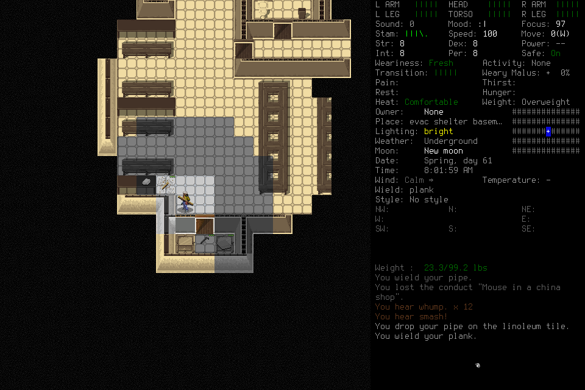

# Supplies secured; first day incomplete

The designated player secured additional food, clean water, first aid, a boiling
can and wood, but could not credibly finish the first day within its remaining
ordinary input allowance. It paused and relinquished authority. The lead closed
investigation and used normal Save and Quit. **No first-day or seven-day acceptance
is claimed.** No human keys, unlock, rescue, hidden-state inspection or save editing.

This is the original native Tiles frame, not an advanced calendar or mock. The
[manifest](2026-10-18-integrated-day1-manifest.json) identifies retained originals;
the published image is byte-identical to capture0151. Private originals require the
original workspace. The actual spectator preflight retained the windowed view and
user Pause; the image above alone does not prove spectator controls.

## Outcome and evidence

[Scope029](../changes/029-seven-day-integrated.md) froze source
`93739eee13d17d3e95338e4d8dc6c3720a5ae58d`, native
`297b443a235af6e4803bb6d2a15bd595f0461124f7fe87c297a59b2382d5f704`
and recorder `9d4ce83edf7ae04156c6020163820022d9e8526be0a3172b17c7bba764e70ca5`.
Protected PR115 exact push/PR runs39175218768/39175221373 and merged-main39175384550
passed. GitHub computed no closing references before merge. Both actual actors'
passive access and the lead's paused windowed native/spectator preflight passed.
These are preparation evidence, not survival success.

| Actual records | Finding and limit |
| --- | --- |
| 1–13 | Ordinary Belgium/Ned load, character sheet and paused handoff verified the preceding save at5212813. Load4 timed out; fresh state does not repair that ACK. Four lifecycle inputs, whole126/day101 at assignment. |
| 14–146 | Sole player E used126 charged inputs. Three guarded walks stopped and each received fresh Observe/deliberate Resume. No new player delivery unknown, approval denial or unsupported boundary. The player retained actual frames, supplies and short work outcomes. |
| 35–36 | Opening the south door exposed a feral cop and milspec searchlight; the player reclosed it. Later absence indoors is not proof the outside is clear. |
| 53–103 | Five additional boxed rations, two sealed bottles with two clean-water portions each, first aid and an empty0.25L BOIL1 can were acquired. Total carried eight rations/eight water portions; two original portions frozen. Toilet96 offered24 ordinary-water portions, not clean water. No raw water was drunk or treated. |
| 124–144 | Actual tool-free shelf deconstruction yielded metal/plastic/pipes; a wielded pipe smashed one wooden table, yielding four planks, nails and a splinter. One plank was wielded; the pipe was dropped. Shelf work took about11 actual seconds and table work about8. No heat/fire or sustainable potable source was established. |
| 145–146 | Paused supported pickup menu, no live request/control/lease, all actor tools terminal and authority relinquished. Whole252/day227,53 ordinary inputs remained. Latest normal139 was5212916; menu144 established plank wielding without exporting a later normal calendar. |
| 147–161 | Cleanup-only fresh observation, menu cancellation, ordinary Save/Y154 timeout, actual MAIN_MENU155, q/Y159 timeout, terminal Pause/status. Native69534 absent, controller58366 exited0, port8766 absent in primary tool evidence. No forced key, signal to the game or user rescue. |

The player checkpoint is8,044bytes/30references. At the stop it explicitly rejected
its local40–45input heat plan as an adequate whole-day plan: fewer than14 ordinary
inputs would remain, almost24 game hours still needed to pass, and Fresh Ned was
not yet eligible for sleep. This was a planning/resource forecast failure, not a
new native capability blocker. Extra inputs would not by themselves establish an
adequate plan.

## Costs, uncertainty and cleanup mistakes

**161rows/137new charges =4load +126player +7cleanup;259whole/234day.** All requested
walk steps are charged, including unused steps. Cleanup includes two lead mistakes:
149 used the pre-Resume revision and was rejected before dispatch; fresh150 informed
newly considered151. At152 the lead assumed Q meant Save; the actual frame reported
an unknown command. Pinned ordinary binding S at153 opened the real Save prompt.
Both failed requests remain fully charged. These errors were avoidable by using
the latest receipt and checking the keybinding before dispatch.

Selected endpoint151 and later normal152 were **5212919 / Spring61 08:01:59**,119seconds after originalT0,
Fresh/Comfortable, green limb bars, no hunger/thirst label and no visible creatures
indoors. No meaningful rest, needs depletion, treatment or full day was demonstrated.
The phone light was on; its current battery charge was unverified.

Native closeout at monotonic3825758.080450125 was **12,087.492seconds** from original
whole admission3813670.588570708; day1's original3823241.166884125 clock reached
2,516.914seconds. Shared lifecycle **84inputs/3,300.007seconds** includes inherited
73/3010, initial4/178.675 and cleanup7/111.331. Daily/whole reserves were not exceeded.
Review/publication continue to consume original whole elapsed time; nested durations
are not added again. Study003 and its day/phase are closed, with no residual input
authority and no retrospective cap increase.

New unknowns are Load4, Save154 and Quit159: cumulative **68 current-v3 plus one
archived-v2 gameplay unknown, two control unknowns**. Live list cap60 is not a
history total. Final161 retains stale YESNO/frame-unavailable state and pending
final Y; it does not prove fresh paused native state or an empty pending slot.
Process absence is separate evidence. Actual main menu155 supports the ordinary
Save flow; acquired state has not yet been verified by reloading this latest save.

Independent review verified rows1–146,141 retained frame hashes and selected actual
images, with no material contradiction in the player's checkpoint. Final review
also verified cleanup and all106selected artifacts/3,005,427bytes plus860indexed
originals/18,113,124bytes; the published image matches151. Publication remains a
separate lane; actor quiescence, permissions
and process shutdown require primary tool evidence as well as files. Source/common
checks are a separate lane and do not turn this partial into survival acceptance.

## Findings and disposition

| Area / owner | Next action |
| --- | --- |
| Planning / lead and player, #82/#100 | Forecast the complete day before spending on a local milestone. Initial setup needs a different allocation from later maintenance. Any larger continuation is prospective, inherits every spent input and original clock, and needs a useful awake-time/needs/rest plan. |
| Memory / player, #100 | Retain indexed carried-versus-cached supplies, untreated-versus-clean water, observed threats and session-scoped locations. Current provenance/checkpoint records suffice; no new memory framework is required. |
| Monitoring / lead, #82 | Walk-stop reassessment worked in actual play. Sustainable heat/water and substantial activities remain unverified. Distinguish native numeric timers from operator monitoring ceilings. |
| Controls / lead, #75 | Use the latest post-Resume authority and verified lifecycle bindings. Reconcile shared lifecycle forecasts after actual cleanup costs. Daily Issues were corrected to put consolidated publication/final shutdown at parent #82, preserving day4 restart and daily independent acceptance. |
| UI and maintenance / maintainer, #75 | Linoleum required individual moves under the narrow guarded-walk terrain set. Measure this overhead before expanding skills. Retain recorder/review burden and reuse current CLI/controller/GitHub; do not invent infrastructure merely to extend a failed study. |

Parent #82 and daily #100–106 remain open. The full campaign goal remains active.
