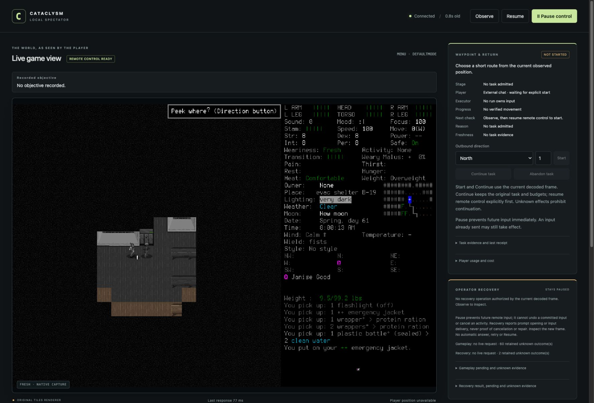

# Saved-character reload and direction cancellation verified

The same normally created **Ned Meyers/Belgium** reloaded after the preceding menu
proof's normal Save/Quit. The actual “Peek where?” direction chooser was supported
and cancelled to normal play without movement or game-time advance. This closes
[the menu repair's remaining native checks](2026-10-18-ordinary-menus.md), subject
to protected publication. It does not complete a survival day or admit further play.

The image is an actual browser screenshot. The [manifest](2026-10-18-menu-gate-manifest.json)
identifies retained originals; the published screenshot is byte-identical. Private
artifacts are unavailable on a fresh checkout.

[Scope028](../changes/028-direction-reload-gate.md) defined a separate prospective
20-input/20-minute gate, investigation12inputs/12minutes and8input/final8minute
reserve. It retained112whole charges and the original creation clock; the earlier
36-charge proof was closed and its limits were not renewed. Independent review
traced registered `peek` to `game::peek -> choose_direction`, with cancellation
returning before movement/cost. No code, build, dependency or permission change.

Source `0987cb17e115b7594d1b7fe97764ead675d34078` differs from accepted main0f54a8b
only in the prospective document. Its normal450-test hook passed. The production
bytes and installed binary `297b443a235af6e4803bb6d2a15bd595f0461124f7fe87c297a59b2382d5f704`
match the preceding real menu probe. PR113 final exact push/PR CI39172892094/
39172894775 and merged-main39173070166 passed with identical source trees.
The new gate's final exact/main publication checks remain a distinct lane.

| Actual records | Result |
| --- | --- |
| 4–10 | Actual Belgium/Ned list; selected-character Load5 used the sole declared15s deadline and timed out. Fresh paused normal6/status7 showed turn5212813 and no live work; deliberate Resume8, actual Ned sheet9 and cancel10 verified current identity. The Load ACK and preceding Save ACK remain unknown. |
| 11–15 | Registered peek opened actual DEFAULTMODE **menu**, “Peek where?”. Escape12 returned normal turn5212813, position unchanged, visible “Never mind.” Pause/status/fresh Observe retained current needs/calendar. No direction was selected. |
| 16–25 | Cleanup-only Resume; ordinary Save17/Y18 timeout; fresh MAIN_MENU19/status20, deliberate Resume21, ordinary q22/Y23 timeout; final Pause24/status25. No signal, force-kill or user keys. |

**25rows/10charged inputs =6investigation +4cleanup**,269.804seconds through native
closeout. Whole lineage112+10=122,7883.663seconds from original creation admission
3813670.588570708. Normal turn remained **5212813 / Spring61 08:00:13**, zero verified
new game time, Fresh/Comfortable and visible green health. No pickup, consumption,
work, combat, peeking at a selected tile, save editing, hidden-state inspection,
reroll or new character. Source/native/helper were frozen; all players quiescent,
lead the only runtime owner, project-local windowed wrapper/userdir and turn duration0.

Load5, Save18 and Quit23 add three unresolved lifecycle ACKs: cumulative65current-v3
plus one archived-v2 gameplay unknown; two control unknowns remain. The live gameplay
list is capped at60. New state does not repair old ACKs. Terminal25 is frozen/Pause-
requested with stale YESNO/frame-unavailable state and retained pending final Y;
it does not establish fresh paused native state or an empty pending slot.
Exact owned PID77727 was absent; controller6542/PID75886 exited0 and port8766 closed
in the lead trace. Native exit code is unavailable. This gate verifies reload of
the **preceding** save; its own final Save18 was not reloaded after shutdown.

Independent actual-result review verified all103indexed artifacts/2,265,024bytes,
receipt/frame correspondence, images and costs. Process, permission and empty actor
queue evidence also requires the primary lead trace. No new approval denial occurred;
the original campaign's denied input remains honored. The separate iteminfo_window
renderer and arbitrary menus remain unexercised; no generic-default support claim.

On verified publication/main CI, complete scoped #112 and remove its blocking labels
from #82/#100, retaining native dependency history. #75 keeps the source-review miss,
partial-probe estimation and evidence/control burden for maintenance at existing
triggers; no due date is renewed. Retire this gate's authority/helper from use.
Further survival requires a new prospective assignment with all122charges, original
whole clock, unknowns and mixed-candidate failures retained. No automatic learning,
new tier, broader rules or survival success is implied.
