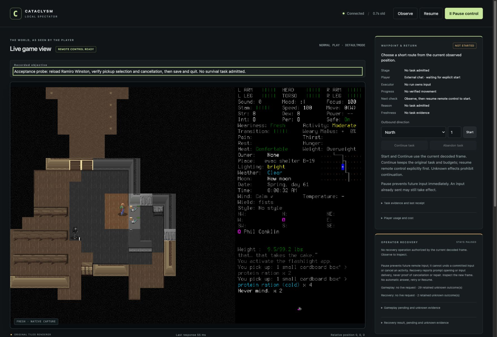

# Direction pickup works without a rescue keystroke

The rebuilt engine handled the actual **“Pick up items where?”** query through
the harness: Escape cancelled it, selecting the east cupboard opened real item
names, and the registered current-tile `pause` action returned normally on an
empty tile. Pause still refused input. **No user intervention or desktop input
was needed.** This resolves the specific direction-menu defect found in the
[failed first-day rehearsal](2026-10-18-first-day-rehearsal.md); that attempt
remains failed. No first-day, seven-day or general recovery success is claimed.

The [reviewed brief](../changes/017-native-direction-menu.md) and
[PR93](https://github.com/CVX-Hull/enactive/pull/93) own the scope. The
[manifest](2026-10-18-native-direction-menu-manifest.json) indexes 49 selected
local artifacts and the private index of 146 original probe files. Large originals
remain ignored locally; preserve them and the normally managed save. One actual
spectator screenshot is included here for review on a fresh checkout.

This is a dated screenshot, not a live control or a survival-progress claim. It
shows the supplied browser viewport; narrower viewport acceptance remains open.

## Source, reuse and build

Clean checkpoint `00bf9fb0bfec62be8fa293f0506cde33edc6c8a9`, tree
`c5a1dfbd6c6bb14653e8209019db48f2c9c832bc`, was committed before building and
unchanged throughout native acceptance. The native design/diff and isolated
viewer diff received independent review. The required common checks passed,
including **439 Python tests** and viewer/diagram/governance checks.
Exact-candidate push [39149023679](https://github.com/CVX-Hull/enactive/actions/runs/39149023679)
and PR [39149026706](https://github.com/CVX-Hull/enactive/actions/runs/39149026706)
both passed before installation/admission. Final publication and merged-main CI
are recorded in PR93; these initial runs do not prove a later commit passed.

The existing pinned 0.I-1 source archive and owned build workspace were reused.
`src/action.cpp` bytes were independently compared with that checksum-verified
official archive before adding its pin. The existing patcher, engine chooser,
native keybindings, renderer and unchanged `tools/setup.py --build --jobs 6`
recipe supplied the integration. No dependency or global setup was added.

An initial context-rename design was rejected before implementation: the engine
falls back to global `default`, so renaming DEFAULTMODE would lose its local
current-tile/custom bindings. The implemented RAII marker spans only the common
helper's actual input wait, admits only an in-game empty scope stack, and ends
before callbacks. Published category and binding lookup remain DEFAULTMODE.
Nested/debug/activity and other unmarked contexts retain their restrictions;
this menu exports no structured gameplay scene. Review establishes those source
conditions; the real probe below establishes the tested ordinary chooser path.

The native build exited successfully. Built SHA256:
`9fc9dd8cc8375a2556929cb17974b7a0b67e3e38036c2e460defe3a288ff7bc0`;
installed after normal preparation/signing:
`9cf1f76db19d6b401582bd7e6768422b653f6204069bd544804b8a5490e95273`.
Previous installed binary and manifest were retained. The build log preserves
upstream Git-metadata diagnostics from an archive without a Git checkout and a
link warning that bundled FreeType targets macOS15 while the recipe targets13.
No flags were changed to suppress these; other-host support remains unverified.

The first evidence-publication check rejected extra manifest fields and missing
required existing fields. The failure log was retained; the manifest was corrected
to the existing schema rather than extending the contract. This changed no native
source, original artifact or acceptance outcome. Final checks are recorded in PR93.

## Real probe and accounting

Admission at **2026-10-18 17:22:42.827271 UTC** froze one 30-input/600-second
probe, investigation stop at24/540, six inputs/final60seconds reserved for cleanup,
and at most60 additional game seconds. This was a development restart/direction
probe, not a renewal of the failed survival allowance. Lead owned the only
executor, engine, save and port; no task lease or player input delegation existed.
Earlier pilot18, rehearsal57 and separate menu operations5 remain in history.
The previous desktop-tool preflight was unadmitted and charged zero probe inputs;
its access report did not establish that the Mac was physically locked.

One prepared bundle was launched with explicit project userdir and FULLSCREEN=no.
Current actual native PNG/control preflight passed without desktop-tool access.
The option check initially expected string `0.0`; CDDA had serialized `0.00`.
The retained diagnostic was corrected to a semantic zero check, without changing
an option. Both mean no real-time game turns. Passive UI/preflight operations
before admission sent no gameplay input.

| Observation | Original probe rows | Scope of result |
| --- | --- | --- |
| Actual Sneedville(1) Load menu offered Ramiro Winston; selected once | 2–4 | Load acknowledgment timed out across a new world session; fresh Observe established current normal play, not a recovered receipt |
| Bounded @/ESC identity episode, followed by Pause/Observe and explicit new authorization | 5–10 | Rendered Ramiro Winston, male25; day61 08:00:32 and turn5212832 matched. Old relative coordinates/leases were not identity |
| Actual carried inventory matched | 11–12 | Six ration boxes (two normal/four cold), two frozen clean-water portions, active phone54/56; no item change |
| Real pickup direction question | 13 | DEFAULTMODE/menu, current rendered question/PNG, no scene |
| Pause then attempted Escape | 14–17 | Controller refused before dispatch; charged one input anyway. Fresh Observe/explicit Resume required |
| Deliberate harness Escape | 18 | Returned normal view, “Never mind. x2”, unchanged turn/position; no user keystroke |
| Reopen, RIGHT, inspect, Escape | 19–21 | Actual CUPBOARD1E list: FEMA evacuation pamphlet,13cold and2frozen ration boxes. Cancelled without taking any |
| Reopen, registered `pause` | 22–23 | Current empty tile closed the query normally; unchanged turn. No inventory/pickup-success claim on that empty tile |
| Normal Save and quit, fresh main menu, normal application Quit | 24–29 | Save acknowledgment remains unknown; actual Sneedville(1)main menu observed separately. Final Quit acknowledgment unknown; game process absent separately |

**14 probe +4 cleanup =18 charged inputs**, including the refused paused request.
Resume, Pause and observations charge zero primitives but their time and reasoning
remain within the original clock. There were29 capture/command rows. Through
stopped-runtime verification: **218.939 seconds**. All visible normal-play turns
remained5212832, so **zero additional game seconds**; no movement, consumption,
rest or supply acquisition occurred. No requested walk steps or native desktop
inputs were omitted. The controller exited0, the owned game/controller were absent
and port8766 was free. Launch Services did not expose the game exit code; process
absence is not reported as exit0. Saves and all original unknown history remain.

These three request receipts stay unknown: load
`465f4227-82aa-49d7-8b1d-8a3dacb08286`, Save and quit
`4f3312d1-4fc8-4bdf-bb26-78df6210b1c0`, and final Quit
`e7d4c4e9-a4a6-4502-9440-999204421ef4`. None was replayed or relabelled.

## Viewer, maintenance and remaining work

The recorded objective is now above the native frame, labelled as recorded intent.
It starts no task and invents no progress. Actual browser inspection used a
clearly labelled temporary UI objective: literal markup stayed text, keyboard End
scrolled the bounded region, and it remained at scrollTop147/clientHeight63/
scrollHeight210 across subsequent polling. The probe objective then replaced the
test text. Focused-draft/empty/update behavior also has portable regression coverage.
This verifies the supplied viewport; it does not close #79's broader campaign UI.

Wirev3 and stored formats are unchanged. The new matching native/source set was
installed after shutdown; no compatibility reader, copied keymap, save conversion
or uncertain-input replay was added. Reassess the exact marker/anchor when the
upstream chooser or pin changes, or a new unsupported ordinary query appears.
Native ancestry branches, unrelated menus, arbitrary recovery, combat, usable
water/rest and full-day throughput remain outside this probe's claim. Campaign-wide
semantic/game-time/accounting limits are still lead-enforced, not a mechanical
controller guarantee. No memory, learning, model-tier or efficiency benefit follows.

Independent evidence review found no material defects: all146original and49selected
hashes, the exact journal snapshot, ledger, critical rendered frames, binaries and
unchanged production source matched. The reviewer relied on the lead's retained
shutdown evidence because fresh process enumeration was sandbox-unavailable in
that review. Protected publication and merged-main CI precede #91 closure.
#79/#80 retain their broader continuity and first-day requirements; #81/#82 remain
gated. The next survival continuation needs its own prospective finite brief,
retained original history and no required human intervention.
