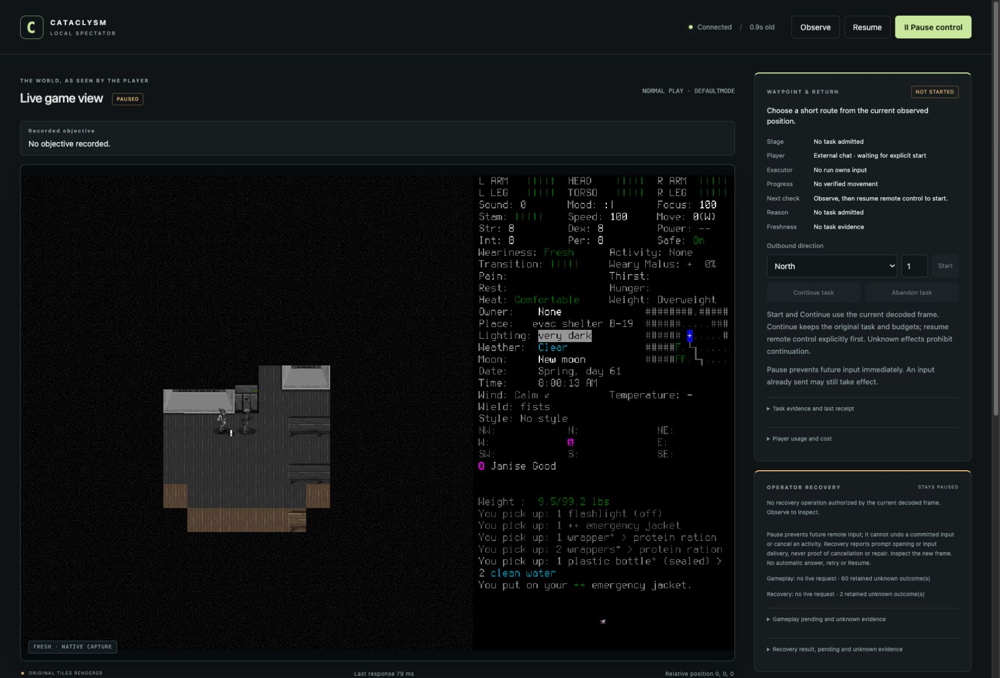

# Ordinary item menus work; acceptance remains partial

The corrected native build opens and cancels nearby-item examination, two-item
comparison, crafting and construction in the actual game. Normal Save/Quit returned
to the main menu, then ordinary app Quit closed the process without user keys.
**Direction-query regression and post-shutdown reload remain unexercised.**
[#112](https://github.com/CVX-Hull/enactive/issues/112) stays open; this is navigation
evidence, not crafting success, first-day survival or seven-day completion.

The screenshot is an actual browser capture, not a reconstructed interface. Original
native frames and selected local evidence are identified by the [manifest](2026-10-18-ordinary-menus-manifest.json).
Private artifacts are unavailable in a fresh checkout; the image is tracked by Git.

## What changed and what failed

[PR113](https://github.com/CVX-Hull/enactive/pull/113) addresses the
[functional continuation's unsupported LIST_ITEMS](2026-10-18-seven-day-continuation-stop.md).
Four finite categories reuse existing native menu handling. Category-specific
`menu_query` markers cover only exact pinned item/direction waits and expire before
callbacks. Generic `default`/`DEFAULTMODE` remain excluded elsewhere; native binding,
empty-stack/nesting exclusions, debug/activity precedence, wire3, Pause, expiry and
production deadlines are unchanged. No dependency, global permission change,
framework or compatibility path was added.

Candidate6484151 passed450 common tests, exact push/PR CI39171036716/39171040453 and
native build/install. Its real first proof nevertheless **failed**: nearby items,
creature tab and filter/cancel worked, then EXAMINE reached unsupported `default`.
The actual call was `game.cpp -> output.cpp::draw_item_info`, a different current
renderer from the initially marked `iteminfo_window`. Source review and synthetic
patch fixtures had missed the actual entry-to-handler chain. The proof stopped.
A separately recorded cleanup-only upstream SIGINT/actual Quit exception discarded
unsaved UI/memory without Save; it has expired. No user unlock/keys were requested.

The lead added that precise wait, verified/pinned official source bytes and reused
existing restoration, repeatability, changed-hash and missing/duplicate-anchor tests.
Independent review verified the call chain and marker lifetime. Candidate
`471e4126bd1032755949d96701527df0e0395df8` passed20 targeted setup tests and the normal
450-test common hook, plus exact push/PR CI39172096919/39172099826. A preceding default-
sandbox check could not launch the diagram browser; its failure is retained. An
initial648 integration run also retained four lexical/canonical temporary-path
fixture failures; exact full-path expectations were corrected without weakening
rejection assertions. Portable tests do not execute native classification.

Both candidates built/installed through the existing recorded owned workspace.
Corrected built hash: `f11f4f397eb015ce7406a873590cefa62b7766dd446f4e42c0fec9d371b53e56`.
Installed hash: `297b443a235af6e4803bb6d2a15bd595f0461124f7fe87c297a59b2382d5f704`.
The existing macOS13-target/bundled-FreeType15 linker warning remains; other hosts
are unverified. Source/native/helper were frozen during each proof. Windowed
project userdir, turn duration0, no new world/character or hidden-state/save reads.

## Actual second proof and costs

[The prospective correction](../changes/027-item-detail-owner.md) retained the
original combined40-input/45-minute envelope,12spent inputs, original monotonic
3819543.830057541 and original whole lineage. It did not restore the failed queue.

| Evidence | Actual result |
| --- | --- |
| Rows4–12 | Stale revision rejected by controller before native dispatch; conservatively charged. Fresh observation permitted the current revision. Selected-Ned Load7 timed out; fresh normal8/status9 and deliberate Resume10 allowed actual Ned sheet11/cancel12. Load ACK remains unknown. |
| Rows13–21 | LIST_ITEMS; EXAMINE14 now supported lowercase `default`; cancel15. COMPARE16, visible fork B17 and knife C18 opened actual comparison; cancellation19/20/21 returned normal. |
| Rows22–27 | CRAFTING/cancel and CONSTRUCTION/cancel supported. Pickup automatically selected its single neighboring item tile and opened INVENTORY/cancel; it **did not exercise a direction query**. |
| Rows28–40 | Pause/status/fresh normal turn5212813. Cleanup-only Resume, ordinary Save/Y33 timeout; fresh MAIN_MENU34/status35, deliberate Resume36, q37/Y38 timeout, final Pause/status. No signal or user rescue in this second proof. |
| Accounting | First proof26rows/12charges; second40rows/24charges (20investigation/four cleanup). Combined66rows/36charges,1128.917seconds through native closeout. Investigation stopped at combined32; no budget renewal or further investigation. Whole lineage76+36=112,7002.159seconds since original creation. |

Fresh normal frames remained **Ned Meyers/Belgium, turn5212813, Spring61 08:00:13**,
visible Janise Good and Fresh/Comfortable with green health. Zero verified game
advance. No consumption, pickup, recipe, construction, movement or combat occurred.
The alternate `iteminfo_window` renderer was not exercised. Creature/filter results
belong to6484151, not a repeated corrected-candidate test.

Load7, Save33 and Quit38 remain unknown, adding three to cumulative62current-v3
plus one archived-v2 gameplay unknown; two control unknowns remain. The live list
is capped at60 entries and is not the cumulative historical count. Terminal status40
is frozen/Pause-requested with stale YESNO/frame-unavailable state and a retained
pending final Quit request; it is **not** a fresh paused native or empty-pending claim.
Exact native PID69346 was absent; controller94210/PID64164 exited0 and port8766
closed in the lead's primary tool trace. Native exit code is unavailable. These
facts and the observed main menu do not supply missing native ACKs or a reload test.

Independent review verified all107first-proof artifacts/2,179,557bytes and all160
second-proof artifacts/3,437,583bytes, receipts, frames and accounting. External
tool permissions, actor queues and process/port checks also require the lead trace;
local files alone cannot prove them. No new approval denial occurred. The original
campaign's denied request was not retried or routed through another actor.

## Disposition and maintenance

Publish the qualified repair; retain #112 open for actual direction-query and
normal saved-character reload validation under a separately reviewed prospective
scope. Existing proof limits remain closed, with every original whole charge and
clock carried forward. #82/#100 remain blocked until that disposition is accepted.
No failed campaign is retrospectively successful, and no further survival is
admitted by this report. Final protected publication/main CI is a separate gate.

#75 retains the missed source call chain, fixture limits, partial proof and process
cost. Future native review traces the requested entry to its actual wait, including
alternate current renderers. Reuse existing Git, setup, parser, checks and passive
recording; closed one-off helpers have no further input authority. No automatic
learning or sustained control-effectiveness claim follows from these probes.
Maintenance/research dates remain unchanged; no new architecture diagram is needed
because responsibilities and transport did not change.
