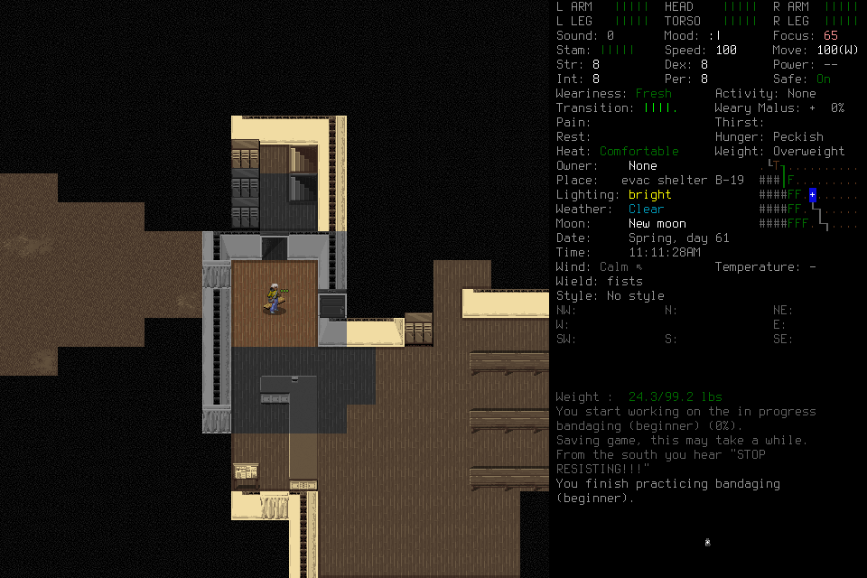

# Useful work completed; the complete-day forecast failed review

Ned Meyers/Belgium finished the interrupted carving job and one finite bandaging
job, alive at **Spring61 11:11:28**, turn5224288. This advanced1h47m02 in006,
3h11m28 after originalT0=5212800. **No survival day is accepted.** At the exact
40-player-input checkpoint, the proposed remaining schedule still depended on
unverified wood and sustainable light. Independent review caught the gap; a
read-only player replan agreed there was no grounded complete-day fit. No player
input41 or proposed20-input follow-up test occurred under this admission.

The image is byte-identical to native79. The
[manifest](2026-10-18-resource-feasibility-manifest.json) indexes private original
receipts, copied frames, budgets, checkpoints and shutdown evidence. Raw debug
images contain a local machine path and remain private. Private originals are
unavailable in a fresh checkout; the public image is the actual ordinary scene.

## Frozen candidate and prospective admission

Clean source57b40d47c8ad5184ec3f3b8acd81617b1490a68d and installed nativea053adb0…3e0a
stayed frozen. The preceding repair's exact push39188820843/PR39188824044 and
merged-main39189063934 passed; no new build or source implementation occurred in006.
Scope[035](../changes/035-full-day-continuation.md) and its preparation were
independently reviewed. Actual E/F stable-CLI passive preflights succeeded without
recurring review observed. The windowed game and connected spectator were checked.

Admission monotonic3834868.3757075 occurred with1572.791177seconds remaining under
the old220-minute day1 investigation limit, before the prospective extension.
The new340-minute investigation allocation from the **same** original
dayclock3823241.166884125 left8772.791177seconds against5280forecast seconds plus
initial load/review. Original wholeclock3813670.588570708 and all spent costs
continued. Inherited371whole/346day/108lifecycle inputs,4148.431055lifecycle seconds
and77v3+1archived/control2unknowns were not reset. Earlier stopped scopes stayed closed.

## Actual sequence and uncertainty

| Rows | Observed result |
| --- | --- |
| 1–8 | Passive preparation and normal Belgium/Ned selection. Load5 timed out at the prospectively allowed15s. Pause6/freshObserve7 verified normal5217866 and the prior proof save; status8 empty live slots. Load acknowledgment remains unknown. |
| 9–20 | E closed the west curtains, verified8rations/2Lcleanwater and equipment. Darkness required another light source. A southeast step while hauling triggered native DEBUG_MSG: Lost target item of ACT_MOVE_ITEMS. E Pause19/status20 relinquished input. |
| 21–26 | Lead recovery22 rejected stale prompt evidence before dispatch and remained charged. Fresh23 verified the exact same debug image;24 delivered one Space through continue_debug_once, never Ignorefuture. Fresh25 normal5217871 and empty26 are separate evidence of return, not an inferred movement acknowledgment. |
| 27–49 | E stopped hauling through the ordinary menu, used the phone light and finished the21% item. Finite-repeat No; normal41 reached5220687. Carving6% at42 is distinct from item completion; the last earlier proficiency was1%, with no preload sheet to isolate all gain to006. Actual ground44 had2planks/6nails/1splinter; one plank remained reserved for fuel. Phone46 had43/56, before the later bandaging hour. |
| 50–66 | First partial milestone review; then bandaging search62 returned unsupported. E paused63/status64. Lead's one-Observe8.763776second reassessment65/66 positively verified supported CRAFTING and empty live slots. Explicit reassignment/fresh Observe–Resume, no filter replay. |
| 67–78 | Recipe71 showed one-hour beginner bandaging, reusable bandage and missing Wound Care; current health skill1 was already at this recipe's skill cap. One job72, a supported cop-shout question73 at94%, ordinary No74 for the remaining work, then finite-repeat No76. Normal5224288 after3601game seconds. Pause77/status78 at exactly40E inputs,909.960seconds from the original player-phase clock, empty live slots and quiescent handoff. |
| 79–89 | Lead normal/empty-live verification, then review rejected the full-day fit. Cleanup-only Resume81, Save83/Y84 timeout, actual MAIN_MENU86; Resume87/q88/ReallyquitY89 timeout. Native57302 absent; owned controller57268 SIGINT/terminal exit0 and port8766 absent. Save84/Quit89 remain unknown. Final save has not been reloaded. |

The character remained Fresh/Comfortable/Peckish, no displayed thirst, green
limbs and no visible creatures at the final normal checkpoint. Closed curtains
do not clear the outside cop or prove a defensible daylight workspace. Wound Care
gain after bandaging and the phone's then-current charge were not measured.
Normal bandaging completion is established; a proficiency-gain claim is not.

## Costs, failure and owned dispositions

**89rows/48new charges =2initial lifecycle +40E +2recovery +4final lifecycle.**
Cumulative419whole/394day1/114lifecycle inputs and4232.099166lifecycle seconds.
Load5/Save84/Quit89 add three unknowns:80current-v3 plus1archived-v2 gameplay
unknown/control2. The stale recovery22 is a known nondispatch, not a new unknown.
Initial/final lifecycle38.984706/44.683406seconds and recovery26.266880seconds
are included in their shared/day/whole costs. Whole inspections10 including7
inherited; boundary reassessments5 including4 inherited. No clocks were restarted.

| Finding and consequence | Disposition / owner / required next evidence |
| --- | --- |
| Longer carving coverage lacked acquired wood and sustained light; useful local jobs consumed the first40 without resolving complete-day feasibility. | Fix next / lead in[#100](https://github.com/CVX-Hull/enactive/issues/100): front-load bounded resource discovery and conditional branch checks before long work. Retain006 as failed; no deferred gate or retroactive pass. |
| Shared lifecycle114 leaves only3ordinary inputs under117; the previous future load/midpoint forecast no longer fits. | Replan prospectively / lead in[#82](https://github.com/CVX-Hull/enactive/issues/82), with actual inherited costs and all cleanup reserves; no silent new pool. |
| Actual stable CLI/menu/crafting/recovery calls had no recurring approval observed. | Accepted scoped permission result; no new rule, Codex restart, weaker guard or model tier. Future changed setup uses existing actor preflight. |
| Retained hauling triggered an authentic native debug; existing exact recovery returned normal. | No native repair selected. Ordinary Stophauling worked; retain the incident and check hauling before transporting material. Revisit on recurrence with exact evidence. |
| One benign filter return needed existing bounded passive reassessment. | Existing procedure worked; no new menu allowlist or source patch. Keep original unsupported receipt and procedural limits. |

Independent review verified89contiguous rows, all48charges, hashes, finite job and
question sequence, no input41, qualified claims and retained unknowns. Its process
inspection was sandbox-blocked; process absence/controller exit rely on the lead's
retained primary tool results, transparently recorded in closeout.json. Source,
native and capture hashes match. The first40 P2 changed the next action before an
overrun; it does not establish overall process efficiency or survival success.

[#82/#100](https://github.com/CVX-Hull/enactive/issues/82) retain the open outcome
and actual stopped-result/readback. Parent82 owns qualified publication and final
seven-day acceptance. The[next prospective scope](../changes/036-resource-first-campaign.md)
must resolve discovery ordering and shared-budget feasibility before new input.
