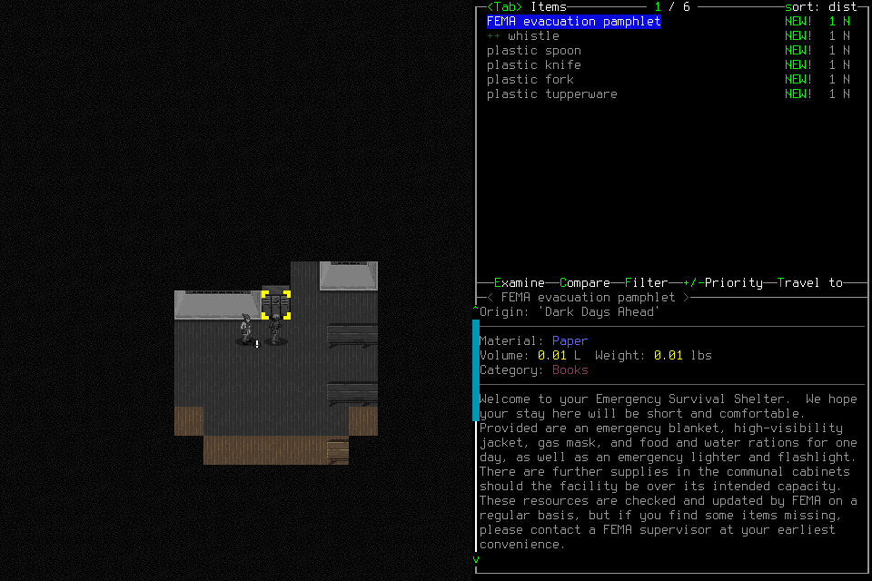

# Functional continuation stopped at an unsupported nearby-items menu

**No day1 or seven-day success.** The prospective continuation on normally created
Ned Meyers/Belgium stopped when an ordinary advertised action opened `LIST_ITEMS`,
which the native bridge classified unsupported. The player paused and handed off
without attempting dismissal. No new game-time advance was verified. The
[earlier failed deciding attempt](2026-10-18-seven-day-stop.md) and
[unexercised/targeted walk probes](2026-10-18-walk-reassessment.md) remain separate.

The [manifest](2026-10-18-seven-day-continuation-stop-manifest.json) identifies
selected local-only evidence; Git owns the tracked image. Original raw receipts,
frames and failures stay under `.runtime/campaigns/seven-day-campaign-002/`.

## Admission and actual player work

[Brief025](../changes/025-seven-day-continuation.md) prospectively admitted one
functional continuation, preserving the same normally created character, all65
spent inputs and the original creation clock3813670.588570708/wall1792355636.0674691.
It did not reclassify campaign001 or resume its unused authority. Frozen candidate
**86c070817e0b2e141cefe3d9aee4a7045cf4648e**, protected[PR111](https://github.com/CVX-Hull/enactive/pull/111),
matched merged9c796de's tree. Exact push39169163267, PR39169165732 and merged-main
[39169323355](https://github.com/CVX-Hull/enactive/actions/runs/39169323355) passed;
448common checks/normal hooks,12offline recorder tests and independent scope/helper/
preparation review passed. These are separate from native gameplay.

Both actual designated players passed explicit approved passive access. Their first
large tool outputs were truncated; the incomplete result was acknowledged and
complete passive recaptures retained. No JSON or native evidence was fabricated.
Project rule matching passed with mature Codex tooling; live startup activation
remained unverified. No broader/global permission change occurred. Prepared wrapper
launched windowed with explicit project userdir and unchanged native9cf1f76 binary;
TURN_DURATION=0.00. Fresh main-menu and spectator images were retained.

Lead rows1–12 used **four inputs**: actual Belgium Load list/Ned confirmation and
character sheet/cancel. The15s Load confirmation0004 timed out, never replayed;
fresh paused normal scene at turn5212813 plus actual Ned sheet0008 established
current identity, not its missing ACK. Lifecycle4 closed at334.223seconds. Independent
review verified all63initial prefix references, exact first12ledger lines, images,
identity/calendar and no live input/recovery/lease.

Player C's day1 assignment started at3818291.919112625 with40inherited daily charges,
260remaining/120minutes inside unchanged whole limits. Its five inspection inputs
were inventory/cancel, overmap/cancel and nearby items. Fresh inventory confirmed
three protein rations and four clean-water portions across two sealed bottles,
one frozen; these were carried, while nearby pamphlet/utensils were not. No sustained
water source, travel, meal, useful work or rest was established. Last normal0019
remained turn5212813, Spring61 08:00:13, Fresh/Comfortable/speed100/green visible health
with nonhostile Janise Good. These are point observations, not survival maintenance.

Row0020 returned `ready`, category`LIST_ITEMS`, boundary`unsupported`, no recovery
operation, scene null. Its readable image could not authorize input. Player Pause21,
terminal tools/no queued input and3816-byte/11-reference checkpoint relinquished
ownership; no Escape, retry or alternate actor was attempted. Player checkpoint
elapsed113.040seconds; root later fresh Observe22/status23 verified actual paused
unsupported state and no live request/control/lease. No new approval rejection
occurred; this gap is native coverage, not the earlier stale-movement denial.

## Cleanup qualification

Native CUA inventory access failed with a lock/access report; actual OS-lock cause
was not established. No user keys/unlock were requested. Normal Save/Quit could
not be reached through this unsupported menu. **Normal Save/Quit acceptance failed.**

Lead prospectively recorded one cleanup-only exception in
[#112](https://github.com/CVX-Hull/enactive/issues/112#issuecomment-6255629444), after
independent source review. The pinned upstream SIGINT handler invokes its existing
“Really Quit? All unsaved changes will be lost” confirmation. One verified-owned-PID
signal was separately charged at24; it was not a native request/ACK or an unsupported
Escape. Fresh25/26 showed the exact supported YESNO prompt, paused with no live work;
deliberate Resume27 and one ordinary5s Y28 followed. No second signal, force-kill,
Save, restored investigation or stronger fallback occurred.

The final Y acknowledgment timed out and stays unknown. Pause29/status30 retained
uncertainty. Primary lead tools verified nativePID84323 absent, controller exec34460
Ctrl-C exit0 and controllerPID83819/port8766 absent. Native exit code is unavailable;
empty local files alone would not prove shutdown. Existing normal save was not
edited. Unsaved memory/UI state was discarded; expected last saved turn5212813
was not post-shutdown verified by reading saves or reloading. This exception grants
no future cleanup or gameplay authority and cannot substitute for normal saving.

## Accounting, findings and next gate

**30rows/11new charges = four load/identity + five player inspections + two cleanup
(one external signal/one Y). Whole lineage76 =48campaign001 +6probe001 +11probe002
+11this continuation.** Day1 counter45 includes40inherited/five new; sublimits overlap
without double-charging the whole. Native closeout was4990.498seconds from original
creation, including earlier repair/publication costs; original24h/2600 limits remain.
No new game advance is verified beyond the original13seconds. Two new native unknowns
(Load0004/Quit0028) make57current-v3 gameplay plus one separate archived-v2=58all-era
and two control unknowns. The signal has no native ACK and is not another native
unknown request. No human input, save edit, hidden state, debug advantage, reroll,
source change during play or paid API. Final immutable artifact review is recorded
separately; original negative results and all tools' actual limitations remain.

| Area | Actual finding and disposition |
| --- | --- |
| Memory | Fresh inventory replaced the advisory baseline; nearby and carried supplies remained distinct. No persistent-memory or learning result. |
| Planning | Supply sustainability remains unproved; an ordinary inspection can enter an unsupported context. Audit related normal UI before another run. |
| Monitoring | `ready` was not treated as permission or success; player stopped correctly and handed off. |
| UI/native | Explicit menu coverage omitted LIST_ITEMS. [#112](https://github.com/CVX-Hull/enactive/issues/112) owns the bounded related-menu audit/repair and native proof. |
| Process/controls | Actor preflight, current images and correct stop behavior did not establish reachable cleanup. [#75](https://github.com/CVX-Hull/enactive/issues/75) retains review cost/recurrence/reuse evaluation and unchanged dates. |

[#100/#82](https://github.com/CVX-Hull/enactive/issues/82) stay open/blocked by#112;
#108 remains accepted. [The next design](../changes/026-ordinary-survival-menus.md)
is a separate native repair/probe, not renewed survival allowance. Further play
needs an explicit prospective decision with original clock and all76+later costs,
no new character or hidden favorable reset. Useful failure review is not survival,
unattended reliability, generalized monitoring, causal improvement or model superiority.
