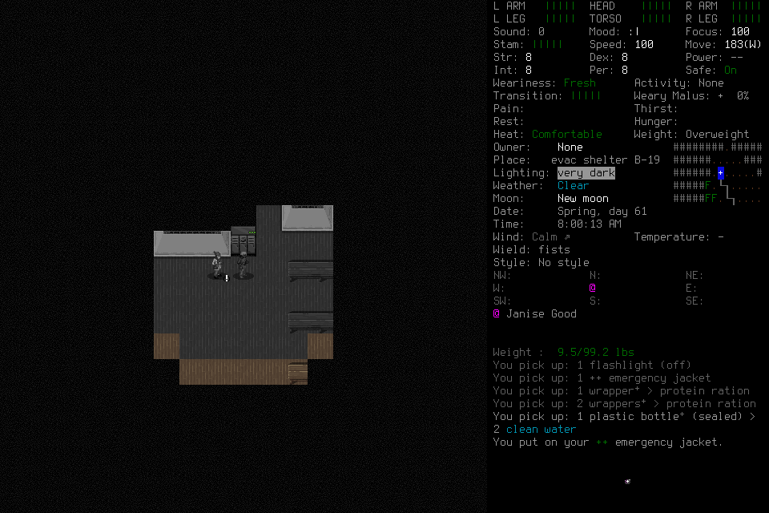

# First deciding campaign: a retained partial

Ned Meyers was normally created in a fresh Belgium world, collected shelter
supplies and wore an emergency jacket. The attempt stopped after **13 game
seconds** when automatic approval review rejected movement following a stopped
guarded walk without a fresh verified observation. The player honored the denial,
paused and handed off; the lead used normal Save and Quit. **This is neither
first-day nor seven-day survival success.** No user keys, unlock or rescue occurred.

The [frozen protocol](../changes/022-seven-day-campaign.md) and
[readiness evidence](2026-10-18-seven-day-readiness.md) remain historical inputs.
Its unused allowance cannot resume this stopped investigation. The actual
observation/caller gap is tracked in [#108](https://github.com/CVX-Hull/enactive/issues/108),
blocking further [#100](https://github.com/CVX-Hull/enactive/issues/100)/
[#82](https://github.com/CVX-Hull/enactive/issues/82) execution until a prospective
correction and admission decision. The overarching goal remains active.

This is the native endpoint image, not a mock or an advanced calendar. A separate
actual spectator-origin image retains the ordinary-window objective and user
Pause; its frame precedes the player input. The [manifest](2026-10-18-seven-day-stop-manifest.json)
identifies selected originals. Source stayed frozen until native/controller shutdown.

## What happened and what it proves

| Boundary | Original evidence and limit |
| --- | --- |
| Readiness/publication | Protected PR107 corrected candidate `d7cb22c1ce325106a8d70924d073bb4deb03d309` passed both exact checks; merged source `ace2ab2976e40415c1f7f4f6b644b752f9d765f0` has an identical tree and [passing main CI](https://github.com/CVX-Hull/enactive/actions/runs/39163568503). Earlier required CI failure remains in the readiness report. Both real actors' approved passive access and fresh normal-window/native preflight passed. No broader rule or global setup. |
| Ordinary world/character | Captures0007/0008 show Belgium defaults and unchanged default mods;0016–0023 show Evacuee/Survivor, attributes8 and default backgrounds/skills, one generated name and random start. Actual0028 character sheet corroborates Ned. No reroll, favorable restart, hidden-state/save inspection, save edit or debug advantage. |
| Origin | First supported spawn0026 establishes turn5212800 / Spring61 08:00:00, evac shelter B-19 and nonhostile Janise Good. Spawn confirmation0025 timed out, charged once and never replayed; later state does not repair that ACK. Paused0031/0032 has no live input, recovery or lease. |
| First player handoff | Observe0034 succeeded; Resume0035 incorrectly included `--expect`. Shared-parser preflight rejected it before controller contact, publishedfalse/zerocharge. Player0036/0037 Pause/status and terminal quiescence preceded lead0038–0040 fresh paused inspection. Corrected literal Resume was separately assigned under the **same original daily clock**, with no source/helper/permission change or compatibility alias. |
| Supplies and clothing | Actual0043 inventory showed frozen starting clean water and matchbook;0053 pickup messages show flashlight, emergency jacket, three wrapped protein rations and a sealed bottle containing two clean water.0056/0062 show jacket worn, Fresh/Comfortable, speed100 and visible green health at08:00:13. No consumption, sustained water source, purification, rest, illness handling, combat or full-day sufficiency was demonstrated. |
| Decisive stop | Guarded walk0057 requested four south steps and stopped with zero completed: visible creatures or unknown visibility. Its aggregate provided status/steps/error without the stop observation/frame. The player proposed a single DOWN action from the earlier frame/revision75. Actual automatic approval review rejected it: fresh verified observation was required after that stop, with no workaround. No helper/native execution, corrected retry, actor/transport switch or rule expansion followed. |
| Terminal handoff/accounting | Player0058 Pause/0059 status and checkpoint002 ended all handles/authority. Lead0060 is explicitly **accounting only** for the one denied request; it preserves the original later Pause/status ordinals, null native ACK/returncode and unavailable exact denial timestamp. It is not a new action or a fabricated receipt. |
| Cleanup | Lead0061/0062 Pause/fresh paused normal endpoint,0065 Save prompt/0066 confirmation,0067 actual Belgium(1) main menu,0069 Quit prompt/0070 confirmation. Ordinary deadlines stayed5seconds. Save0066/Quit0070 ACKs remain unknown. Native72467 was absent; controller36493 exited0 normally and port8766 closed. Native exit code is unavailable under LaunchServices. |

The model's proposed movement is a caller-discipline failure. Source inspection
also confirms a narrow observation boundary gap: public `walk` discards the actual
observation behind its aggregate stop. Existing ordinary action preflight checks a
fresh native boundary, but cannot supply the missing evidence to the player making
the decision. The movement guard is conservative even for visible nonhostile
companions. None of this justifies weakening it or bypassing the actual denial.

## Fixed accounting and evidence limits

**72 rows / 48 charges =25 creation/identity +19 day1 +4 cleanup.** Day1 is
14 ordinary key/action requests returning ready, four fully charged requested walk
steps with zero completed, and one denied-before-execution request. Passive commands
consume wall time with zero input charge. Local grammar rejection0035 is separate
from actual approval denial and from native uncertainty.

The whole envelope remained2600charges/24wall hours, investigation2400/22hours,
with200/final2hours reserved for cleanup/review/publication. Day1 retained its
original300/7200seconds; shared phase and original clocks were never reset. Native
closeout was recorded at **974.996419 seconds** from original admission, including
reasoning/tools/approvals/pauses and handoffs, not merely native execution. The
final reserve/review/publication clock continues in the originals; formal terminal
closeout follows publication. Nested phase times are not added to original elapsed.
No wait, sleep or long-work allowance was used; seven-day feasibility is untested.

Unknowns from this campaign are spawn0025, Save0066 and Quit0070. Final status has
49 distinct current-v3 gameplay unknowns and two control unknowns, plus one
separately retained native-v2 historical gameplay unknown: **50 all-era gameplay
unknowns**. The origin summary's “total47” meant its then-current v3 array only;
`unknown-count-scope-clarification.json` preserves a separate correction without
rewriting original summaries. Archived unsupported state is evidence, not runtime
input. No later state or process exit makes an old ACK successful.

Originals remain under `.runtime/campaigns/seven-day-campaign-001/`. Prefix33 has
198 files; prefix37/40 preserve the grammar-stop/reassignment; final prefix72 has
**409 files /5,697,608 bytes**. Independent review verified every hash/size in all
four prefixes, all72 rows/48charges, actual images, count scope and honest cleanup;
no new confirmed P1/P2 defect in the stopped-outcome evidence. The published PNG is
byte-identical to actual0062. Source, helper/native hashes and external tool
parameters/quiescence remain separate lead-verification lanes; files alone cannot
authenticate an external actor, approval event or process exit.

Native binary stays
`9cf1f76db19d6b401582bd7e6768422b653f6204069bd544804b8a5490e95273`;
no rebuild is claimed. Common/source checks and protected publication of this
report are separate from this real unsuccessful graphical run. No paid API,
global permission/environment change, hidden retry or automatic learning occurred.
Model/approval cost and sustained reliability remain unknown.

## Findings, ownership and next decision

| Area | Disposition / owner |
| --- | --- |
| Control and planning | #108, lead: expose/retain the actual walk outcome observation, define freshness/absence and require explicit reassessment before another decision. Migrate callers/tests/docs together; preserve every guard/deadline and actual denial. A new bounded native probe/readiness decision precedes later play. |
| Caller grammar | Lead corrected the assignment using the existing parser/CLI, no new alias. Runbook now states which commands accept `--expect`; generated help/source remain authority. Guard caught the mistake before input. |
| Memory/accounting | Lead separated current-v3 and archived-v2 counts using original IDs, preserving summaries. Carry actual frozen water versus newly collected water and invalidate all earlier-world routes. No generic memory framework is needed for these corrections. |
| Capture/UI | Read original numbered receipt JSON rather than a truncated tool-display envelope. Recorded objective names campaign/day/player; the waypoint panel remains a separate task arrangement. Native/spectator images are actual, one host/window size. No automatic campaign-progress UI guarantee. |
| Survival and monitoring | Food/water pickup and jacket use were meaningful; supply sufficiency, depletion/rest/threat handling and long activities remain unexercised. Existing #100–106 remain uncompleted/gated. No learned monitor, model tier or purification claim is promoted from this partial. |
| Maintenance | #75, maintainer: retain actual CI/approval/capture/caller findings and review burden; no unrelated dates renewed. Reuse current controller/CLI/parser/observation machinery, Git/GitHub and existing checks. Any expansion beyond this narrow gap needs an explicit reuse/scope/cost decision. |

Current permission access worked for earlier inputs. This rejection identified a
fresh-observation requirement, so a broader permission rule is not the remedy.
Any later assessment needs a new prospective scenario/candidate/finite lineage
decision with this stopped attempt retained. It cannot silently resume001 or call
this review a successful seven-day run.
