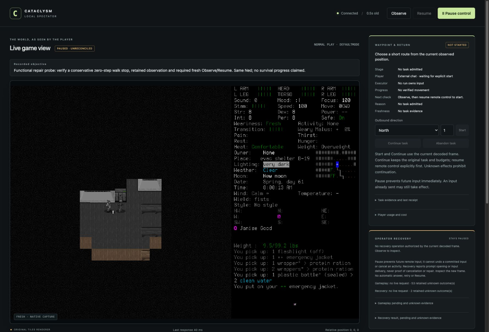

# A stopped walk now requires fresh reassessment

The real game verified the repaired boundary: a conservative north walk stopped
at zero steps, returned its actual observation, and left dispatch paused/frozen.
Resume was rejected until an explicit fresh Observe. After interpreting that new
image, explicit Resume and ordinary inventory/cancel worked. **No movement or game
time advanced. This is a targeted functional result, not survival success.**

The image is the actual ordinary browser window, captured before reconciliation;
it is not a reconstructed interface or the earlier campaign's endpoint image.
The [manifest](2026-10-18-walk-reassessment-manifest.json) identifies selected originals.

## Change and evidence lanes

[PR110](https://github.com/CVX-Hull/enactive/pull/110) addresses the
[campaign001 observation failure](2026-10-18-seven-day-stop.md). Each admitted walk
retains its last validated ready response, pre/post-step phase, original receipt
clock only when the entire atomic snapshot matches, and exact terminal exchange.
An uncertain input can therefore retain a pre-action image without implying success.
Every stopped walk freezes, requests Pause and revokes its original generation;
status/internal preflight cannot release the hold. Interpretation remains the
player's responsibility. See the [current contract](../protocol.md#closed-loop-play-and-observations).

Production candidate `32bbae60ce6fecb5fbbcbf4ad7782c093be27c7c` passed all 448 common
tests, viewer/boundary/document/governance/diagram checks and the normal commit
hook. Independent design, implementation/test and visual review found no P1/P2.
Exact push/PR CI 39166466838/39166469624 passed. The probe executed clean committed
`e8840c625613d5380eb48ab906824dda425fe9c6`; its only later changes were the reviewed
prospective documents. Exact push/PR CI 39167244296/39167247785 passed too.
Final publication and merged-main checks remain a separate release gate.
Earlier worker fixture/refinement failures and an accidentally split lead HTTP
test were corrected without weakening expectations; the original failure log and
review record remain in the manifest.

Native wire3, deadlines, terrain/creature guards and unknown tracking were unchanged.
The existing pinned CDDA0.I-1 windowed bundle/userdir and installed binary
`9cf1f76db19d6b401582bd7e6768422b653f6204069bd544804b8a5490e95273` were reused;
no rebuild, global setup, paid API or permission expansion occurred.

## Two probes, one original finite envelope

| Attempt | Actual result and limits |
| --- | --- |
| [Probe001](../changes/023-walk-reassessment.md), source32bbae6 | Load004 timed out. The literal cleanup-only clause barred investigation, so no walk occurred.15rows/six charges = two load/four cleanup; zero game advance; normal Save/Quit. Load004, Save009 and Quit013 ACKs remain unknown. |
| [Prospective probe002](../changes/024-walk-reassessment-probe.md), sourcee8840c6 | Inherited six spent charges and the original clock. Only its single declared load transition could be freshly reconciled for identity/exercise; no load retry or old authority restored.26rows/11charges = two load/two identity/one requested guard step/two inventory/four cleanup. |
| Combined accounting | 17 charges,856.281seconds through native closeout, zero game seconds advanced, within the original40-input/45-minute/60-game-second ceilings. Review/publication continues on the original clock. Cleanup reserves were preserved; none of these limits was renewed. |

Actual Load list and `@` sheet verified **Ned Meyers/Belgium**. Fresh normal frames
remained at **turn5212813 / Spring61 08:00:13**, with visible Janise Good, a north
locker, Fresh/Comfortable and green visible health. No hidden state/save reads,
save edits, new character/world, reroll, debug advantage, human keys/unlock/rescue
or native CUA input occurred. Native UI inventory reported an access/lock error;
its actual OS-state cause is unknown. Supported engine menus and spectator sufficed.

Probe002's original rows identify the sequence:004 load ACK unknown;005 fresh paused
normal/006 no live request/control/lease;008 identity sheet;012 walk stopped0 with
literal observation/terminal/original clock;013 frozen/Pause;014 known controller
Resume rejection;015 explicit fresh Observe;016 explicit Resume;017 inventory and
018 cancel. Inventory visibly retained jacket, flashlight, knife, smartphone,
rations and two water bottles, one frozen. No supply consumption was tested.

Normal Save019/Y020 left its ACK unknown;021 showed actual MAIN_MENU Belgium(1).
Resume022/q023/Y024 normally quit; final ACK stays unknown. Pause025/status026
retained **55 current-v3 gameplay unknowns plus one separate archived-v2 unknown**
(56 all-era gameplay), and two control unknowns. No old outcome was repaired by
fresh state. Known native PID82256 was absent, controller28369 exited0 and port8766
closed; native exit code is unavailable. Those facts do not supply a native ACK.

Independent review verified all **51 probe001 and82 probe002 artifact hashes/bytes**,
41capture/ledger records and actual images. External approval/tool parameters,
empty execution queues and process/port exits also require the lead's tool trace;
local empty check files alone cannot prove them. The first campaign's actual
approval denial remained honored; neither probe retried DOWN or used another
actor/transport to bypass it. No new approval denial occurred in these probes.

## Disposition and limits

The controller/native zero-step observation and reassessment gap is corrected.
Portable tests separately cover partial/final-step stops, stale/conflicting/missing
evidence, malformed/uncertain responses and Pause/queue races; this native probe
does not establish those cases' real-game reliability. One run proves neither
seven-day survival, unattended operation, model superiority nor learning.

[#108](https://github.com/CVX-Hull/enactive/issues/108) retains the correction's
publication gate. [#100/#82](https://github.com/CVX-Hull/enactive/issues/82) still
need a prospective finite campaign decision before play; unused campaign001
allowance is not authority. [#75](https://github.com/CVX-Hull/enactive/issues/75)
owns review of restrictive probe wording and repeated one-off capture cost.
The maintenance/research due dates were not renewed. The overall goal remains
the actual seven-day survival outcome.
