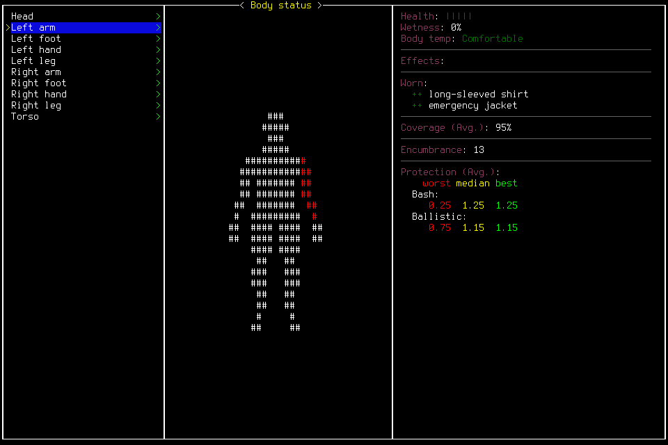

# Body-status input and retained medical continuation

The rebuilt game supports ordinary body-status navigation and exit through the
existing exact-owner menu mechanism. The same Ned Meyers/Belgium reloaded at
Spring62 03:27:03, verifying the prior save. **No daily survival outcome is accepted.**

## Actual campaign failure

008 learned Wound Care after6120actual seconds of useful beginner practice and
made useful partial Expert progress through advanced work. Meals, clean water,
phone-light conservation, shelter preparation and one four-hour alarmed rest with
an actual wake-up were observed. Requested rest is not exact sleep duration.
HUD Fresh labels weariness, not sleepiness or proof of sleep eligibility.

At03:27:03, body status opened to assess Chilly. BODYGRAPH was unsupported in
153–159, including fresh lead reassessment after E returned terminal tools and
empty live slots. Investigation stopped before day1 target5299200. Separately
charged native Escape160 enabled normal Save/Quit; main menu166 and normal owned
process shutdown followed. Save164 and application-Quit170 acknowledgments timed
out and remain unknown.008 ended at578whole/553day/128lifecycle inputs and
4593.386686497lifecycle seconds, retaining every earlier attempt and clock.

## Separate native repair and probe

Source checkpoint `15b3c8a258e966cd2cf9d6b48c1fc56e0a613e4f` adds only the pinned
bodygraph wait marker, source pin and existing patch-test coverage. It does not
globally admit BODYGRAPH. Independent review found no P1/P2.451 portable tests,
viewer/import/docs/governance/diagram checks and normal commit hooks passed.
The first default-sandbox check could not launch Chromium; the required-access
run passed. These checks do not establish native behavior.

The separate native build succeeded using the recorded existing project-local
toolchain. Installed signed binary SHA256:
`2095b718f470fa01b5a98ae6a1a8a3b5cd62d171597c7e11d34f199f0edcd69b`.
The linker warned that the existing FreeType dylib targets macOS15 while the
binary target is13; this host result does not establish macOS13 support.

009's finite probe used5charged inputs in87.411030seconds:2reload lifecycle
inputs and3menu inputs, within16investigation/20hard inputs and8/10minutes.
Actual label3 selected Ned/Belgium; Load4 timed out and was never replayed.
Pause5, normal6 and empty-live status7 verified the prior save at5282823.
Body-status action9 produced BODYGRAPH/menu. Down10 selected Left arm, visibly
Comfortable with green health and0%wetness. Escape11 returned to normal play at
the same turn; Pause12/status13 ended with no live request or lease.

The game remains windowed and paused for publication; no player owns input.
Runtime/native code is frozen. Later documentation-only commits require source
diff verification and exact/main CI before a new admission, not another native
build or game restart. Unmarked/nested/out-of-game/mismatched negative contexts
were reviewed in source but not exercised natively. This image does not establish
every body part, future cold safety, useful sleep or a complete remaining-day fit.

## Permission and continuation

The unchanged project rule parsed and allowed literal status/key/action/resume;
arbitrary Python and server launch did not match. Two consecutive live status
calls156/157 and actual probe menu inputs needed no recurring approval. These
are scoped observations, not a guarantee overriding managed restrictions.
No broader rule, global setup change, paid API or Codex restart was used.

[#124](https://github.com/CVX-Hull/enactive/issues/124) owns this native repair;
[#100](https://github.com/CVX-Hull/enactive/issues/100) remains the unaccepted day1
outcome under[#82](https://github.com/CVX-Hull/enactive/issues/82).
[038](../changes/038-body-status-input.md) preserves original clocks and costs,
requires fresh remaining-day admission and records the prospective lifecycle fit.
The[manifest](2026-10-19-body-status-manifest.json) retains original evidence hashes;
private media availability, receipt uncertainty and negative coverage limits are explicit.
