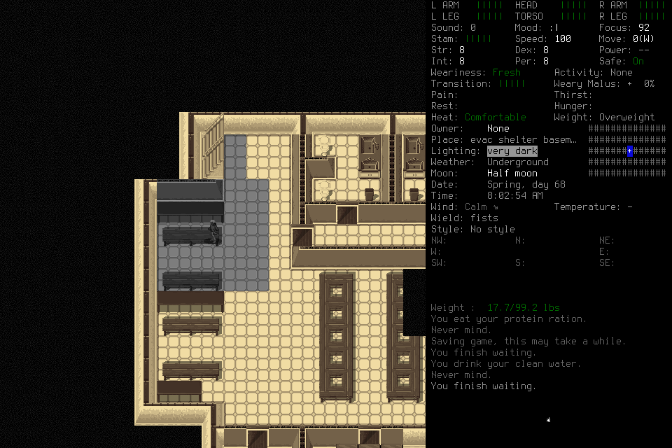

# Seven-day functional survival campaign

**Normally created Ned Meyers / Belgium reached 168h02m54s, with all seven daily
milestones accepted and final normal Save/Quit and shutdown verified.** This is a
functional continuation under prospectively revised admissions. Original expired,
failed and closed attempts remain failures; later progress does not pass them.

| Day | Accepted normal turn | Elapsed from original T0 | Material qualification | Evidence |
| --- | ---: | --- | --- | --- |
| 1 | 5,299,992 | 24h13m12s | Peckish retained; ordinary supplies/shelter/care | [Day one](2026-10-19-survival-progress.md) |
| 2 | 5,386,166 | 48h09m26s | Tired retained; earlier failed rest remains failed | [Day two](2026-10-19-functional-survival.md) |
| 3 | 5,472,809 | 72h13m29s | Normal midpoint native restart, exact reload and fresh player replacement | [Midpoint](2026-10-19-midpoint-survival.md) |
| 4 | 5,558,422 | 96h00m22s | Useful bench rest after failed floor attempts; uncertain shouts prompted retreat | [Day four](2026-10-19-four-day-survival.md) |
| 5 | 5,646,358 | 120h25m58s | Comfortable, rest/thirst clear, Peckish;3.25 L clean/nine rations | [Campaign manifest](2026-10-19-seven-day-survival-manifest.json), frozen day5-stop |
| 6 | 5,731,780 | 144h09m40s | Displayed needs clear;2 L clean/five rations,8h10 calendar rest | Campaign manifest, frozen day6-stop |
| 7 | 5,817,774 | 168h02m54s | Healthy, Comfortable, displayed needs clear;750 mL clean/one ration | Campaign manifest and independent day-seven adjudication |

Unaltered actual native capture 646, identical in bytes to the endpoint frame 643.
Game/UltiCa imagery retains [upstream attribution and CC BY-SA 3.0](../../NOTICE.md).
The live graphical spectator was also inspected at this endpoint; its waypoint
panel describes its separate service, not the external campaign actor.

Original T0 is 5,212,800. Each daily check uses a supported normal frame in the
unchanged one-hour window following its24-hour milestone, then terminal handoff
and independent acceptance before
successor-day input. A table row is an accepted milestone, not seven independent
trials. Stocks are last verified quantities with intervening inputs accounted for,
not hidden inventory reads. Detailed earlier reports retain their failures and
dated state.

## What the run demonstrates

One designated player sub-agent chooses and sends ordinary inputs while the lead
owns admission, escalation, lifecycle and verification. The existing windowed
CDDA/UltiCa renderer is shown through the local graphical spectator; user Pause
remains available. The waypoint service is a separate candidate/execution path,
not an operator lease for this campaign. Its panel does not accurately describe
the external actor; #126 retains that UI gap.

The character used actual supplies, ordinary shelter and responsive food/water,
rested on benches after floor sleep failed, retreated from an observed hostile and
unresolved noise, and treated water using ordinary tools/fire/containers. This is
largely a cautious shelter-and-care campaign, not a demonstration of broad combat,
exploration or an autonomous general survival policy. General memory, monitoring
and learned planning remain separate work. The day-four wake shout was SOUTHWEST:
the lead's wrong southeast correction contaminated a checkpoint and was later
explicitly corrected from primary pixels. Later upstairs SOUTH noise remains
unresolved; a locally quiet frame does not establish global clearance.

[Water evidence](2026-10-19-water-coverage.md) retains the wrong compound-tool
interpretation, damaged crowbar, declined storage warning and two heat interruptions.
Small-piece fuel with the marked source completed the same retained craft; both
1.5 L outputs were stored. This successful configuration does not isolate fuel shape
as the cause: progress, quantities and duration differed, with no controlled trial.
Free raw water, craft-bound ingredients, finished output and consumed supplies are
accounted separately.

The first final-day bench-rest attempt failed after 1,171 calendar seconds despite
Tired/Comfortable. The operator chose Stop and handed back; no sleep is proved.
The next source analysis incorrectly claimed that trying to sleep suppresses
sleepiness growth and that awake growth is one point per minute. The lead and
first source review accepted that premise. Reading the executable condition and its
five-minute caller exposed both errors before the dependent new Sleep input;
the lead withdrew that instruction. B executed only two awake hours and needed
care (nine inputs,253.000 seconds). The wrong rationale had already informed that
awake hold; the catch preceded the new Sleep input, not every dependent action.
Its original brief/analysis remain frozen.

Executable growth tests `!asleep`, not `!lying`; the default caller/rate imply
roughly one sleepiness point per five minutes, subject to modifiers. Trying to
sleep still builds sleepiness. Corrected review distinguishes sleepiness from sleep deprivation, comments from
executable branches, and visible Tired from exact stochastic sleep readiness.
C prospectively permitted one ordinary sleep entry and at most two assessed native
lowercase-c Continue responses in the same activity; it preserved the 30-minute
sleep-check throttle and queries, with third query Stop. No query disabling,
menu/alarm loop or hidden-state read. The old alarm may remain and duration may
add; candidate wake times are not guarantees. The alarm-confirmation 590 timed out;
the player stopped without replay. Status 592 later showed normal 5,790,652, ten
calendar hours later, with Rest clear and ordinary wake text, but Chilly/Thirsty/
Peckish. The request acknowledgment remains unknown. No Continue response occurred,
so its bounded policy is reviewed but unexercised, not a demonstrated improvement.
After actual terminal handoff and closure, lead 594 explicit Observe reconciled the
expired live slot; 595 confirmed all three slots null, fresh paused normal state
and the new UUID retained as unknown. There was no replay or native input recovery.
A separately authorized D then treated actual hunger/thirst and Chilly, checked
warming after 30 minutes, removed the blanket, and assessed three two-hour intervals
and a final one-hour interval. It stopped at the first qualifying normal frame 641,
5,817,774, followed immediately by Pause 642 / Status 643 and FINAL. Lead 644–646 and
independent review confirmed the same healthy/Comfortable, needs-clear endpoint,
null slots and terminal handoff. D cost 33 inputs/704.062 seconds; its last verified
stock 636 was 750 mL clean/500 mL raw/one ration, with only menu exit and the final
one-hour interval afterward. There was no post-endpoint gameplay demonstration.
These source and review errors remain useful negative data, not a perfect-control
claim. Prior successful rests do not erase the failed attempt.

## Continuity and final lifecycle

Creation was ordinary Evacuee/Survivor with default attributes and random location;
Ned / Belgium is distinct from earlier assisted rehearsals. The midpoint normally
saved, returned to the main menu, exited/restarted the native process and reloaded
exactly 5,472,809. A fresh operator then actually sent ordinary inputs. No save
editing, rewind or engine-validation bypass establishes these milestones.

After independent day-seven acceptance, the lead resumed 647, requested ordinary
Save 648 and inspected the case-sensitive prompt. One uppercase-Y 649 timed out;
Pause 650 and eligible Observe 651 after its original deadline showed actual
MAIN_MENU and Belgium, under a new session. Status 652 confirmed null live slots.
The lead resumed 653, pressed lowercase-q 654, inspected “Really quit?”, then sent
one uppercase-Y 655. That confirmation also timed out, without replay.

Read-only process checks verified owned native PID 24221 absent. The original owned
controller terminal 27433 then exited 0 after ordinary Ctrl-C; controller PID 23606 and
port 8766's listener were absent. Last live Status 657 retained the Quit request as
pending and stale: process exit proves runtime quiescence, not a null last slot or
successful acknowledgment. No native signal, force kill, restart or hidden save
inspection established this final result. Final save persistence was not tested
by another reload; the midpoint exact reload is the persistence demonstration.
Earlier exceptional cleanup remains in its historical reports; this normal final
flow is not a claim that every earlier exit was normal.

The admitted native 2095 binary remained unchanged from campaign 009 onward; earlier
lineage used 9cf→297b→a053 before 2095. The initial build hash 545c differs from the
installed binary. Gameplay sources changed through reviewed repairs/admissions;
99c7 is the source for small-fuel completion and subsequent care, not the source
for character creation. Tests, native builds and real gameplay are separate lanes.

## Costs, uncertainty and reusable evidence

Final charged costs are **2,109 whole / 1,188 aggregate / 444 in current study028**, including
171 lifecycle inputs. Aggregate uses the original 921 whole-input baseline. Day five
cost 663, day six 63 and day seven 65 before the final four lifecycle inputs; day seven
including that cleanup is 69. Resource cost is frozen at 412 inputs through treatment; later scope includes care. These overlapping views must not be added.

Whole monotonic origin 3813670.588570708 (functional 004 admission, not original 001
spawn) and aggregate 3876400 remain unchanged. Owned-process closure 3913895.3929155
is 100,224.804345 seconds after the whole origin and 37,495.392915 seconds after the
aggregate origin. These are trajectory clock spans, including intervening
preparation/review, not measured model latency. Later publication work is separate.
The final lifecycle used four of 100 reserved inputs and 75.976666 of 1,800 seconds;
unused authority was retired, not carried into future play. Historical lifecycle
7442.818810 plus this 75.976666 gives 7518.795476 seconds across recorded episodes.

| Care assignment | Inputs | Recorded seconds |
| --- | ---: | ---: |
| Day five A / B | 64 / 33 | 1491.216 / 406.704 |
| Day six | 63 | 892.112 |
| Day seven A: failed rest | 18 | 366.903 |
| Day seven B: hold/care, rest revoked | 9 | 253.000 |
| Day seven C: unknown rest confirmation | 5 | 206.554 |
| Day seven D: final care | 33 | 704.062 |

Original prospective extensions, failed costs and clocks remain in frozen admissions. Use recorded
operator-terminal timestamps rather than the last request-start time: the
small-fuel correction 1049.354→1082.369 seconds preserves the mistaken snapshot.

Before the final-day sleep timeout, 101 cumulative v3 gameplay unknown UUIDs were traced independently:
46 pre-existing plus 55 Ned-lineage requests. The recent status array of 60 is bounded,
not cumulative. Two control unknowns and one archived v2 unknown predate Ned.
Timeouts are correlated development observations, not 101 independent model mistakes.
Sleep 590, Save-Y 649 and Quit-Y 655 add three independently matched durable UUIDs.
The final cumulative v3 set is **104 = 46 prior-project + 58 Ned-lineage**, comprising
103 keys/one action. All 104 durable admission bytes and the new timeout receipts
were checked; the earlier101-member audit and its unchanged bytes are retained.
Later effects do not convert unknown ACKs into success. Exact asleep time,
model-specific usage/cost and causal effects are unmeasured. Alarm requests, recipe estimates and last-seen stock are labeled as such.

The [final manifest](2026-10-19-seven-day-survival-manifest.json) binds frozen snapshots and selected actual receipts/images
for later care and lifecycle. Earlier linked reports/manifests own prior phases.
Local artifacts are not included on a fresh checkout; hashes bind bytes, not truth, representativeness or tamper-proof storage.
The public image is byte-identical to its bound original capture, with upstream notices.
This trajectory includes lead feedback (notably alarm selection), revised plans and
shared context. It is development data, not an unassisted/held-out model benchmark,
model-tier comparison, learning result or reliability estimate.

Campaign findings are owned in #71 memory/data readiness, #40 monitoring and #75
workflow/control maintenance, with #25/#72–74 retaining model-evaluation gates.
Source/quantity/direction errors, actual actions versus intended actions, labels
versus intake, alarm requests versus wake, and unknown ACK versus observed effect
remain separate. Existing Git, journals and GitHub own history and work; no new
memory/history framework follows solely from this campaign.

Publication status belongs in the PR/Issues: reviewed candidate/common checks,
exact-candidate CI, effective main protections, protected merge and merged-main CI,
public identities/messages/tree checks, current Project and owned cleanup. A source
commit need not be amended merely to record its own resulting hash or CI receipt.
