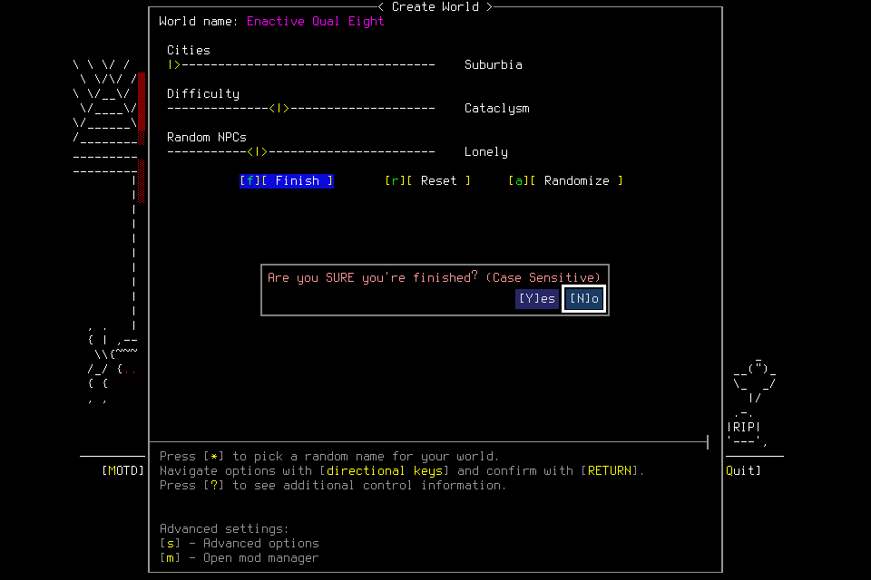
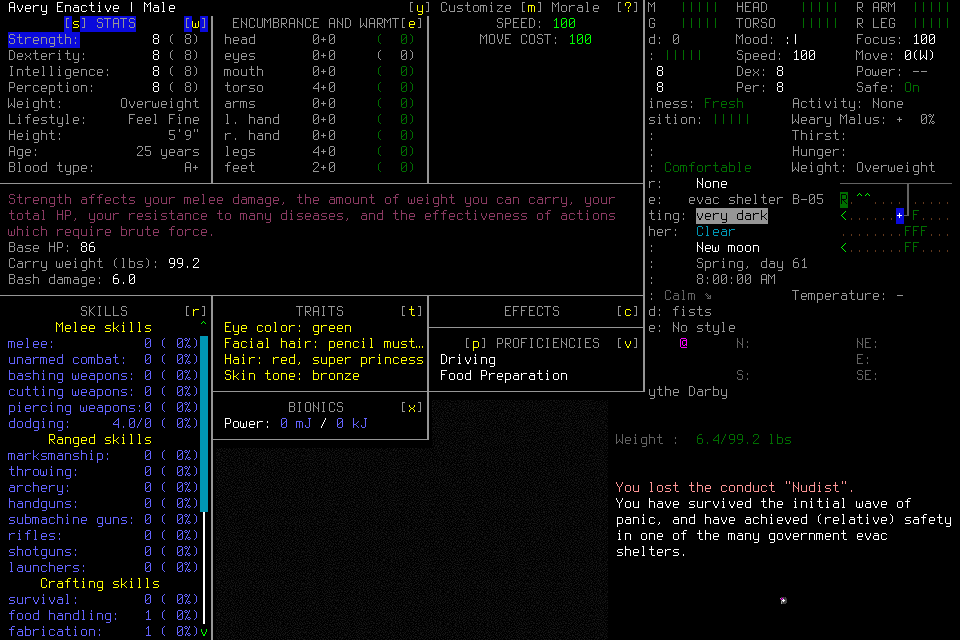
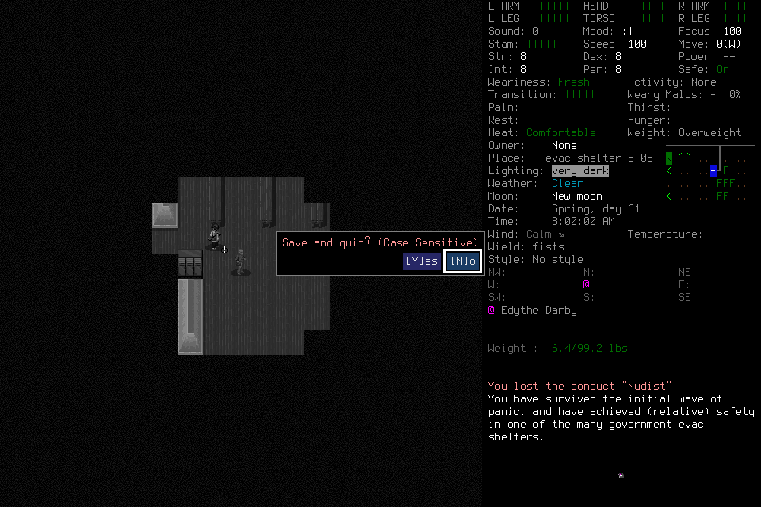

# Native confirmation correction qualification008

**The scoped engineering qualification passed.** A bad world question and a bad
Save question each returned blocked without input or phase renewal. New exact
questions then continued through normal creation, identity adoption, save, owned
exit and stopped Finish. This does not accept independent supply/shelter gameplay,
fresh-context succession or seven-day survival. [Independent001](2026-10-20-independent-mission-first-attempt.md)
remains failed; no later repair restores its phase or erases its costs.

Frozen source was `f4db8ae5603587327fdc1e4b813f9484e885b7ae`; unchanged native SHA256
was `cd031f200748cbbb387011335db15596346dac29607221fac25641ec9a771f1f`.
The local common gate passed 1145 tests in 310.288 seconds plus the other controls.
Exact [push CI](https://github.com/CVX-Hull/enactive/actions/runs/39481380624) passed,
but [PR CI](https://github.com/CVX-Hull/enactive/actions/runs/39481388818) failed a
synthetic clock-fault test. Thus this freeze did not satisfy deciding readiness.
Native behavior, portable checks and exact hosted acceptance remain separate lanes.

## Finite admission and actual operator

A fresh general-purpose operator alone sent game inputs. The lead owned frozen
source, service, admission and final verification. Explicit one-attempt limits
were 400 inputs, 3600 wall seconds, 43200 game-seconds, 2048 frames and 768 MiB;
50 inputs, 600 seconds, 128 frames and 128 MiB were protected for ending work.
Optional work stopped by 200 inputs/1800 seconds/1300 frames/384 MiB. The create
root allowed at most 256 inputs and 1200 seconds. No allowance transferred from
another attempt or renewed during this qualification.

Prepared native/windowed wrapper/userdir, clean committed source, empty runtime
slots, independent source/prospective review and two actual passive CLI calls
preceded admission. Passive calls succeeded in the default sandbox; the first
Start connection failed there before an admission response. After checking that
no mission was admitted, the operator used the existing explicitly authorized
`require_escalated` mode and the same immutable Start ID. Subsequent admitted
commands completed without an observed review rejection or user prompt. No rule,
global setting, provider or spending authorization changed. Passive access alone
had not established write-path mode readiness; future briefs must name the mode.
Exact underlying model/effort and review-delay timing were unexposed.

The operator normally created default Evacuee/Survivor Avery Enactive in Enactive
Qual Eight, preserving existing worlds. At the actual world confirmation it
deliberately supplied the wrong question with the adjacent legend. The blocked
request created no primitive, left input cost at 26, epoch at 0, and retained the
same checkpoint, lease and original create deadline. A **new** request copied only
`Are you SURE you're finished?`; full guarded exact-image refresh and one returned
Yes continued normally. No new consent or deadline was manufactured.

Creation's session-transition ACK remained unknown. Diagnostic Observe, typed
same-root transition reconciliation, a separately charged provisional Resume,
actual PLAYER_INFO and visible world/character Claims established normal adoption.
Historical interpretation alone granted no input authority.

At Save, another deliberately malformed question returned blocked with no
primitive, unchanged input cost 63/epoch 1, the same phase/lease and original Save
deadline. A new exact `Save and quit?` request continued. Its ACK remained unknown;
diagnostic menu evidence and the typed transition established SavedCheckpoint.

The owned normal menu exit retained a third unknown ACK and its original charge.
Exact published Yes, retained child exit 0 and correlated retirement produced
OwnedNormalExit. The normal Finish request then committed disposition **stopped**
with no completed objective Work. The lead separately verified its asynchronous
terminal receipt, no lease/phase/active operation and normal service exit 0. No
signals, exceptional cleanup, raw rescue, source/save edits or user keys occurred.

## Costs, closeout and limits

| Retained evidence | Result |
| --- | --- |
| Requests | 43, including two local blocked interpretations |
| Charged admissions | 67 = 64 returned + 3 unknown ACKs |
| Unreconciled effects | Zero; original unknown receipts stay unchanged |
| Archive | 165 verified PNG hashes; 4,696,397 bytes |
| Terminal ledger watermark | 517.490972757 wall seconds |
| Canonical game time | Zero seconds; no survival/rest claim |
| Normal ending | SavedCheckpoint, OwnedNormalExit code 0, stopped NormalFinish; service exit 0 |
| Reopen | Stopped historical evidence without authority; no game/listener/live slots |

Independent read-only audit reproduced ledger validation, exports, dispatch IDs,
all frame hashes, both correction lineages, adoption, save/exit/Finish, clocks and
process closeout. Fifteen inherited global unknowns remain separate. NormalFinish
relinquishes its completed adapter, so audit uses committed exit retirement/Finish
and the retained terminal sample rather than expecting a failed-run shutdown
custody event. Initial private audit/output/import mistakes were corrected without
game input or history changes. [The scoped result](assets/owned-character-qualification-008/result.json)
accompanies private immutable requests, original journal, ledger and frames.

For 64 returned setup/menu/identity inputs, retained preflight-to-terminal
intervals have median 77.91 ms, nearest-rank p95 141.60 ms and maximum 6393.12 ms.
The three unknown ACKs are excluded and remain recorded separately. These
intervals include host validation/persistence and native transport; they exclude
earlier observation, player/tool deliberation and browser presentation. The
517.49-second qualification includes deliberate checks and is not a normal-play
benchmark. The sample supports fast local input in this scope, not a controlled
speedup over Native007 or a representative end-to-end latency claim.

PR CI's first failure was `wall_age`: the fixture advanced a wall-clock sample
taken before the fake bridge captured its frame. A scheduling gap above 10 ms
could leave that actual frame younger than three seconds, making publication
valid. The next nine subcase failures cascaded from the retained lease. Independent
review confirmed the production post-callback freshness fence. The fixture repair
ages the actual observation timestamp by 3.01 seconds, preserving all assertions,
the three-second protection and existing timeouts. New common/exact hosted checks
are required; no blind CI retry or native failure relabeling follows from this.

This narrow engineering run exercised no meaningful supplies/rest, movement,
reload, outcome correction or actual successor. [Native007](2026-10-20-native-lifecycle-qualified.md)
retains its separate unchanged-path evidence. Model/tool/display latency and
settled skill timing remain unmeasured; total setup wall time is not engine speed.
#154 owns staged timing and history-growth profiling; #143 owns terminal display
clarity. The actual stopped viewer retained a stale final question alongside its
stopped mission panel; it must not be interpreted as a running game.

Next: coherent test/report checkpoint and exact hosted checks, then #156's new
finite actual-player readiness before a genuinely fresh #157/#144 independent
mission. #145 still needs actual mission evidence for its bounded seven-day plan
or concrete owned blockers. No optional curator/tier/provider/training gate or new
seven-day gameplay authority is created by this qualification.
