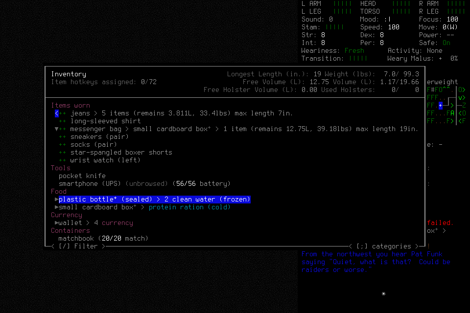
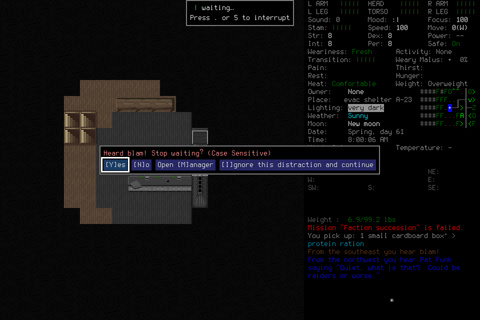

# Independent mission005: stopped at a distraction question

The player normally created/adopted Morgan Enactive, found food and completed four
purposeful navigation steps with a direction change. A sound interrupted its
30-minute shelter wait. The semantic layer rejected the actual distraction
question before sending an answer. The player autonomously issued Stop and
permanently quiesced. The full independent mission failed.

[Public result and image provenance](assets/independent-supply-shelter-005/result.json)
retain bounded costs and explicit unknowns. [#144](https://github.com/CVX-Hull/enactive/issues/144)
owns delivery; [#167](https://github.com/CVX-Hull/enactive/issues/167) owns the
concrete dialog correction. This report grants no resumption or new allowance.

The frozen source was `3cd70710b22df737f66d201fc22455147839f8aa`, native SHA256
`cd031f200748cbbb387011335db15596346dac29607221fac25641ec9a771f1f`;
mission/7, campaign-memory/3, ledger9 and native wire4. Both exact
[PR](https://github.com/CVX-Hull/enactive/actions/runs/39517945349) and
[push](https://github.com/CVX-Hull/enactive/actions/runs/39517940333) CI passed before
admission. Source stayed unchanged during deciding play. One immutable admission
allowed1600inputs/3wall hours/12game hours with a100input/15wall-minute cleanup
reserve. All earlier failed attempts remain retained independently.

## Actual outcome

The visible identity screen confirms Morgan and attributes8. Creation used the
ordinary admitted Evacuee/Survivor setup and random location. A creation-confirmation
ACK timed out; the player retained it, observed the expected transition, explicitly
reconciled its effect and separately readmitted for visible identity/adoption.
The original ACK remains unknown. No key was replayed.

The player moved `[0,0]→[0,1]→[0,2]→[1,2]→[2,2]` for a cupboard supply search,
picked one protein-ration box and verified it in inventory. The bottle showed
**two units of clean water (frozen)**; millilitres were unverified. That does not
accept the500mL retained-water target. The observed shelter and selected wait do
not establish30minutes of rest. Consumption, genuine correction, fresh successor,
normal save/new-child exact reload and normal final ending remain unfulfilled.

The wait returned `Heard blam! Stop waiting?` at
`CANCEL_ACTIVITY_OR_IGNORE_QUERY`, a native menu with registered YES/NO/MANAGER/
IGNORE. The player chose Yes to cancel and reassess shelter safety. Its typed
child was blocked with zero proposals: `Prompt category does not match the
interpreted control`. Native already owned this exact query; semantic confirmation
incorrectly required only `YESNO`. The
[bounded correction](../changes/052-distraction-confirmation.md) reuses existing
native actions and source/phase checks. Source regressions are separate from a
future real mission; no repair turns this stopped attempt into success.

## Tools, timing and cleanup

The actual player used the fifteen project-preapproved MCP tools for observations,
semantic operations, result/image presentation and supported memory. Bootstrap
checks included owned launch/create, semantic menu/text edits, original-result
lookup and an accepted evidence-linked memory write. Local invalid memory/control
drafts remain retained; no primitive was dispatched by the blocked answer.
The actor and root transcripts reported zero visible routine human or automatic
approval-review events. Invisible host review telemetry is unavailable. Engineering
setup, tests, publication and exceptional cleanup are separate activities; neither
a successful call nor missing prompt alone proves a universal no-review guarantee.
The actual fresh-successor and normal lifecycle paths still need verification.

The closed ledger contains72terminal requests,107charged inputs(106returned/one
original unknown with reconciled effect),276verified original PNGs/14,050,829bytes,
and six observed canonical game-seconds. Wall time was499.460273seconds through
the stopped-owner watermark and590.321665seconds through shutdown verification.
Returned native preflight-to-ACK intervals had median92.16ms,p95370.58ms and
maximum6937.44ms; their sum was23.231381seconds. The unknown timeout is excluded.
These are not full skill, model, tool, reviewer or display latency measurements.

All four credited navigation requests were single-step goals; a fifth navigation
request was blocked. This demonstrates guarded target operations, **not batching
or a gameplay speedup**. Future players should choose meaningful bounded targets
when evidence supports them, keeping per-step checks in software. #138/#143/#164
own that follow-through and honest whole-workflow measurement.

After registered Stop, the sole player declared every tool terminal and no
queued/scheduled input. The lead verified revoked lease/phases, native Pause and
empty bridge slots, then sent one separately scoped SIGTERM to the exact owned
child and closed its controller. Custody recorded child exit0 with
`normal_exit_verified:false`; service exit0, exact-process/listener absence and
empty slots were checked. No save or evidence file was edited/deleted. Unsaved
in-memory progress preservation remains unknown. No ordinary user/lead gameplay
rescue, normal Save/Quit/Finish, fresh successor or full objective success is claimed.

Closure was checked from read-only SQLite, retained transcripts and all276frame
hashes; selected original pixels were inspected. Queue quiescence and signal count
also rely on the retained actor/lead declarations. Reopened files restore no lease.
The goal remains the complete new independent mission and #145's evidence-backed
seven-day readiness decision, not a smaller rest/dialog qualification.
