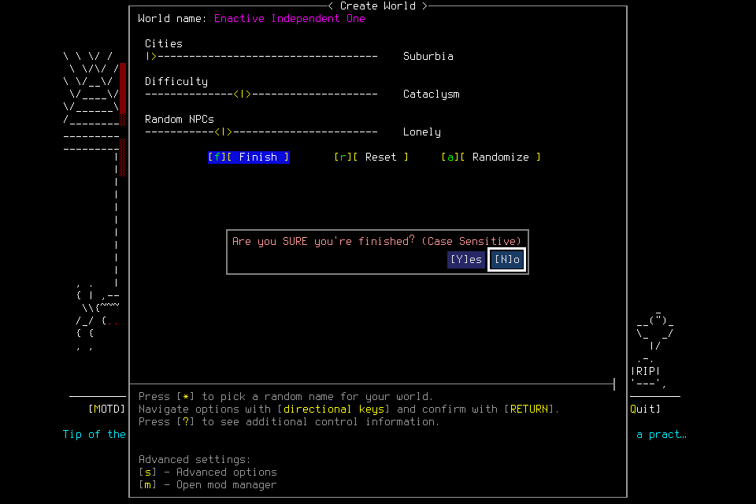
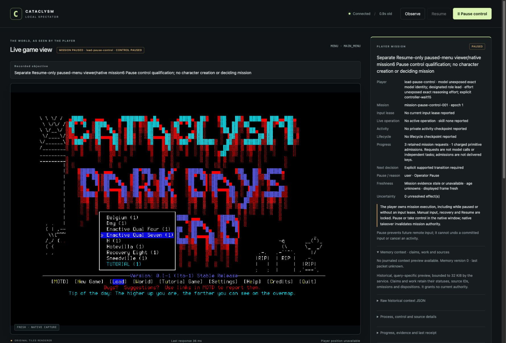

# Independent mission first attempt

**Deciding001 failed before world creation.** A separate control qualification
passed actual spectator Pause, authority revocation and stale-request rejection.
Neither result accepts independent supplies, shelter, memory succession or normal
mission finish. Both owned runtimes are closed. The failed attempt cannot resume
or become a successful attempt through a later source repair.

Both used frozen source `32f61477c9e8799bb98aa1ecf167b3a13e56aaf9` and native SHA256
`cd031f200748cbbb387011335db15596346dac29607221fac25641ec9a771f1f`.
Its common gate passed 1129 tests in 288.389 seconds plus the other controls;
exact hosted [push](https://github.com/CVX-Hull/enactive/actions/runs/39474424459)
and [PR](https://github.com/CVX-Hull/enactive/actions/runs/39474429979) lanes passed.
These checks precede, and do not override, actual native outcomes.

## Actual deciding player

A clean-context general-purpose player owned plans and ordinary input. Its two
literal passive CLI checks succeeded against the fresh service without prompts.
The frozen admission allowed 1600 inputs, 10800 wall seconds, 43200 game-seconds,
4096 frames and 1 GiB, protecting 100 inputs, 900 seconds, 256 frames and 128 MiB
for ending work. The default role had no explicit model override; exact underlying
model and effort were unexposed. No paid provider was added.

The scenario admitted ordinary default Evacuee/Survivor creation of Morgan Enactive
in Enactive Independent One. Meaningful water/food, travel/replanning, shelter and
at least 30 minutes of rest assessment, corrections/unfinished Work, a genuine
fresh-context successor and normal save/restart/final shutdown were required.
None of these gameplay objectives was reached.

The player recovered from its own bounded name-editor partial result by cancelling
the uncommitted editor, reopening it and entering the admitted name. This was a
setup recovery, not meaningful gameplay replanning. At world FINALIZE, it supplied
`Are you SURE you are finished? (Case Sensitive)` as the interpreted question.
The actual base question was `Are you SURE you're finished?`; the parenthesized
text was a separate displayed legend. Exact validation rejected before Yes input.
The frozen implementation treated that local request error as a stopped lifecycle
and revoked its phase and lease. General cancellation at this setup boundary was
unsupported. No world commit, character, adoption or normal gameplay followed.

The actor stopped quiescent without replay, engineering tactics or user keys.
A separately reviewed exceptional teardown verified the exact owned child,
parent, wrapper/userdir, paused unloaded YESNO boundary and empty live slots before
one SIGTERM. The retained child handle and service exited 0. The journal explicitly
records `normal_exit_verified:false`; an exit code is not a NormalExit or Finish.
No game, listener or live input slot remained. Reopened history was paused without
authority. No source or save was patched during the attempt.

| Retained deciding evidence | Result |
| --- | --- |
| Semantic requests | 18 |
| Charged inputs | 70 returned; zero unknown or unreconciled effects |
| Frames | 156 verified PNG hashes; 2,703,485 bytes |
| Stopped-owner ledger watermark | 188.201132774 wall seconds |
| Canonical game time | Unknown; no adopted character |
| Lifecycle / objectives | No adoption, successor, NormalExit, Finish or gameplay objective |
| Exceptional failed-run cleanup | One exact-child signal; child and service exit 0 |

Independent read-only audit matched exports, SQLite validation, all 70 dispatch
IDs, frame hashes, failed question and teardown custody. The 15 inherited global
unknowns belong to older runs and are not these 70 returned inputs. Wall time and
request counts do not measure model calls, engine throughput or player speed.

## Separate Pause control

Before deciding001, an explicitly separate unloaded-menu test admitted 16 inputs,
600 wall seconds, 60 game-seconds, 128 frames and 96 MiB, with protected cleanup
capacity. One returned create-root Resume established a live lifecycle phase and
lease. Clicking the actual spectator Pause button advanced epoch 0 to 1, revoked
that phase and lease, and left the native menu paused. A staged old-epoch request
was rejected with CLI exit 1 and sent no further input.

Its own declared exceptional unloaded-menu teardown used one exact-child signal;
child and service exited 0, with no normal-exit or finish claim. Two private
pre-signal guards first looked for a nonexistent turn field and failed before any
signal. The corrected guard checked the actual unloaded boundary. This test
retains one returned input, zero unknowns/unreconciled effects, five verified PNGs
and 163,145 bytes. Independent audit accepted only this scope. It did not test
in-flight cancellation, long activity interruption or post-Pause resumption.

## Repair and next acceptance

The subsequent source repair distinguishes a malformed local question from world
uncertainty. It returns blocked without dispatch, refresh, rotation, new consent or
deadline renewal, preserving the original phase for a new corrected request.
That request must still pass all original actor, Pause, source, pixels and budget
checks. Spare-points stage installation moves after full interpretation validation.
Wrong source, changed pixels, expiry, Pause and unknown delivery remain stops.
Synthetic regressions and independent review are separate from the required new
scoped native correction proof. They cannot repair deciding001 retroactively.

Budget tests also corrected an initial inference: normal actions checked game
time, while registered lifecycle dispatch could bypass that check. The repair
enforces the selected cap across input lanes and revokes authority after rejected
dispatch settles. Its software maximum becomes eight days, with the 12-hour
default unchanged. Seven-day survival needs prospectively selected closeout
headroom; there is no cleanup exemption or extension of an existing admission.
Synthetic boundary turns do not prove native seven-day survival.

The [scoped result](assets/independent-supply-shelter-001/result.json) accompanies
retained private requests, journal, ledger and frames. #155/#159 own correction;
#156 requires a new reviewed finite freeze before a genuinely fresh #157/#144
player/successor attempt. #145 still needs actual mission results for a finite
seven-day plan or concrete owned blockers. [Native007](2026-10-20-native-lifecycle-qualified.md)
remains engineering evidence, not independent acceptance. Research/control
maintenance dates remain October 24, 2026 and January 15, 2027.
