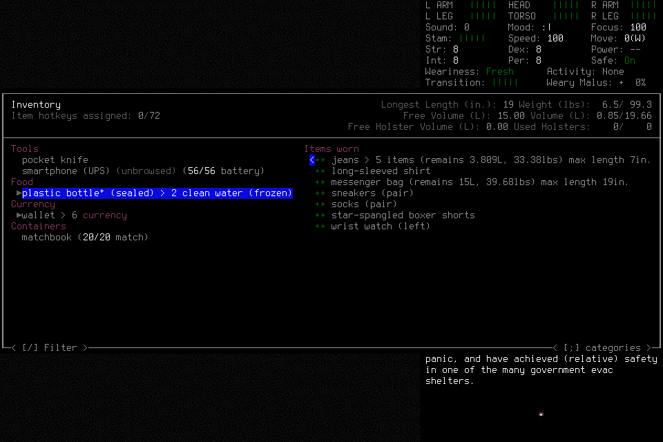

# Independent mission second attempt

**Deciding002 failed after ordinary creation/adoption and initial inventory
inspection.** The player supplied a copied old boundary ID in a bottle-details
request. The request was blocked before activation; generic failure handling then
revoked its inventory phase. No eligible registered normal save/exit remained.
The player stopped without lead/user gameplay assistance or a source repair.
This attempt is closed and cannot resume or become a passing mission through a
later correction. [The first attempt](2026-10-20-independent-mission-first-attempt.md)
and its separate Pause qualification retain their original outcomes.

## Admission and actual progress

Frozen source was `cd55bcdf726bc8d910342d3e621b94b301bb977a`; installed native SHA256
was `cd031f200748cbbb387011335db15596346dac29607221fac25641ec9a771f1f`. Common
controls passed 1,145 tests in 309.159 seconds, and both exact hosted lanes passed:
[PR](https://github.com/CVX-Hull/enactive/actions/runs/39484861135) and
[push](https://github.com/CVX-Hull/enactive/actions/runs/39484854815). Independent
review verified source/native linkage, the actual actor's two passive CLI access
checks, immutable admission and finite limits. [Native008](2026-10-20-confirmation-correction.md)
and Native007 retain scoped engineering evidence; they did not accept this mission.

One fresh general-purpose player owned ordinary UI decisions under mission/6.
The lead owned admission/runtime, passive observation, verification and publication.
Limits were 1,600 inputs, 10,800 wall seconds, 43,200 game-seconds, 4,096 frames and
1 GiB; protected ending reserves were 100 inputs, 900 wall seconds, 256 frames and
128 MiB. Lower root/child limits and the predeclared optional-objective stop points
remained in force. No previous attempt's allowance or current-world facts transferred.

Quinn Enactive was normally created in Enactive Independent Two using default
Evacuee/Survivor/random-location choices. The creation confirmation's original
unknown ACK remained unknown: later observation, typed transition reconciliation,
separate identity-only readmission, visible identity inspection and direct Claims
supported normal adoption. No confirmation replay or hidden/save editing occurred.
Initial inventory interpretation noted two frozen clean-water units, with usable
liquid volume unverified. No meaningful food/water acquisition is credited.

## Failure and nondelivery

After a returned two-arrow inventory focus batch, the player cited the correct
immutable revision-102 source but supplied its older boundary suffix `b25`.
Both that source and its later equivalent refresh recorded `b27`. The control's
source check rejected the inconsistency before producing an activation proposal.
The ledger contains **zero primitives for the bottle-details request**. Its blocked
result remains immutable; there was no blind retry, manual key, permission failure
or unknown activation to reconcile.

The ordinary request error propagated through stale-source revalidation as an
EvidenceError, triggering the generic stop. Epoch advanced to 2; lease, prompt and
lifecycle phases were revoked. The adopted character remained at paused INVENTORY
with no SavedCheckpoint. The player independently found no eligible registered
normal cleanup, settled its tools and became quiescent. A separate source/ledger
review confirmed that classification before exceptional teardown.

## Closed outcome and costs

| Retained measurement | Result |
| --- | ---: |
| Mission requests | 42 |
| Charged primitive admissions | 74 |
| Returned / original unknown ACKs | 73 / 1 |
| Unreconciled effects | 0 |
| Verified PNG frames / bytes | 182 / 4,921,007 |
| Wall seconds through stopped-owner watermark | 627.2023 |
| Canonical elapsed game-seconds | 0 |
| Exact owned-child / controller exit codes | 0 / 0 |
| Exceptional failed-run teardowns / signals to game | 1 / 1 |

One separately declared, finite cleanup reverified exact retained child, parent,
launch identity, prepared resources/userdir, paused inventory, player/tool quiescence
and empty request/control slots. It sent one exact-child SIGTERM, then normally
closed the owned controller. The retained handle verified exit 0 with
`normal_exit_verified=false`. No owned game, listener or live slot remained. Existing
project files were preserved; **normal saving and preservation of in-memory progress
are unproven**. This is neither NormalExit nor NormalFinish nor gameplay rescue.

Reopening the ledger/evidence verified original costs, all 182 frame hashes and
historical state without restored input authority. Eighteen prior global unknown
records remain separate from this mission's one unchanged unknown ACK. The wall
span includes creation, interpretation and tool work; it is not engine or model
latency. External model, tool, approval and display timing remain unmeasured.
One earlier failed bottle-focus CLI call lost its original error text; retained
same-ID lookup showed no admitted request. This evidence limitation is not filled in.

Meaningful supplies/navigation/rest, actual correction/replanning, fresh-context
successor, normal save/new-process reload and final normal Finish remain unmet.
[Result and figure provenance](assets/independent-supply-shelter-002/result.json)
retain this scope. [#160](https://github.com/CVX-Hull/enactive/issues/160) owns
pre-execution request consistency validation and safer opaque-field construction
through existing JSON tooling. Changed source needs reviewed checks and separately
finite qualification before a genuinely new deciding admission. #144/#145/#136
remain open; no seven-day authority follows from this report.

Independent read-only review verified ledger/adoption/custody projections, all
182 PNG hashes, public figure bytes/provenance, privacy and the reported limits.
It accepted this closeout as failed-attempt evidence only.
