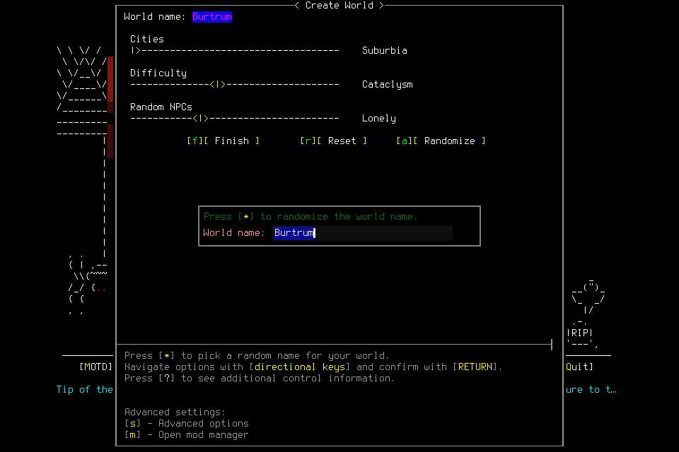

# Independent mission007: editor source expired before dispatch

The player reached the world-name editor, then autonomously Stopped after a
freshness failure. `TEXT.CLEAR` was proposed but never dispatched: no native
request UUID or publication was created. The semantic request remains unknown;
all eight charged native primitives returned. No admitted world Enactive Mission
Seven or character Devon Enactive was finalized. The full independent mission failed.

[Result and original-image provenance](assets/independent-supply-shelter-007/result.json)
retain 13 terminal requests, eight returned charges, one unknown **semantic
request**, zero unknown native primitives/unreconciled effects and 26 hash-verified
original PNGs totaling 708,886 bytes. Game seconds are unknown because no normal
identity/time anchor existed. Wall time was 112.674382 seconds through Stop
admission and 208.432693 seconds through the shutdown watermark. Model usage,
whole-skill/tool/display latency and hidden host review telemetry are unavailable.

The source/native/contracts and both passed CI runs were exactly those in
[mission006](2026-10-20-independent-mission-sixth-attempt.md). No source changed
during deciding play. Global limits/reserves were unchanged. Creation prospectively
allocated 256 primitives, 1,800 wall seconds and 3,600 game seconds to the entire
root, including Resume and all children. This corrected the prior allocation
procedure without importing old game facts or promoting general lessons online.
The player verified the actual fifteen-tool catalogue and two harmless snapshots;
routine gameplay showed zero visible human or automatic approval-review events.

The selected source was approximately 2.97 seconds old at request admission.
The lifecycle control path skipped refresh because it was still fresh, then the
later preflight reported stale evidence with no revalidation relation. The ledger
alone does not recover the precise monotonic interleaving. A deterministic
regression against the original implementation reproduces a source crossing the
three-second limit between entry and dispatch. [The repair](../changes/053-operation-entry-refresh.md)
reuses existing Observe and typed equivalence before the first proposal for all
analogous entry paths, preserving final freshness and original authority/limits.
[#168](https://github.com/CVX-Hull/enactive/issues/168) owns verification within a
new full mission; source tests do not accept native gameplay.

Unsupported draft shapes were locally refused without input. The player also
mistakenly parsed one plaintext local refusal as JSON, queried the absent original
operation, then used a new valid request. These observations do not prove a retry
of uncertain native input. After the actual failure, the runtime revoked the
phase/lease; supported editor-phase readmission was unavailable. The player did
not replay or ask for tactical rescue and permanently quiesced after Stop.

Cleanup had an engineering ordering defect. The lead checked stopped ownership,
exact child PID/parent/birth/cwd and empty slots, then sent one exceptional SIGTERM
to child 64621. The immediate sample still showed it running, but the controller
was closed before termination was verified. Shutdown custody therefore records
`running:true`, exit code **unknown**, `normal_exit_verified:false`; service exit
was 0. Later exact OS checks verified child/controller/listener and slots absent.
No additional signals or save/evidence deletion occurred. Later absence does not
prove normal exit or an exit code. Future cleanup must retain the controller and
original child handle until actual termination is verified.

No supplies, needs, rest, memory correction, fresh-model successor, normal
save/new-child reload/final Finish or ordinary lead gameplay rescue is accepted.
All previous failures and costs remain; this attempt never resumes.
