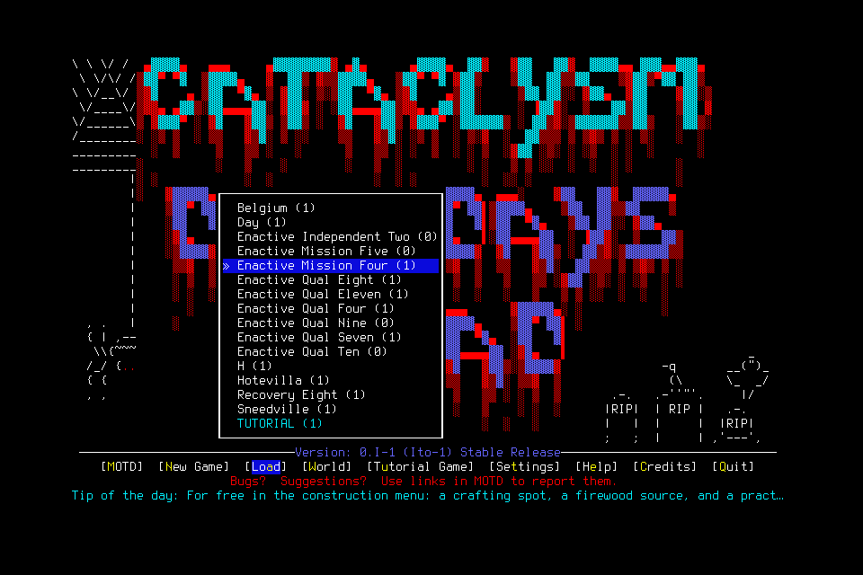

# Independent mission006: creation phase exhausted by Resume

The designated player assigned one primitive to the entire creation phase.
Resume consumed it. The next menu proposal was refused before dispatch because
its parent phase had no remaining inputs, even though the child requested four.
The player autonomously Stopped and permanently quiesced. Neither the admitted
world Enactive Mission Six nor Skyler Enactive was created. The full mission failed.

[Result and original-image provenance](assets/independent-supply-shelter-006/result.json)
retain six terminal requests, one charged/returned native primitive, no unknown
native delivery or unreconciled effect, and six hash-verified original PNGs totaling
192,804 bytes. Game time is **unknown**, since no adopted identity/time anchor
existed. Wall time was 34.442971 seconds through Stop admission and 126.032861
seconds through the shutdown watermark. Model usage and whole-workflow latency
were not measured.

The exact reviewed source was `ed92a911e4f47ef2625b5ace8fe73be4aa721a66`, native
SHA256 `cd031f200748cbbb387011335db15596346dac29607221fac25641ec9a771f1f`, using
mission/7, campaign-memory/3, ledger9 and native wire4. Both exact
[PR](https://github.com/CVX-Hull/enactive/actions/runs/39522900227) and
[push](https://github.com/CVX-Hull/enactive/actions/runs/39522893218) CI passed.
Source stayed unchanged during play. Global limits were 1,600 inputs, 10,800 wall
seconds, 43,200 game seconds, 4,096 frames/1 GiB, 4,096 requests and 8,192 mappings;
cleanup reserved 100 inputs, 900 wall seconds and 256 frames/128 MiB.

This is an operator allocation failure with the resource guard working as designed.
Root limits include Resume and every child; a child cannot renew them. A subsequent
attempt must prospectively budget the whole phase. #164/#143 own clearer guidance
and existing-ledger visibility; this does not require another budget service or
per-action reviewer. No previous allowance transfers or retroactively expands.

The actual fresh player verified the fifteen preapproved tools and two live passive
snapshots. Routine calls showed no human or automatic review events; invisible
host telemetry is unavailable. Normal lifecycle and fresh-successor execution were
not reached. Engineering setup, publication and exceptional cleanup are separate.

After registered Stop, the sole player declared all handles terminal and no queued
or scheduled input. The lead verified Pause/revoked authority, exact PID/parent/
process identity and empty bridge slots, sent one exceptional SIGTERM to child
22578, and verified child termination before closing the controller. Custody
recorded exit code 0 but `normal_exit_verified:false`; service exit 0 and exact
process/listener/slot absence were checked. No save/evidence file was edited or
deleted. No normal Save/Quit/Finish, memory continuity, supplies/rest or ordinary
user/lead gameplay rescue is claimed. The attempt never resumes.
