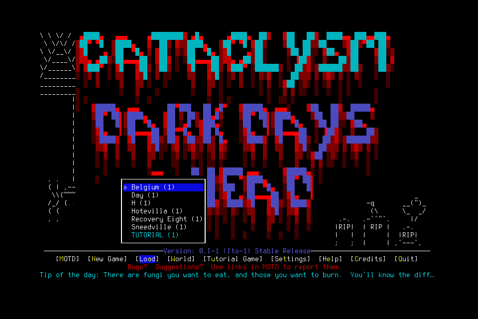
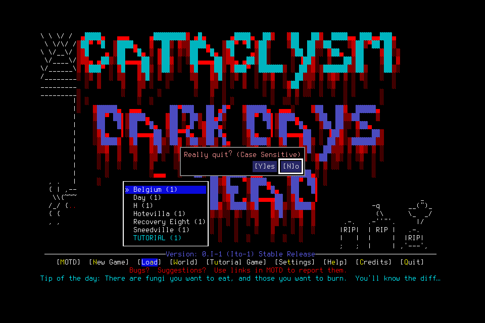

# Native lifecycle qualification stopped at stale evidence

Qualification001 **failed before character creation** at source
bcf11b7eeb26328569a93a9553b161b20b74c547 and unchanged native4 SHA
c65778e2912230f34b67340a4f2caacd0d5874af24ab964526c436bd686f7720.
Normal owned-menu cleanup and stopped Finish succeeded. This is not character
lifecycle, memory, independent mission or seven-day acceptance. #155/#154 own the
source repairs; #156 owns a separately prospective native retest. [#144](https://github.com/CVX-Hull/enactive/issues/144)
owns the integrated sequence and exact source/CI publication.

## Frozen engineering attempt and observed failure

The lead operated one windowed engineering qualification, separate from the
deciding player. The prepared project wrapper and explicit userdir, native hash,
clean checkout, empty slots and absence of another game/listener passed preflight.
Source had1077 common Python tests and both exact-head CI lanes passed. A fresh
general-purpose agent twice ran the passive literal CLI status command successfully
without a user permission prompt; neither call granted input or proved handoff.

The finite admission was800inputs/7200wallseconds/43200game-seconds/4096frames/1GiB,
with100inputs/900seconds/256frames/128MiB protected reserve. Review found that
normal save/exit inputs still use ordinary limits. The proposal therefore stopped
qualification work early enough to leave200ordinary inputs/1800seconds/1040frames/
256MiB for normal cleanup. It did not promise an unsupported reserve-input escape.
No old allowance, failure, save or admission was renewed or transferred.

Owned launch returned a real paused MAIN_MENU. Creation's Resume used the original
27.76second-old informing source. Although native preflight observed the menu,
retention against the stale checkpoint failed before primitive admission. There
were zero charged primitives at that failure and no world or character creation.

## Normal cleanup, separate from qualification

Read-only Observe refreshed the same owned menu. Registered cleanup charged
Resume and Quit separately and returned Really quit? The first interpreted Yes
used a3.739second-old source and stopped with zero proposals, sending no input.
An exact-image Observe and a new explicit Yes through the existing CLI completed
normal exit. A bounded one-off helper kept that refresh and already-decided Yes
together; it introduced no executor, retry of unknown input or source change.
This workaround is failure evidence, not acceptable routine player orchestration.

The exact original child exited at0. Native request
986b19c1-40c1-4d83-bd18-d66c4dcc0b40 still has an **unknown ACK**; a separate typed
OwnedNormalExit resolves its effect without rewriting delivery. NormalFinish is
**stopped**, with no objective-completion claim. Source stayed frozen; no raw
rescue, signal, save edit, user key or manual unlock was needed. Native app
automation was unavailable, while engine observations and registered cleanup worked.

| Retained scope | Inputs | Wall seconds | Frames / PNG bytes |
| --- | ---: | ---: | ---: |
| Through stopped Finish |3|364.984962|10 /331622|
| Including later reopen verification |3|426.067757|same retained frames|

The additional61.082795seconds are verification, not another execution or model
inference measurement. Charges are Resume returned, Quit returned and Yes unknown.
Game time has no anchor; model/tool usage and external tokens remain unmeasured.
Normal service close followed child exit. OS/slot checks found no game,8766listener
or live inbox. Current-version reopen retained stopped phase, costs and proof,
restoring no lease, phase or process authority. Independent read-only review checked
SQLite, original journals, native pixels/hashes and the separate exit/ACK evidence.
[Sanitized proof, limits, costs and asset hashes](assets/owned-character-qualification-001/result.json).

## Following source correction and limits

Four real-aged temporary-bridge regressions failed the original source: initial
Resume, explicit creation-stage commit, normal save and owned exit confirmation. The repair
reuses guarded exact-checkpoint refresh before lifecycle Resume and exact-PNG
revalidation before explicit stage commit, save, identity inspection and owned exit
confirmation. Save retains its original normal-game time anchor. Lifecycle refresh also carries the
original child's absolute deadline. Persisted exit validation follows the existing
typed revalidation from immutable interpretation to dispatched source, including
orphan proof and reopen checks; it does not accept a weaker native-state substitute.
There is no TTL relaxation, faster-model assumption, new schema, compatibility
reader, native patch or additional executor/store.

Source checks cover aged success, changed pixels, user Pause during refresh,
expired roots, original child deadlines, unchanged unknown ACKs and altered proof.
Portable repair/review/common CI remain distinct from a new native retest. This
failed admission is not repaired retrospectively. Actual character creation,
save/restart/exact reload, selected item/activity outcomes, clean-context memory
use and the independent mission remain open under their original acceptance scope.

## Portable control maintenance, separate from native acceptance

Two later local1090-test runs and their PR checks passed, while separate push
checks exposed fixture timing defects: [ead8ac9 push](https://github.com/CVX-Hull/enactive/actions/runs/39437020947)
measured177ms against an existing150ms Pause proxy; [fcf6cea push](https://github.com/CVX-Hull/enactive/actions/runs/39439412837)
failed to reach an activity claim within its100ms deadline. These failures remain
retained. Neither is a new native result or proof of an inspected production fault.

The Pause regression now holds the actual exchange and requires HTTP Pause to
revoke control before release. The activity regression reaches an actual held
claim, then advances only the controller's monotonic clock past the original
deadline; real watchdog/thread clocks remain unchanged. Independent negative
controls deliberately serialize Pause or renew the deadline and correctly fail.
An80ms delayed-publication probe also reproduced a60ms unknown-ACK fixture failure
before input existed. That functional identity/no-replay test uses its existing
ordinary timeout, with explicit short expiry tested separately. No production
deadline, Pause fence, receipt, unknown replay rule or native binary was changed.
The corrected761f183 checkpoint passed its common gate and both exact hosted lanes.
The [later qualification002](2026-10-20-native-capture-churn.md) records its separately
reviewed sequencing, new native failures and exceptional cleanup. C-PORTABLE's
triggered maintenance records partial effectiveness; January15 and October24
review dates are unchanged.
