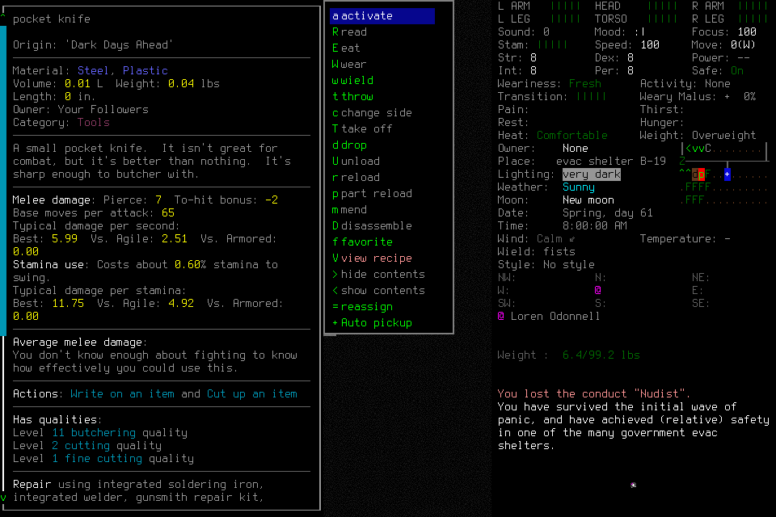

# Native010: correction exercised, normal ending failed

**The narrow request-correction probe worked; the qualification failed its required
normal ending.** A fresh corrected request opened real pocket-knife details after
a malformed boundary request sent no input and retained its original phase. The
next dismissal needed `UILIST.QUIT`; the semantic control selected `QUIT` and
blocked without input. The operator stopped. Native010 is closed and cannot resume
or become a passing qualification through a later repair. Independent mission
acceptance remains open.

## Source and scope

Source was `63da3a27c7b83dab93b5d973798bcded9f43f920`; prepared native SHA256 remained
`cd031f200748cbbb387011335db15596346dac29607221fac25641ec9a771f1f`. Independent
source review, all 1,178 common tests in 331.572 seconds, viewer/document/diagram/
governance checks and both exact hosted lanes passed before admission:
[PR](https://github.com/CVX-Hull/enactive/actions/runs/39499439624),
[push](https://github.com/CVX-Hull/enactive/actions/runs/39499432487).

One fresh general-purpose engineering operator passed two passive literal CLI
access calls. Admitted typed calls used the same authorized execution mode with no
observed approval prompt or denial. Exact model/effort and external usage were
unexposed; no provider spending or global setup occurred. Ordinary skill/lifecycle
requests used the pure canonical producer; only the declared fault changed one
opaque field. Local malformed semantic drafts and three earlier zero-input blocks
remain in the record. The producer does not choose or validate player intent.

One attempt allowed 400 inputs, 3,600 wall seconds, 43,200 game-seconds, 2,048
frames and 768 MiB, with protected reserves of 50 inputs, 600 seconds, 128 frames
and 128 MiB. Smaller root/child limits and optional-proof cutoffs remained in
force. No earlier allowance, world facts or authority transferred.

## What actually happened

Enactive Qual Ten / Casey Enactive was created normally with default Evacuee,
Survivor and random-location choices. The final character Yes had an unknown ACK;
it was never replayed. Diagnostic observation, same-root transition reconciliation,
separate identity-only readmission, direct-root visible identity inspection/Claims
and normal adoption succeeded. Its original charge and unknown receipt remain.

The declared inventory fault changed only `expected_boundary_id` on a retained
canonical base. The immutable result was plain blocked with zero primitives or
refresh. Before/after archive bytes were identical; retained prompt checkpoint,
epoch, lease, original root/mission deadlines and primitive/frame/byte counts
matched. Request count and elapsed time were still spent. Public `current_source`
availability became null; this is **not** a claim that every public field remained
unchanged or that freshness was certified. The retained checkpoint/source remained
the explicit context for correction.

A newly composed corrected request differed from the canonical base only in its
new request ID. It selected the same source/root and original limits, passed normal
guards and exact-PNG refresh, and delivered one returned `CONFIRM`. Actual visible
details showed the pocket knife, Steel/Plastic, 0.01 L, 0.04 lbs and qualities.
The old malformed result remained blocked afterward.

Dismissal then blocked with zero primitives: current native category `UILIST`
registered `UILIST.QUIT`, while the semantic mapping requested generic `QUIT`.
The operator used no raw key, alternate transport, source patch or user/lead
gameplay rescue. Typed Stop completed and revoked its phase/lease. No normal save,
owned normal exit or Finish was produced.

## Closed result and measurement limits

| Retained measurement | Result |
| --- | ---: |
| Mission requests / charged primitives | 42 / 67 |
| Returned / original unknown ACKs | 66 / 1 |
| Unreconciled effects | 0 |
| Verified PNGs / bytes | 168 / 4,551,887 |
| Seconds through stopped-owner watermark | 529.1006 |
| Seconds through process-shutdown verification | 702.8140 |
| Canonical game-seconds | 0 |
| Retained child / controller exit codes | 0 / 0 |
| Exceptional teardown / signals to game | 1 / 1 |

Independent read-only review found no eligible registered normal cleanup after
Stop. A separately declared teardown freshly verified the exact owned child,
parent, launch/start time, prepared Resources cwd/userdir, paused state, quiescence
and empty slots. One exact-child SIGTERM produced a zombie; only then did the lead
close the retained controller. Its handle recorded exit 0 with
`normal_exit_verified=false`. Both exact processes, listener and slots were absent
afterward. Existing world/save files were preserved; normal saving and preservation
of in-memory progress are unproven. Reopening retained costs/evidence without
restoring authority. Twenty prior current-bridge unknowns remain separate.

The 66 returned setup/identity/inventory preflight-to-ACK intervals had median
83.44 ms, nearest-rank p95 121.60 ms, maximum 6,412.52 ms and sum 11.78 seconds.
The one unknown is excluded. These are neither a controlled performance comparison
nor movement, model/tool/approval, whole-skill or available-frame-to-display timing.
The remaining wall span has no measured causal allocation. The observer's “Last
response” label uses the controller's native exchange clock; its clarification is
tracked in existing viewer work, not accepted as a display-latency measurement.

[Result and figure provenance](assets/owned-character-qualification-010/result.json)
retain this failed scope. The next repair must translate supported dismissal to
the actual registered context action, preserve one-input/partial/no-implicit-answer
behavior, migrate stale fixtures and receive a new finite native qualification.
It does not justify another executor, compatibility path, permission change or
revival of Native010. No independent mission or seven-day authority follows.
