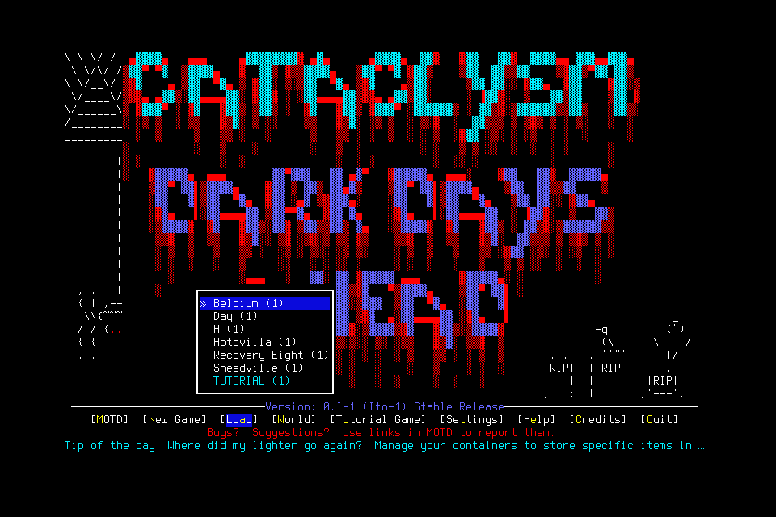

# Passive captures exposed two lifecycle defects

Native character qualification002 **failed** at source
761f1837cc9788f2f1274008c11bab6ed9236355, with unchanged native4 SHA
c65778e2912230f34b67340a4f2caacd0d5874af24ab964526c436bd686f7720.
One guarded Resume returned; the first menu skill stopped before any menu input.
No world or character was created. Normal cleanup was unavailable and one separate
exceptional teardown was required. This accepts no character lifecycle,
independent mission, memory efficacy or normal shutdown.

## Actual engineering attempt

The lead operated a windowed qualification, separately from the deciding player.
The fixed project wrapper/userdir, native hash, clean committed source, empty slots
and absence of another game/listener passed preflight. The common gate passed1090
Python tests, viewer checks, Ruff, four boundaries, documentation/governance and
diagrams. A general-purpose agent twice used the literal passive status CLI with
no user prompt; this was permission preflight, not gameplay or successor acceptance.

A prospectively reviewed sequencing amendment allowed this Mac engineering probe
to run alongside hosted Linux CI after the common gate and clean source freeze.
Both [PR CI](https://github.com/CVX-Hull/enactive/actions/runs/39442066281) and
[push CI](https://github.com/CVX-Hull/enactive/actions/runs/39442057560) subsequently
passed. Both remain required before deciding-player readiness, release and merged
delivery. No source changed during the attempt.

The separate finite admission allowed800inputs/7200wallseconds/43200game-seconds/
4096frames/1GiB, including100inputs/900seconds/256frames/128MiB protected reserve.
An early ordinary-work stop left200ordinary inputs/1800seconds/1040frames/256MiB
for normal cleanup because that cleanup cannot use protected input reserve.
No previous allowance was transferred.

The aged creation checkpoint refreshed successfully and Resume returned with UUID
5dc78532-df38-4106-867d-458cf1af9e47. The first World-tab child then failed in
`_binding` before refresh or primitive admission: the controller had passively
accepted a newer native id/timestamp/frame filename. The retained PNG and native
boundary were unchanged. One charge remained; there were no unknown primitives,
world/character actions, game-time anchor or identity Claims.

Registered exit also stopped before input. Its history predicate counted creation's
Resume as gameplay requiring a saved checkpoint, although no character existed.
The paused post-Resume menu also differed legitimately from the initial launch
checkpoint in revision/control generation. Read-only Observe could not resolve
that eligibility defect. Independent source/journal/SQLite review confirmed both
failures. A stale-epoch cleanup Observe was rejected before transport; a unique
current-epoch diagnostic Observe succeeded and is retained separately.

## Exceptional teardown and costs

The original no-signal qualification proposal remains unchanged. After failure,
a separate finite teardown proposal verified the exact owned PID/parent/start,
project userdir, paused MAIN_MENU, no in-game state, empty slots and one returned
Resume. Native-window automation was unavailable. The lead sent **one SIGTERM**
to that exact child under the existing project-cleanup delegation. No user key,
unlock, source patch, save edit, arbitrary PID adoption or repeated signal occurred.

The retained owner sampled child returncode0. This is **not OwnedNormalExit**:
there is no registered normal-exit proof or NormalFinish. Record one exceptional
engineering-cleanup intervention, not a successful/rescued qualification or routine
player operation. The service then closed normally. OS/inbox checks found no game,
listener or pending slot. Ledger reopen retained paused failure, original receipt
and costs without restoring a process, phase or lease.

| Endpoint | Inputs | Wall seconds | Retained frames / PNG bytes |
| --- | ---: | ---: | ---: |
| Post-teardown status009 ledger watermark |1|419.284726|5 /166610|
| Shutdown/reopen010 record clock |1|619.288934|same frames|

The additional200.004208seconds are shutdown verification. Review corrected an
unsupported428.876300second derived endpoint; the original private summary remains
retained. A first readback used incorrect ledger-constructor arguments and failed
before opening/writing; corrected keyword-only readback passed. Neither changes
the native failure. Game time and model/tool usage remain unknown.
[Sanitized result, source states, timing basis and image hash](assets/owned-character-qualification-002/result.json).

## Following source repair and remaining acceptance

The bounded repair reuses evidence equivalence for validated live states,
excluding only transport id, capture timestamp and frame filename. Semantic state,
status/error, frame validity, Pause and takeover remain compared. Exact response
and original receipt clocks are retained; later polling cannot replace either.
Immutable UUID/preflight correlation stays exact. Image-informed preflight keeps
the original PNG requirement and native input fence. Recovery additionally hashes
the sampled live frame outside the Pause lock and rejects an intervening unverified
frame; interruption answers retain their native exact-frame requirement.

Resume-only cleanup derives the original launch and one fully correlated returned
creation Resume from retained history. Runtime checks original menu pixels,
expected revision/control transition and fresh internal host Pause before adopting
a private cleanup checkpoint. A separate normal exit root is still required.
Any setup input, unknown Resume, transition candidate, normal play, lost custody or
user Pause rejects this exception. Ledger write/reopen/orphan checks audit the
same immutable input mapping and source IDs; EvidenceStore/runtime own pixel and
live-authority verification. Reopening grants no authority. Existing proof shapes
and contract versions remain current; no compatibility path or new executor is added.

The first required common gate for this repair ran1105tests in259.225seconds and
failed with18failures/2errors. Two existing callback frame-fault cases exposed a
real regression: a valid-looking replacement filename with no image file was
treated as capture churn. Their later shared-fixture subcases cascaded. The failed
gate and staged diff remain retained; no commit or native admission followed.
A shared preflight helper now verifies actual replacement PNG bytes outside the
Pause lock and fences the verified filename afterward, for ordinary and recovery
inputs. Six focused checks passed, including both original fault tests, passive
capture integration and changed-live-image rejection. Independent review checked
the correction; a new required common/exact-candidate gate is still needed.
No fault assertion was removed or relabeled as timing noise.

Synthetic regressions and independent source review are separate from native
qualification. A new finite attempt must demonstrate ordinary abort cleanup and
actual creation/save/new-child reload under viewer polling. #154/#155 own these
repairs; [#156](https://github.com/CVX-Hull/enactive/issues/156) then decides readiness
for #157/#144's real player/successor mission and #145's next campaign assessment.
This failed admission and unused budget cannot be reused or relabeled.
