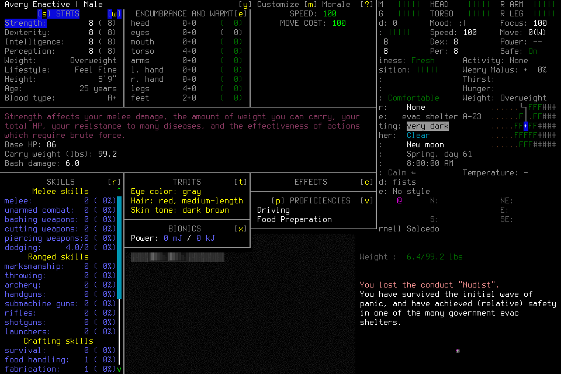
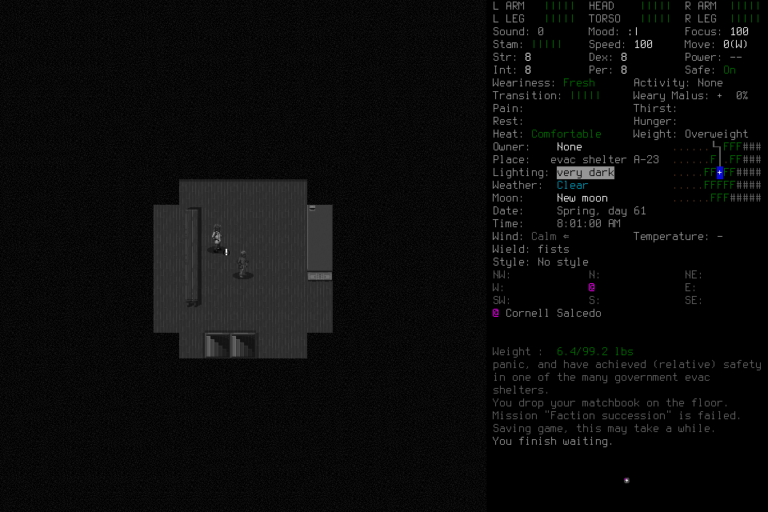
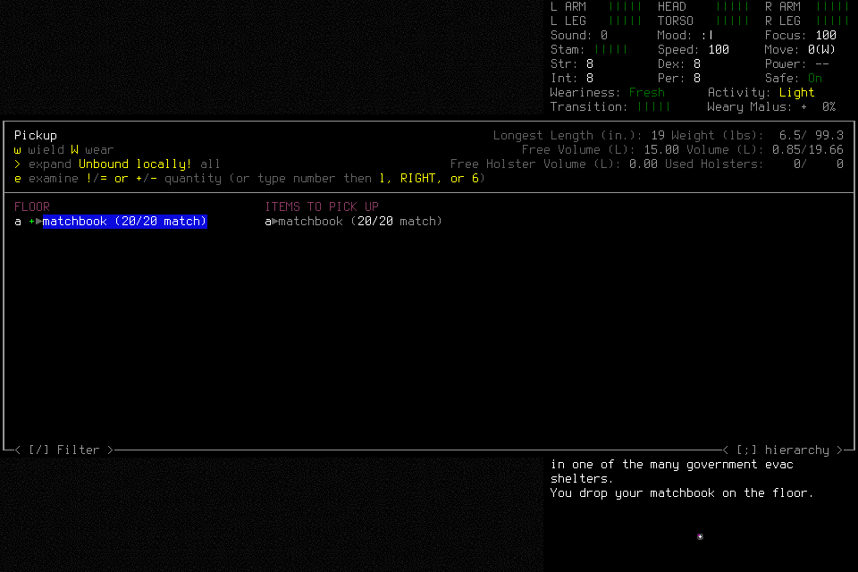

# A character was created and saved; independent gameplay remains unqualified

Engineering qualification006 used checked source
b44afbe77d32d7e732d6948bd917621e80eb7565 and installed native4 SHA
6cc8078455401c9ae8094dddeb596820e93f207c609cad65da747e2ce5d4907a.
The required1107Python tests passed in256.219seconds with the other common checks.
Both [PR CI](https://github.com/CVX-Hull/enactive/actions/runs/39459158445) and
[push CI](https://github.com/CVX-Hull/enactive/actions/runs/39459153360) passed.
The unchanged native integration did not require rebuilding for that Python/JS
receipt/observer correction. Neither these checks nor this attempt accepts the
independent player/successor mission or a new seven-day campaign.

The overall qualification **failed before reload selection**. It established
several real capabilities, retained three unknown acknowledgments, and normally
saved/exited its first child. Its genuinely new second child required exceptional
closure because the frozen load adapter and its normal cleanup did not match the
actual UI. No source or save was patched during the attempt.

## Admission and observed capabilities

The separate reviewed admission allowed800charged inputs/7200wallseconds/
43200game-seconds/4096frames/1GiB. Protected reserve was100inputs/900seconds/
256frames/128MiB. Early optional-work stop at500inputs/4500seconds/2800frames/
640MiB preserved ordinary cleanup headroom, subject to earlier root deadlines.
Creation/load roots used actual256primitive/1800second maxima. The sole project
service explicitly used the existing15second upper wait; matching ACKs return
immediately. Windowed wrapper/options/userdir/hash, no game/listener/input slots,
and two current-boot literal passive CLI access checks passed before Start.
The lead was the engineering operator; this was not deciding-player acceptance.

Fresh menus from the owned child showed Enactive Qual Four had0characters. That
world had been normally created in004; no prior identity, source authority or
unused allowance transferred. Ordinary Evacuee/Survivor defaults were retained.
Semantic tab navigation reached Description; one15primitive text request entered
Avery Enactive, followed by a separate observed name confirmation and explicit
character-completion stage. The character entered an evac shelter normally.

The final creation Yes had an unknown ACK across the changed native session.
Diagnostic Observe, same-root typed transition reconciliation, separately charged
identity-only Resume, visible identity inspection and two source-linked identity
Claims established normal adoption. The original unknown ACK remained unknown.

Inventory inspection showed one sealed plastic bottle containing2charges of
**frozen** clean water. The retained Claim distinguishes carried charges from
bottle count, ground stock and successful consumption. A counted item path opened
the real count field, entered/confirmed1, separately verified complete selection,
then dropped one owned matchbook. The native message confirmed the drop. This was
an engineering drop/reacquire test, not meaningful supply gathering.

An activity Work item preceded an ordinary one-minute wait. Native rendered-row
selection reached a real activity-poll frame. The registered Observe path polled
without input or Resume, returned to normal play, and retained turns5212800→
5212860, visible08:01 and “You finish waiting.” Work completion covers that
60second wait only; it proves neither sleep recovery nor interruption/resumption.

Normal Save and quit returned to a menu showing Enactive Qual Four(1). The save
transition's unknown ACK was retained and its observed effect reconciled into a
SavedCheckpoint. Registered Quit/Yes and the retained child handle established
OwnedNormalExit with exit0; its final Yes ACK remained separately unknown. A
genuinely new owned child then launched. No existing PID was adopted.

## Concrete blockers retained before further input

| Capability | Actual limit and owned repair |
| --- | --- |
| Navigation | A three-tile semantic route proposed0inputs because the shared guard rejected any visible creature, including Cornell Salcedo with`hostile:false`. That field means not classified HOSTILE; it does not establish friendship or safe occupancy. #138/#154 own a deliberate movement-policy correction with strict malformed/hostile checks and unchanged per-step outcome guards. |
| Pickup acquisition | The picker selected the one dropped matchbook, but native rows flattened the passive selection-summary echo and actionable floor row into identical labels. Unique-target/native-row agreement cannot validly confirm that state. The picker was normally canceled; the matchbook remains on the floor. #151/#154 own filtering the engine's non-selecting cosmetic column at its existing renderer hook, retaining genuine actionable duplicates as ambiguous. |
| Reload correlation | The adapter armed`load_selection` only for the literal goal label`Load Game`. Actual visible labels are`Load` and the selected world; the pinned engine subsequently presents a native character list. No world-selection Confirm was sent after the load root's Resume. #155 owns observed menu-transition staging and exact rendered admitted-character validation before dispatch, without a label alias. |
| Untouched load-menu cleanup | Resume-only cleanup accepted a creation root, excluding an otherwise untouched load root. The old first child's saved proof could not qualify the new child. #155 owns a narrow explicit abort/normal-exit path for proven Resume-only create/load menus. General cancellation after other setup inputs remains separate work. |
| Setup efficiency | Character-tab category changes stop the current focus batch and require fresh interpretation. This limits model-round-trip efficiency despite correctly bounded native key batches. #154 retains the finding; optimizing cross-category composition must preserve actual screen interpretation and explicit final stage commit. |

Independent source review confirmed the load-label and create-only cleanup gaps
before any load selection. No fictitious interpretation was submitted to arm the
adapter. The lead explicitly stopped the failed engineering qualification. A
separate finite cleanup proposal reverified the exact second child/parent/start/
command/project userdir, fresh paused main menu with no loaded character, and
empty slots before one SIGTERM under existing project-cleanup delegation. That
child's exit0 is not OwnedNormalExit or Finish. Count one exceptional cleanup and
one explicit lead Stop; no user keys/unlock or ordinary gameplay rescue occurred.

## Costs, evidence and limits

| Endpoint | Charges / returned / unknown | Wall seconds | Frames / PNG bytes |
| --- | ---: | ---: | ---: |
| Owner-exit ledger watermark |70 /67 /3|1325.679461|185 /9639699|
| Owner-exit status sample |same|1325.694328|same|
| Shutdown/reopen record |same|1362.450346|same|

All three unknown ACKs remain unknown; their creation/save/first-exit effects are
separately reconciled, leaving0unreconciled effects. There is exactly one normal
adoption, one SavedCheckpoint and one OwnedNormalExit, all from the first child,
and no NormalFinish. Eight local staging/inspection issues sent no input; these
include rejected Claim quantity-plus-state, absent request/template files and a
never-submitted activity draft mixing a later live revision with its retained
checkpoint. The existing registered Observe path handled that moving activity.

Independent closeout review reproduced all185PNG hashes/byte counts, exports,
proof limits and clock bases. The service closed normally with exit0. OS checks
found no game/listener/live slots; ledger/evidence reopen retained paused history
without authority. Model/tool/approval usage and actual browser presentation
latency remain unmeasured. Whole engineering wall time is not engine latency or
independent-player throughput.

[Scoped result](assets/owned-character-qualification-006/result.json) accompanies
the original private request/controller/native journals and immutable frames.
Native navigation, acquisition, reload, final normal second-child exit and
independent memory/successor play require new actual evidence after the repairs.
The active #144 goal remains open; #156 readiness precedes #157's real mission,
then #145's evidence-backed seven-day readiness decision and finite plan.
