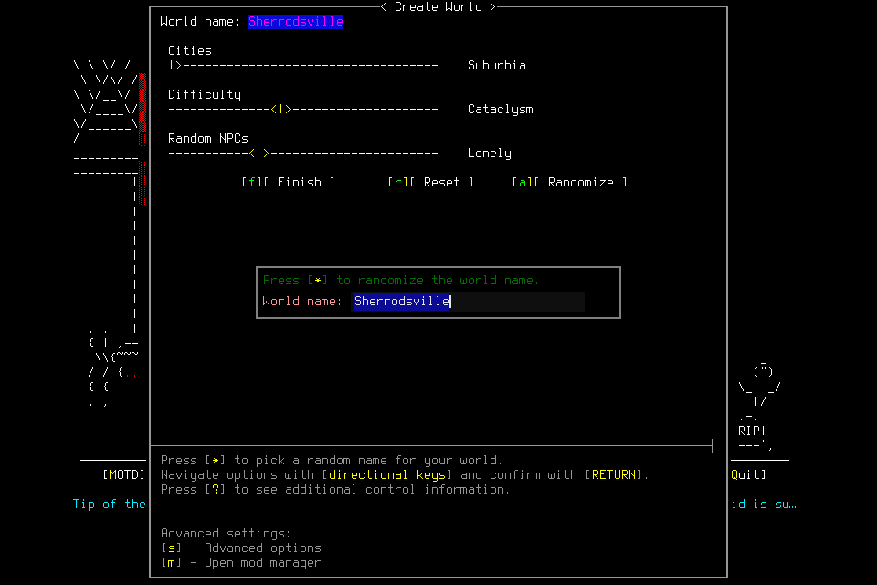
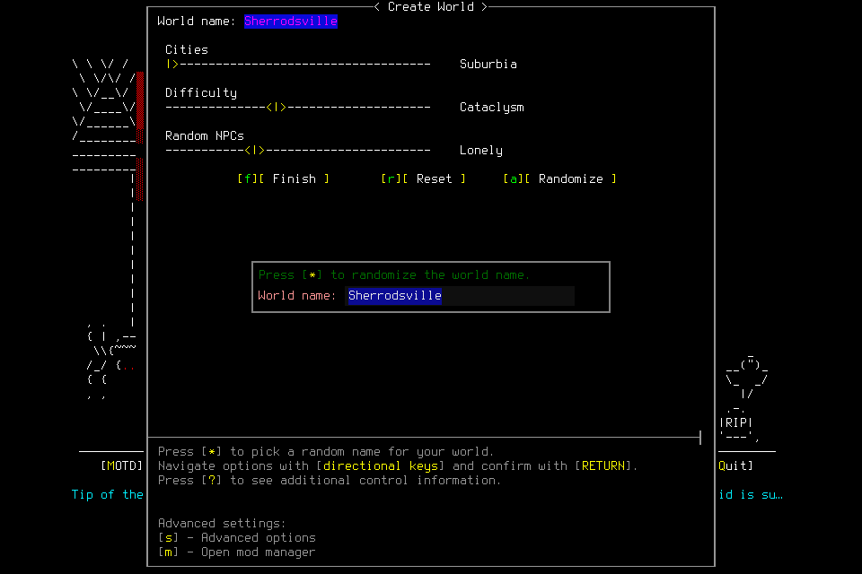

# Setup reached the native editor, then stopped on its blinking caret

At source77d1874954887b1a8c3d0bbef40ae4d891be476b and native4 binary SHA
c65778e2912230f34b67340a4f2caacd0d5874af24ab964526c436bd686f7720,
the separate controlled Resume-only abort qualification passed its narrow cleanup
scope. The subsequent character qualification **failed before any text input**.
Neither accepts character lifecycle, memory/skills independence or a new campaign.

Both [PR CI](https://github.com/CVX-Hull/enactive/actions/runs/39449069079) and
[push CI](https://github.com/CVX-Hull/enactive/actions/runs/39449060055) passed for
that exact source, after the required1105-test common gate. The preceding
[capture-churn report](2026-10-20-native-capture-churn.md) retains the earlier failed
native attempt and first failed source gate. Portable checks are separate evidence.

## Separate controlled abort qualification

A prospectively reviewed engineering admission allowed120inputs/900wallseconds/
3600game-seconds/1024frames/256MiB with protected10inputs/60seconds/64frames/16MiB.
An early ordinary-work stop preserved70inputs/240seconds/448frames/112MiB for
ordinary cleanup. No earlier allowance was transferred.

Creation Resume returned. A deliberately wrong-revision semantic child then
blocked before any menu action. A new current-epoch diagnostic Observe adopted
the internally paused original menu. Registered exit Resume and Quit returned;
one explicit Yes, UUID40b35d4a-b30f-46f0-8641-639e732426e1, remains **unknown ACK**.
A separate correlated OwnedNormalExit proved the retained child's exit0; stopped
Finish and authority-free ledger/evidence reopen succeeded. No signal, source
patch, user key or exceptional cleanup occurred. This is a controlled pre-input
fault probe, not an ordinary gameplay failure or autonomy score.

All4 charges remain:3returned and1unknown with separate effect.12frames/
397137PNGbytes;125.038875seconds through Finish ledger watermark,125.041244seconds
through status sample and168.660300seconds through shutdown/reopen verification.
An initial local Finish-staging invocation incorrectly assumed a live source after
the unknown terminal ACK. It failed before creating/submitting a request; using
the retained final proof source corrected staging without another charge/request.
Independent SQLite/source/12-frame review accepted this scoped result.

## Separate character qualification and actual failure

The next admission allowed800inputs/7200wallseconds/43200game-seconds/4096frames/
1GiB, including protected100inputs/900seconds/256frames/128MiB. An early stop left
200ordinary inputs/1800seconds/1040frames/256MiB. Root deadlines could expire sooner.
Clean frozen source/binary, the fixed windowed wrapper/project userdir, empty slots
and current-boot literal passive CLI access passed preflight. The access agent was
not a deciding player or successor.

Exactly4 primitives returned: creation Resume, World-tab RIGHT, Create World
CONFIRM and the selected world-name field's CONFIRM. The native editor displayed
Sherrodsville. The requested semantic edit to the admitted name stopped in guarded
refresh before any text primitive. No world FINALIZE or character commit occurred.

Decoded960×640 images differ in exactly42pixels, bbox(491,323,494,337), at the
insertion caret. All other validated native state fields match; passive capture
id/timestamp/filename differ. This is a real raster change, not identical pixels
or proof that future image changes are harmless. Exact image validation correctly
stopped the old decision. The private phase was revoked; the existing Resume-only
cleanup rule correctly rejected four setup inputs. No supported normal editor/
setup cancellation or Finish was available.

Native-window automation reported unavailable; this is a capability failure, not
independent proof that the physical Mac was locked. No user unlock/key was requested.
After independent confirmation of the stopped state, a separate finite teardown
proposal reverified the exact retained child/parent/start/command/project userdir,
fresh paused STRING_INPUT with no in-game scene and empty slots. The lead sent
**one SIGTERM** under existing project-cleanup delegation. No pattern kill, repeated
signal, raw key, save edit, source patch or PID adoption occurred. The retained
owner sampled exit0; that is **not** OwnedNormalExit or Finish. Count one exceptional
engineering-cleanup intervention. The service then closed normally; OS/slot checks
found no game/listener/pending input. Reopen retained the failure/cost/custody with
no phase, lease or process authority. Independent read-only validation reproduced
the exports, all15frame hashes and the following costs.

| Endpoint | Charged / returned / unknown inputs | Wall seconds | Retained frames / PNG bytes |
| --- | ---: | ---: | ---: |
| Owner-exit ledger watermark |4 /4 /0|408.729164|15 /386514|
| Owner-exit status sample |same|408.731116|same|
| Shutdown/reopen verification record |same|526.806442|same|

Game time and model/tool usage remain unknown for both attempts. Original private
records, failed intents, interventions and unused allowances remain retained.
[Sanitized cost and image provenance](assets/owned-character-qualification-003/result.json).

## Bounded reuse repair and remaining qualification

The pinned SDL ImGui constructor already owns the public ImGuiIO API. The repair
sets its existing `ConfigInputTextCursorBlink=false` only when the process's
exclusive harness bridge is enabled. ImGui renders the insertion caret steadily;
input/confirmation semantics, game options, non-harness rendering and exact PNG/
state/ACK/authority validation remain unchanged. No image masking, OCR, extra
renderer, native schema or global Mac setting is added. Upstream source hashing,
exact-count anchoring and repeatable patch tests cover the integration mechanics;
actual rebuilt native behavior still needs qualification.

General normal setup cancellation after phase revocation remains an owned #155
limitation. A safe new intent must not reuse the failed text decision or restore
ordinary setup consent after unknown delivery, user Pause, takeover or expiry.
The next prospective native attempt must use a separate finite admission, exact
committed source/new binary and retained failures, then qualify the steady visible
editor and actual creation/save/new-child/exact reload. It cannot relabel this
attempt. #154 owns integration, #156 explicit deciding readiness and #157/#144 the
actual player/successor memory-and-skills mission before #145's next campaign
readiness decision. Optional curation, tiers or training are not blanket gates.
