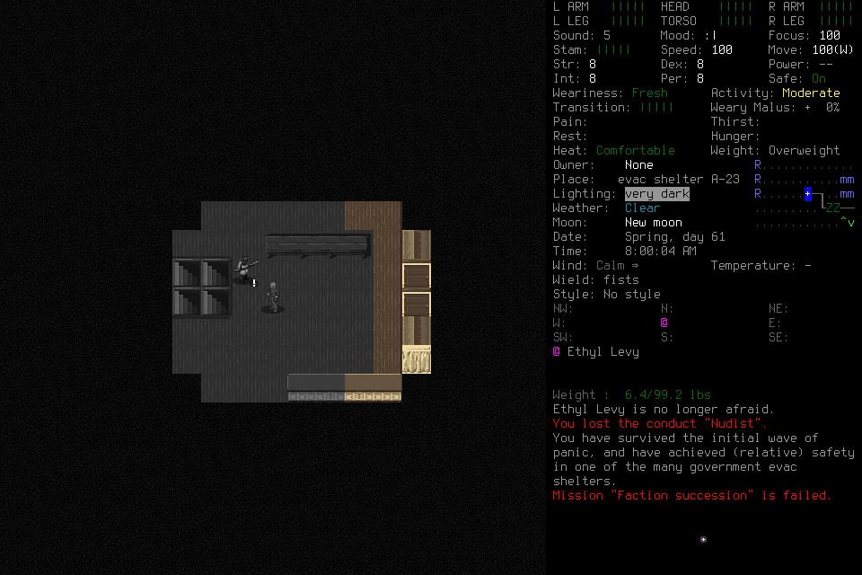
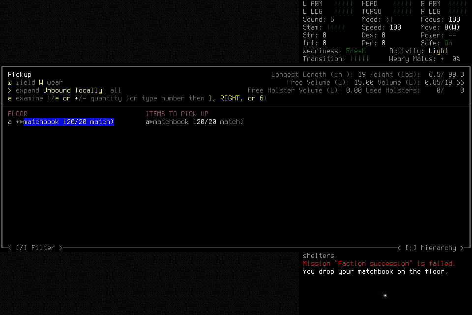
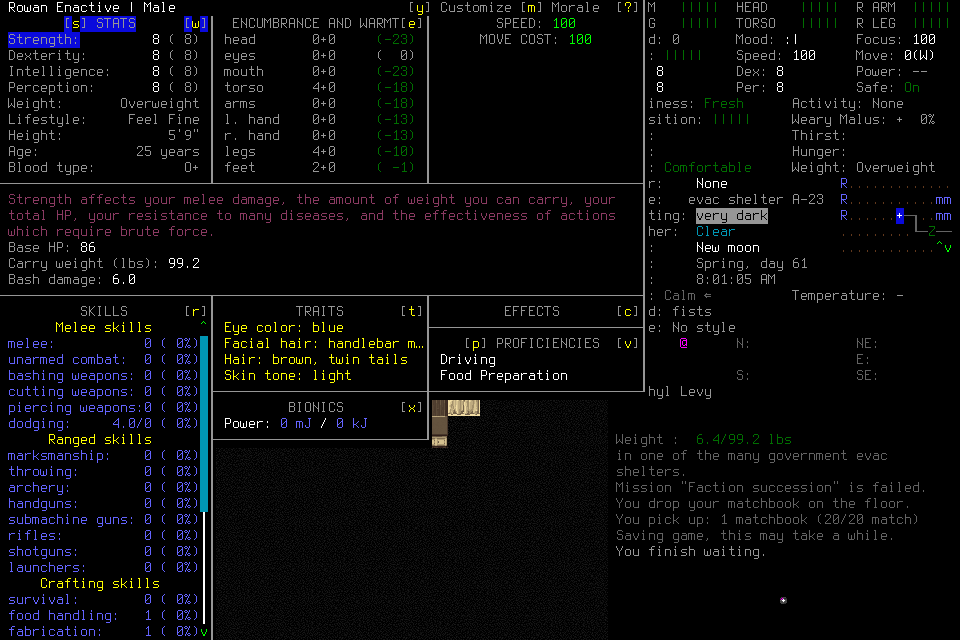

# Native character lifecycle qualification007

**The functional engineering qualification passed within its stated scope.**
Ordinary creation, counted pickup, a known two-step route, bounded native wait,
normal save/new process/exact reload and final normal shutdown were observed.
Finish deliberately records **stopped**, without completed objective Work. This
does not accept the independent player/successor supply-and-shelter mission or a
new seven-day campaign. [Qualification006](2026-10-20-native-character-lifecycle.md)
and earlier failures remain unchanged.

Frozen source was `5da2ea1bbb49b6ff49549f946181cf6b0759ada0`; installed native SHA256
was `cd031f200748cbbb387011335db15596346dac29607221fac25641ec9a771f1f`.
The required common gate passed 1129 tests in 284.070 seconds plus other portable
controls. The preceding common attempt failed one stale HTTP expectation; its
failure remains retained. Both exact source hosted lanes passed:
[push](https://github.com/CVX-Hull/enactive/actions/runs/39467309348) and
[PR](https://github.com/CVX-Hull/enactive/actions/runs/39467320224).
Source checks, native behavior and graphical frames are distinct evidence lanes.

## Admission and observed behavior

The separate prospective admission froze 800 inputs, 7200 wall seconds,
43200 game-seconds, 4096 frames and 1 GiB, with 100 inputs/900 seconds/256 frames/128 MiB
protected for ending work. The remaining 700 inputs comprised 450 ordinary,
100 normal-cleanup and 150 spendable contingency. Earlier limits and costs did not
transfer. Exact wrapper/hash/windowed/userdir, empty runtime slots and two literal
passive CLI checks by a clean-context general-purpose actor preceded Start. The
lead operated this engineering qualification; that actor did not decide gameplay.
Controller wait 15 seconds was an upper ceiling, not a delay per successful input.

Ordinary default Evacuee/Survivor creation produced Enactive Qual Seven and
Rowan Enactive. World/name text used bounded semantic batches and separately
observed commits. Creation's unknown ACK was retained; diagnostic Observe,
typed effect reconciliation, separately charged identity-only Resume and visible
identity Claims established adoption. There were no source/save edits during play.

Actual observed movement went east twice, then returned two verified steps in
one semantic request. The controller checked each step without a model decision
between them. Visible Ethyl Levy had strictly known `hostile:false`; this means
not classified HOSTILE, not friendship, vacancy or guaranteed safety. The route
used genuinely observed terrain. Fresh scenes still project only four cardinal
neighbors; this does not prove general multi-step exploration.

The player dropped one owned matchbook through a count field and separate final
commit, then picked it up through the same native quantity/selection path. The
screen retained its cosmetic summary, while the native projection contained just
the one selectable floor row. The pickup message and later carried inventory
verified acquisition. Reacquiring an owned item is not meaningful supply gathering.
Stock Claims distinguish one matchbook from 20 match charges and two **frozen**
clean-water charges from bottle count or successfully consumed liquid water.

Planned Work preceded a native one-minute wait. Registered Observe polled without
input/Resume, and normal return showed “You finish waiting” and 60 elapsed game
seconds. Only that bounded Work completed; no sleep recovery, interruption or
resumption is claimed. Normal save and first normal child exit produced their
correlated proofs. A genuinely new child presented the actual selected world,
then a native character list. Unique enabled selected Rowan evidence preceded
confirmation; no fictional Load Game label armed the adapter.

After the unknown load ACK, separate reconciliation/readmission and visible
identity established exact same-character reload at saved turn 5212865. Canonical
continuity retained the original time anchor and changed coordinate epoch to 1.
The saved position was the returned origin; this does not test a nonzero-offset
reload. Final normal save/quit and two distinct OwnedNormalExit proofs recorded
exit 0. NormalFinish stopped the mission without input. No game signals or
exceptional cleanup were needed. The saved character remains preserved.

## Costs, timing and acceptance limits

| Evidence | Retained result |
| --- | --- |
| Charged inputs |112 = 106 returned + 6 unknown ACKs; zero unreconciled effects|
| Frame integrity |287 PNG hashes verified; 13999031 bytes|
| Canonical game time |65 seconds, including 60 wait; reload adds no elapsed gap|
| Wall clocks |1941.510031 s terminal ledger;1941.535026 s finished status;2028.220406 s shutdown/reopen record|
| Lifecycle proofs |Two adoptions, two SavedCheckpoints, two normal exits, one stopped Finish|
| Runtime closeout |Service exit 0; no game/listener/live slots; reopened stopped history grants no authority|

All six original ACKs stay unknown: creation, two saves, two exits and character
load. Typed observed-effect proofs do not rewrite delivery history. Independent
read-only review reproduced exports, dispatch IDs, SQLite integrity, frame hashes,
proof correlation, clocks, movement, stock/wait evidence and canonical continuity.
No retained takeover or operator-pause event appeared; zero user keys is an
operator-history statement, not forensic proof of absolute absence.

For 106 returned inputs, original preflight-to-terminal receipt intervals have
median 101.72 ms, nearest-rank p95 337.46 ms and maximum 6716.55 ms. Excluding the
preselected world-entry input leaves 105, median 100.50 ms, p95 336.68 ms and
maximum 856.24 ms. Four movement steps have minimum 156.61 ms, median 182.00 ms and
p95/maximum 191.63 ms; the tiny sample cannot establish representative throughput.
The two-step return reached its last receipt in 767.54 ms from admission. A 20-key
world-name batch took 2173 ms, and eight inventory-focus arrows 4293 ms. These are
**last-receipt proxies**, not settled-result timings. The journal lacks a separate
interpreted-result terminal timestamp. Unknown ACKs are excluded from these
percentiles, not hidden as fast returns. Model/tool/approval/display delays remain
unmeasured. Whole engineering wall time is not native or independent-player speed.

The [scoped result](assets/owned-character-qualification-007/result.json) accompanies
private immutable requests, ledger, native/controller journal and frames. Local
inspection/staging mistakes sent no game input; one apparent empty-menu image was
ruled out by identical retained PNG bytes before selection. It is not a capture
defect. No source patch or manual user rescue occurred during the attempt.

Next acceptance remains #156's explicit finite readiness, #157/#144's actual
independent player with meaningful supplies/shelter, ≥30 minute rest assessment,
replanning, retained-memory correction, genuine fresh-context successor and normal
lifecycle/control evidence. General setup cancellation and recovery/interruption
remain unqualified. #145 must use actual mission results for a finite seven-day
plan or concrete owned blockers; neither this report nor green CI closes it.
