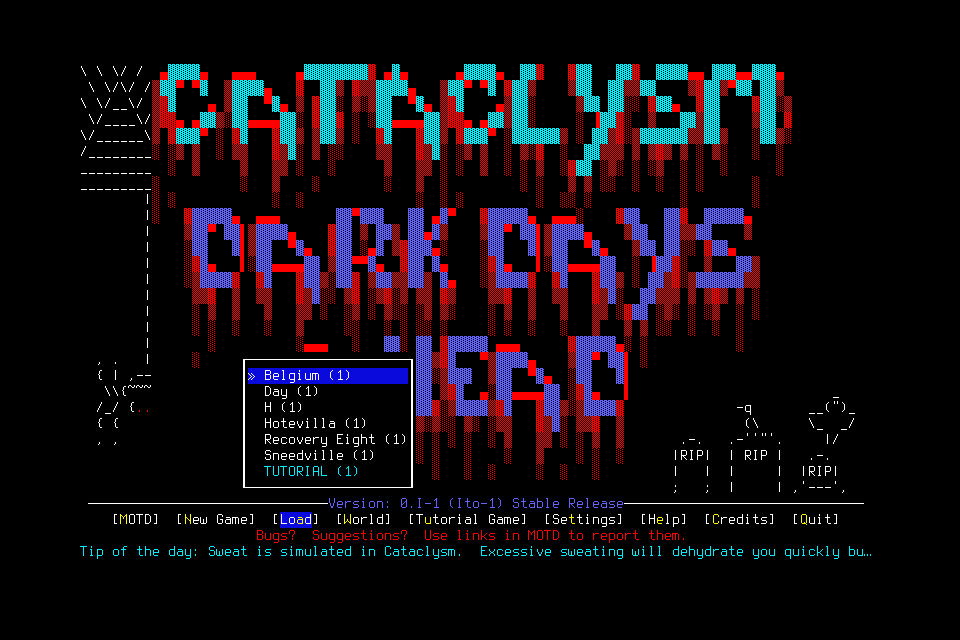

# Wire4 menu and final-preflight probe

The exact-PNG native path worked for menu navigation and opening normal Quit.
Pause and changed-view checks prevented publication. Normal Quit exited the game,
but its final acknowledgement timed out and remains unknown. This qualifies the
tested component paths; it does not deliver the player-owned mission.

Source `fccec853cb5bca90538d792aea6aa0d1a8950af4` passed614 portable Python tests
plus the common viewer, boundary, document, diagram and governance checks.
The actual native build at `bc9313ca7f8256f66c43fa012659fb90ccfc953a` has identical
native/patch source through that checkpoint. Built SHA256 is
`61d3a132e06201aebfe7bb2f7a83822b937e8dcf28b5b9377b2a99706a17e9a1`;
installed/ad-hoc-signed SHA256 is
`c65778e2912230f34b67340a4f2caacd0d5874af24ab964526c436bd686f7720`.
The FreeType deployment-version linker warning remains: this is a current-Mac
build, not verification of macOS13 compatibility.

## Admission and observations

The prospective engineering probe allowed20 inputs,10wall minutes,64 retained
frames and128MiB. It remained at menus: no character load, creation or save.
Actual cost was11 conservative dispatch attempts over141.071seconds, including
three stopped before publication; eight ordinary inputs were published.
Two native-window resize drags are separately recorded test interventions.
Nineteen canonical PNGs total630,387bytes. This was not the deciding mission.

The app was visibly windowed. Final settings were restored to120×40 and
`FULLSCREEN=no`. The existing native renderer still reports `ui=null` at these
main-menu/YESNO boundaries; the probe interpreted actual pixels, not invented rows.

| Check | Actual result and limit |
| --- | --- |
| Exact-PNG RIGHT then LEFT | Both returned ready with `require_exact_frame=true`;0.1053s and0.0993s. Original planning view and actual final preflight were retained separately. This exercises deterministic encoding/comparison on these static views only. |
| Pause inside final preflight | Unpublished, no native request ID, lease revoked;0.0397s. Pause was an intentional negative test. |
| Different informing-image hash | Unpublished before callback/input;0.0392s, explicit image mismatch. This exercises the host comparison, not the native late-change branch. |
| Resize during blocked preflight | At unchanged revision6, current frame changed and publication stopped after2.4658s. Takeover generation remained0. Resizing was then reversed. Periodic frame publication and spectator observation also occurred, so this does not isolate the native byte-mismatch predicate. |
| Ordinary Quit | Exact-PNG QUIT returned ready in0.1006s and visibly opened “Really quit?”. |
| Visible YES and normal exit | Exact-PNG YES was published; final ACK timed out after3.0176s. The bundle wait returned0; subsequent process scan found no game. This verifies the exit effect, not receipt delivery. No retry was sent. |
| Cleanup | Controller, server, console and owned launch handle terminated; port8766 refused connection. No game/server remains. |

The unknown final YES request is
`fa877b97-71c6-4c65-b136-79781b9c966c`. Its original admission/receipt remains
retained. A process exit cannot turn its ACK into ready. Native late-presentation
byte-mismatch rejection and normal-game wire4 movement/activity/save/reload still
need their own evidence. No general latency, autonomy or learning benefit follows
from this probe. Controller disk stalls can delay Pause's serialized durable work;
the measured successful Pause does not remove that limit.

## Stopped bridge cutover and retention

Before installation, no game process existed and the controller process lock was
free. The stopped wire3 bridge was moved intact to
`.runtime/incidents/wire3-cutover-20261020-9888f838/bridge`:5,364files,
357,057,795bytes. Its inventory SHA256 is
`15bf9df8eccdcad9628ca29008e7f552b43e57c73e41a426dbc2ef4a4c2c119d`.
The old installed binary was also retained. The104 gameplay and two control
admissions were preserved as historical unknowns in hashed opaque source bundles,
alongside the prior historical reference. Fresh wire4 startup validated those
references without reading old requests as executable input. No request was
relabelled or replayed; saves were untouched.

The [sanitized manifest](../assets/native-presentation-probe.json) records raw
receipt/frame hashes and project-relative local paths. Original receipts/PNGs and
the cutover/build/install logs remain project-local; a fresh checkout has the
manifest and displayed PNG, not those large/private originals. Retain originals
through relevant component/campaign acceptance review; GitHub owns later status.

[#150](https://github.com/CVX-Hull/enactive/issues/150) owns component follow-up;
[#154](https://github.com/CVX-Hull/enactive/issues/154) owns runtime integration.
[#156](https://github.com/CVX-Hull/enactive/issues/156) and
[#157](https://github.com/CVX-Hull/enactive/issues/157) still require a frozen
integrated admission and real no-assistance mission. This probe closes neither
[#136](https://github.com/CVX-Hull/enactive/issues/136) nor the next seven-day run.
