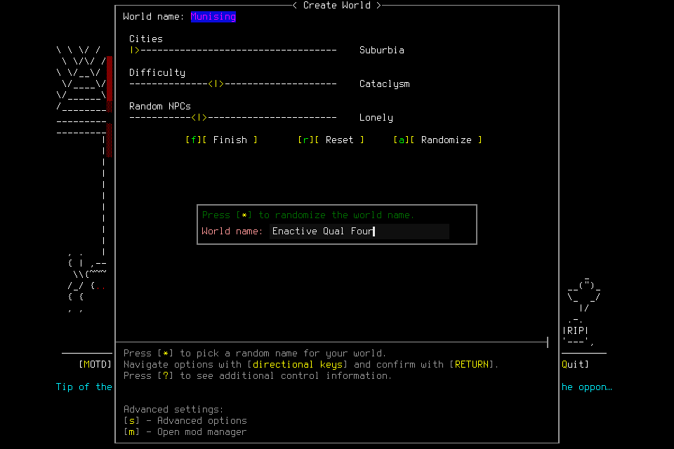

# A steady editor worked; later setup exposed wait and receipt-order limits

Both separate engineering attempts used source
bdd44f61497522a02621fb6e097d4137a5bbafe8, installed native4 SHA
6cc8078455401c9ae8094dddeb596820e93f207c609cad65da747e2ce5d4907a
(compiled7fd9aa210d65af8075673c4d66e0f09af5faba657c91fdb2d0ccacf6703a8f30).
The project-local build/install passed. Linking warned that the bundled FreeType
library targets macOS15 while the build deployment flag is13; this Mac's build
succeeded, without establishing older-host support. Required1105Python tests and
other common checks passed, as did [PR CI](https://github.com/CVX-Hull/enactive/actions/runs/39453390844)
and [push CI](https://github.com/CVX-Hull/enactive/actions/runs/39453381636).
Both attempts **failed** before character commit. Neither accepts normal character
lifecycle, independent memory/skills play or a new campaign.

## Native004: steady caret, semantic text and ordinary world creation

A separate reviewed800input/7200wallsecond/43200game-second/4096frame/1GiB admission
preserved100inputs/900seconds/256frames/128MiB protected reserve. Early ordinary
stop at500inputs/4500seconds/2800frames/640MiB left200ordinary inputs/1800seconds/
1040frames/256MiB, subject to earlier root deadlines. The fixed windowed wrapper,
project userdir, clean checked source/binary, empty slots and two current-boot
literal passive CLI access calls passed. This was lead-operated engineering,
not deciding-player or successor acceptance.

Four unchanged native editor captures had identical encoded PNG bytes across the
former ImGui blink cycle, SHA5418ff2920fcd522bc96a9d8b75fd5f114767a8b6561c8b401fb7f78b44539af.
The admitted name was entered through one semantic batch and separately confirmed.
Explicit world FINALIZE and interpreted Yes created Enactive Qual Four normally.
The actual world picker showed0characters and focused that exact world.

The world-selection CONFIRM then exceeded the actual default5second controller
wait. Native ready for NEW_CHAR_POINTS, UUID8a5b19ac-6ca5-4c45-ab51-dfd89db034df,
arrived7.272seconds after journaled admission,2.273seconds after the request's
native deadline. The original mission receipt remains unknown. Initial derived
3second/5.273second timing was corrected from the raw admission/deadline/ready
records; it was not a measured pure world-load duration. No character was committed.

Two invalid creation drafts exceeded current request maxima and were rejected
locally before HTTP/input. New uniquely named drafts used actual256primitive/
1800second root maxima. These local mistakes remain separate from the actual
native timeout. A later read-only cleanup preflight used an aged status and stopped
at its freshness assertion; no proposal/signal followed that failed read. Sampling
fresh status within the verified OS-check invocation corrected the preflight.

## Native005: existing15second setting, then a ready-envelope failure

The next independent800input/7200second admission kept the same reserve/early-stop
limits and exact source/native. It explicitly used the existing `--timeout 15`.
Current-boot access and actual service command were checked. Fresh visible menu
evidence showed the existing Enactive Qual Four world still had0characters. The
objective was corrected before Start to fresh character creation in that visible
empty world; no previous source, phase, lease, identity proof or allowance was
adopted. Avoiding duplicate world creation did not renew the failed004 admission.

Resume and New Game focus returned. Custom Character CONFIRM returned a matching
native ready for PICK_WORLD_DIALOG, UUIDe12b6432-5a01-4b09-80dc-dae7b4d5d326.
Mission envelope validation rejected its comparison with the current atomic
observation. The mission classified delivery unknown and revoked setup; its
primitive's native UUID/receipt clock remained null, while the complete original
controller receipt retained the actual UUID/result/clock. Those originals are
preserved separately; neither ledger nor receipt was retroactively repaired.
This was **not a native timeout** and did not retest the delayed world-selection
step. An inspection script assumed a live phase and failed before staging or
submitting another request; the next inspection handled the actual stopped state.

The failure-time atomic snapshot was not retained, so its exact mismatch cannot
be established retrospectively. Independent source review found a genuine ordering
defect consistent with it: the spectator can accept a frame first; `_accept`
keeps that frame's first-seen clock, and `_exchange` subsequently records its own
later ACK-read clock. The envelope incorrectly required the former to be later.
A causal fixture forces real status acceptance of the fully published same frame
before the command reader, with real monotonic clocks. Unchanged source fails
with the same envelope reason. The correction accepts independent finite,
nonnegative/nonfuture snapshot time, preserving original raw receipt freshness,
preflight order, UUID/state/source/PNG and authority checks. Five focused tests
passed, including invalid-clock/state/UUID negatives and exact retained history.
The runtime now journals the actual snapshot on a mismatch for future diagnosis.
These fixture/source results do not prove native005's missing snapshot or accept
another native run. No existing unknown receipt changes.

## Exceptional closure, costs and evidence limits

Neither failed setup had a supported registered normal cancel path after phase
revocation; Resume-only cleanup does not cover these inputs/unknowns. Each original
no-signal proposal remains intact. A separate finite postfailure proposal verified
its exact retained child/parent/start/command/project userdir, fresh internally
paused pre-character boundary, no in-game scene and empty input slots before
**one SIGTERM per attempt** under the existing project-cleanup delegation.
No user key/unlock, raw rescue, save edit, source patch or PID adoption occurred.
Retained child exit0 is not OwnedNormalExit or Finish. Count two exceptional
engineering-cleanup interventions across these two failed attempts.

Each service subsequently closed normally. OS/slot checks found no game/listener/
pending input. Independent native004 closeout review reproduced exports, all80PNG
hashes and clocks. Ledger/evidence reopen retained each paused failure/unknown/cost
and no current authority. Native005's retained readback is separate from later
independent review; its original controller receipt remains available.

| Attempt / endpoint | Charged / returned / unknown | Wall seconds | Frames / PNG bytes |
| --- | ---: | ---: | ---: |
|004 owner-exit ledger watermark|32 /31 /1|657.003080|80 /1493908|
|004 owner-exit status sample|same|657.010584|same|
|004 shutdown/reopen record clock|same|697.011165|same|
|005 owner-exit ledger watermark|3 /2 /1|194.023216|10 /312381|
|005 owner-exit status sample|same|194.026121|same|
|005 shutdown/reopen record clock|same|221.304217|same|

Game time and model/tool usage remain unknown. Original local staging/inspection
errors, proposals, raw receipts and shutdown records remain private. Costs are
scoped to their distinct Starts; no aggregate latency or autonomy score follows.
[Sanitized outcomes, timing basis and image hash](assets/owned-character-qualification-004-005/result.json).

## Interactive latency and next qualification

Across004's31 returned primitives, original retained preflight-to-ACK intervals
were62.33ms median,90.00ms p90,91.30ms nearest-rank p95 and95.37ms maximum. This
interval includes host callback/persistence, native frame/input and transport;
it excludes inference and much surrounding setup/observer work. One unknown is
reported separately. Semantic name entry used19native admissions inside one
request, not19model decisions. Model, approval and total tool latency remain
unmeasured; these fast input samples cannot establish end-to-end play speed.

The user requested reasonable latency for a tile-based, turn-based game. The
existing serialized spectator poll now schedules250ms after a completed response
during active play/operations,1000ms when idle/disconnected. Existing decode,
sequence and authority guards stay intact. Common viewer regression passed;
actual browser presentation latency remains to be measured. The
[proposed latency budgets](../evaluation.md#latency-budgets-for-interactive-play)
separate ordinary input, whole semantic requests, observer decode, model decisions
and loading. Reuse native travel/activities and avoid model/approval round trips
per key; adding model tiers or a new execution framework is not an automatic gate.

#154/#155 own the bounded receipt correction and actual native lifecycle; #143
owns observer latency. A new clean committed/common-checked candidate and separately
finite engineering qualification006 are required, retaining explicit15second wait and
all failures. Native integration sources are unchanged by this Python/JS repair;
the installed binary remains separately identified. #156 readiness precedes the
actual #157/#144 player/successor mission, then #145's seven-day readiness decision.
General setup cancellation remains explicit deferred #155 contract work; it is
not an undocumented normal-exit guarantee or consent-restoration shortcut.
