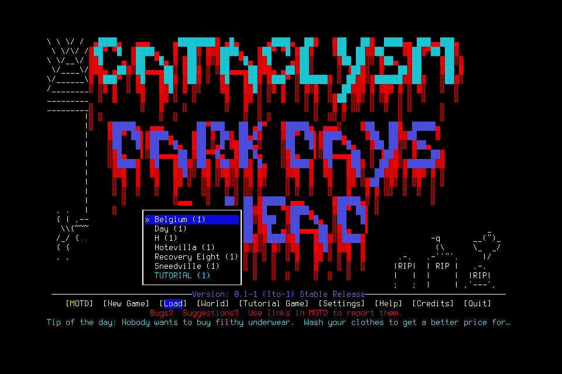
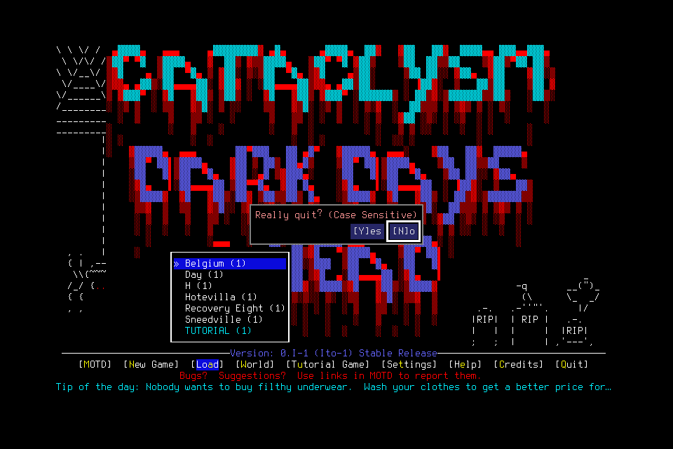

# Owned launch and normal menu exit

The mission runtime now implements lifecycle `launch` through the existing fixed
NativeProcess adapter. It accepts only a source-free root and the admission's
world/character and binary hash. This source increment precedes creation, identity,
charged Resume, save/reload and independent gameplay; it does not complete #155,
#144 or seven-day readiness. [Protocol](../protocol.md#integrated-mission-lifecycle)
owns current behavior; the [earlier ingress report](2026-10-20-mission-ingress.md)
retains the previous checkpoint's scope.

## Qualified source behavior

- Preparation, existing-process guard, exec and readiness share the original
  root/mission wall deadline and preserve the cleanup reserve. Process launch
  consumes no primitive game input and never assumes menu game time is zero.
- NativeProcess receives a required cancellation callback. Checks before/after
  preparation and after committed spawn preserve the handle even if Pause or a
  deadline arrives during exec. No signal, arbitrary script/path or PID adoption
  is exposed. A live or unverified owned launch cannot silently be replaced.
- Runtime requires paused empty host writers/native inboxes, unchanged actor/epoch,
  controller boot and operator counter, a retained running child, and a fresh
  paused untouched MAIN_MENU with an actual frame and empty error. An unrelated
  normal scene, human takeover or stale/error-bearing response cannot establish
  readiness. The menu source is passive: no identity, normal facts, clock anchor,
  map, input binding, lease or Resume follows.
- Trusted passive Observe carries the absolute deadline through bounded command
  queueing and native publication. It cannot start a new relative timeout after
  the root expires. Public JSON accepts no callback or absolute-deadline authority.
- Cached status exposes last sampled process facts, explicitly without restoring a
  handle. Shutdown journals custody without killing the child. Reopening the same
  admission conservatively marks prior attempted/uncertain launches unavailable;
  immutable SQLite request history never acts as an outbox. Process absence/exit
  code alone cannot resolve normal save/exit, and later exit handling remains pending.

## Verification and limits

Common checks passed821 Python tests plus viewer, Ruff, four dependency contracts,
Python/JavaScript syntax, document links/stewardship, governance and pinned diagram
receipts. Thirteen new launch-composition cases use an explicitly named fake process
boundary and real temporary file transport. They include custody after Pause/timeout,
unrelated normal play, stale/error menus, live-child replacement, changed admission/
binary, prepared-launch crash/reopen, no replay and zero Resume/action/key publication.
Process tests migrate every launch caller to required cancellation. Controller tests
check bounded queue refusal, no post-deadline Observe publication and native request
deadline limits, alongside existing mission/Resume queue/deadline regressions.

Independent review found two real defects: an error-bearing menu could count as ready,
and readiness Observe used only a relative timeout after queueing. The first new
regression failed the old source; both defects were repaired and independently
retested. Stale native evidence already failed retention, and now rejects before
readiness publication as well. Earlier fixture failures are retained: shared schema
already rejected borrowed launch authority, and the retired unsupported-launch test
needed to exercise an actually unsupported, fully bound load request. Production
validation was not relaxed to pass those tests.

The reviewer independently passed47 launch/process/deadline tests and cleared this
bounded source slice. There was no real native launch, creation, load, save, game
input, model run or autonomy result. The installed wire4 binary/patch is unchanged;
its earlier menu-only graphical probe remains separately scoped. Registered normal
exit and recovery of unavailable custody still require implementation; no forceful
cleanup fallback is granted by this report.

## Source extension: owned untouched-menu normal exit

A later bounded increment composes normal cleanup before attempting actual launch.
Start now records source-free admission without publishing Observe into a missing
native process. Registered exit applies only to that runtime's owned untouched
main menu; creation/load/normal activity excludes its no-save-required branch.
The root charges Resume and Quit separately, and a player-interpreted Really quit?
confirmation child chooses Yes or No. All use ordinary budgets, the original
operator mark, shared primitive ceiling/deadline and existing exact preflight/ledger.
No save is claimed, no automatic Yes or input retry is added.

Published Yes, exact retained normal child exit, source/actor/native checks and a
narrow controller retirement CAS yield typed historical exit proof. The original
unknown ACK, charge, durable admission and history remain. Retirement records before
clearing only matching expired in-memory pending state, revokes tokens and stays
paused/frozen. Committed validated proof resolves prior launch custody on reopen;
neither that proof nor a PhaseReceipt restores a handle, input phase or lease.
No/diagnostic/failed exit cannot discharge custody.

Independent review found and drove repairs for terminal takeover acceptance,
unexpected normal-frame time/map adoption (including after reopening), false
no-save exit after a normal return, a child deadline incorrectly tied to an old
launch source, and missing immutable launch-source provenance after refresh/No.
Actual normal-session adoption remains blocked behind a durable-proof gate;
synthetic core fixtures explicitly assume that missing identity boundary. New
fault tests retain valid unexpected normal scenes without native facts, bindings,
map or zero-cost game time. Persistent proof-corruption probes reject nested-string
proof, wrong logical receipt/effect source/status, lost launch source, wrong phase
type and noninteger code. Test-only failures and earlier red regressions remain in
local evidence. Independent controller review cleared its narrow retirement API.

Reuse review: this composes existing CDDA Quit/confirmation, controller tokens and
unknown journal, NativeProcess handle, SQLite requests/primitives, EvidenceStore
and JSON Schema. No process manager, new registry/outbox, generic recovery framework
or third-party dependency was added. The harness maintainer owns these narrow
adapters; revisit them with creation/save/reload and actual native failure evidence.
Actual native composition, character lifecycle, fresh-player memory handoff and the
independent mission remain separate acceptance work. No real game or server was
started during this source extension.

The extended source passed859 Python tests plus viewer, Ruff, four dependency
contracts, syntax, document stewardship/links, governance and pinned diagram
receipts. Nineteen new mission-exit cases and nineteen controller-retirement cases
cover composition and faults. Actual native launch/exit is not established by
these portable results.

## Native qualification001: failed host exit proof

Source9f7595d802e092aba82eb8c2f1cc4be5c2ca94f7 and unchanged installed native4
SHA c65778e2912230f34b67340a4f2caacd0d5874af24ab964526c436bd686f7720
ran one prospectively bounded windowed engineering attempt. Limits were8inputs/
600wallseconds/64frames/128MiB with2inputs/60seconds/8frames/32MiB reserved.
No world/character was created, loaded or saved. This was not the deciding mission.

Owned launch returned a fresh paused real MAIN_MENU. The exit root charged Resume
and Quit and returned the actual Really quit? confirmation. After inspecting it,
the operator used explicit Observe and an equal-PNG check before one semantic Yes.
An initial client admission response was mistaken for settled observation and
contained no current source; that client attempt failed before sending input. The
operator then awaited a genuinely settled fresh checkpoint. No Yes was replayed.

Final native request e7605b57-d1ea-4003-bd78-0d1967892e23 timed out after
3021ms and remains unknown. The host incorrectly required the original preflight
receipt to remain younger than3seconds at terminal return; its timing check then
prevented correlated normal-exit proof/retirement. At graceful service close the
exact retained child reported normal code0 and process absence was verified.
**The qualification remains failed:** process exit is separate from its missing
committed lifecycle proof, and the immutable operation/effect is not repaired.
The source/time failure, unknown input, original durable admission and unavailable
custody on reopening remain evidence. No hidden cleanup input or signal was used.

Cost through controller close was3primitive inputs,208.733wallseconds and9retained
frames/298856bytes. Walltime includes inspection/client orchestration, not measured
model inference latency. External tokens remain unknown. Game cost has no anchor;
no zero-second normal game is inferred. Game and server are closed; persisted
mission is paused because the normal finish adapter is not implemented, conferring
no continuing input authority. [Sanitized result and image hashes](assets/owned-menu-qualification-001/result.json).

A new3.05second fake-bridge regression failed the original source, then passed the
minimal correction: enforce freshness at publication, preserve original finite
preflight time/correlation at late terminal return. Independent review also reran
both takeover regressions. This is a source repair, not a retrospective pass or
freshness renewal. Any native retest needs a separate frozen candidate, prospective
attempt and retained cumulative failure/cost accounting.
