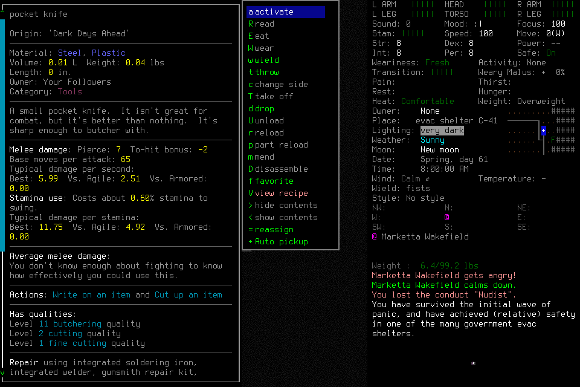

# Registered dismissal and normal ending

**Native011 passed its finite engineering qualification.** A fresh designated operator normally created Riley Enactive / Enactive Qual Eleven, verified visible identity and adoption, inspected a pocket knife, dismissed its actual item menu, then normally saved, exited the owned child and completed stopped Finish. This does not accept the independent supply-and-shelter mission.

Candidate `e92734f82b813ac501d159e8440c13bcd47e0bbf` passed 1,180 common tests in337.957s plus viewer/documentation/diagrams/governance and independent source/proposal review. Both exact hosted lanes passed: [PR](https://github.com/CVX-Hull/enactive/actions/runs/39503924961), [push](https://github.com/CVX-Hull/enactive/actions/runs/39503916295). Installed native SHA256 remained `cd031f200748cbbb387011335db15596346dac29607221fac25641ec9a771f1f`; the prepared wrapper used explicit project userdir and FULLSCREEN=no. Source stayed frozen throughout the run.

This is the unaltered actual native frame; source/hash/revision and aggregate fields are in [the result](assets/owned-character-qualification-011/result.json). Upstream CDDA/tiles imagery retains [its attribution and licenses](../../NOTICE.md). The graphical spectator was observed during creation, item inspection and normal ending; its old frames became stale after process exit.

## Actual result

Item source `d330dd8e5eb1f4811c53380361469a8a8ecfd7ef8c786ab81909575fc5fa438b`, revision93, showed pocket-knife details. One returned `UILIST.QUIT`, UUID `11e32c04-d0cc-4017-a0b5-751271ae34af`, restored INVENTORY revision96. Its result remained partial with one proposal and verification required. A separate registered inventory QUIT returned to adopted normal play. No implicit answer or item action followed dismissal.

The creation and Save confirmations each retained their original unknown acknowledgment. Separate first/latest observations supported same-root effect reconciliation, followed by distinct identity readmission/visible Claims/adoption and a SavedCheckpoint. Normal owned Exit referenced that saved checkpoint, retained its own unknown acknowledgment and verified exact-child returncode0 with pending retirement. NormalFinish disposition was stopped, with no completed objective Work claim. All three original unknown charges remain unknown, with effects reconciled and no replay.

The operator explicitly quiesced before lead custody work. The owned child had already exited normally; the exact controller then closed0. Game, controller, listener and live slots were verified absent. No game signal, user key, ordinary lead rescue, hidden/save edit, new provider or global configuration change established the result. Independent read-only audit matched all74 journal input UUIDs to ledger charges and verified all188 PNG hashes, actual source/action transitions, original deadlines and reserves.

## Costs and limits

50 terminal requests;74 charges (71 returned,3 original unknowns);188 frames/5,882,930 bytes;649.590267s Start→Finish and735.291665s through process-shutdown verification;0 game-seconds. The400-input/3600-second admission and protected50-input/600-second ending reserve stayed intact. Two semantic operator mistakes blocked0inputs: premature world-name commit and incomplete inventory-row interpretation. A malformed read-only CLI record and local draft errors also remain retained; neither was hidden or counted as delivered input.

Returned setup/identity/item/menu preflight→ACK intervals had median80.79ms, nearest-rank p95210.50ms, maximum6362.78ms and sum12.61s across71 returns. Three unknown timeouts are disclosed separately. These figures do not measure movement, whole-skill/model/tool/approval/display latency, causal allocation of the remaining wall time or a controlled speedup. External model/token/time/tool metrics remain unmeasured.

[Native010](2026-10-20-menu-dismissal-qualification.md) remains a separate closed failure. Its scoped binding-correction result did not accept normal ending. This pass does not qualify general worldgen abort, native activity cancellation, user-Pause reconsent, reload, successor or independent supplies/rest/replanning. [Current work](../work.md) and [central mission tracking](https://github.com/CVX-Hull/enactive/issues/144) own the next outcome. No historical report renews input authority.
