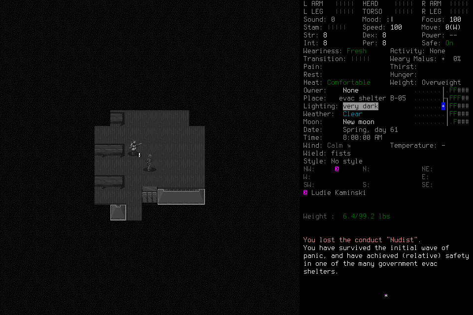

# Native009 request-construction failure

**Native009 failed before its declared inventory-binding probe.** The operator
submitted identity inspection with `phase_id: null` instead of the creation root.
The request sent no input, but the designed failure handling revoked its phase.
The stopped attempt cannot resume or become a passing qualification through a
later repair. Independent mission and native binding-correction acceptance remain
open. [Deciding002](2026-10-20-independent-mission-second-attempt.md) retains its
different stale-boundary failure.

## Scope and actual progress

Source was `26a29241fd8c19025f5cb6ef1cac21ce89431bc3`; native SHA256 remained
`cd031f200748cbbb387011335db15596346dac29607221fac25641ec9a771f1f`. Independent
review and common controls passed 1,156 tests in 319.300 seconds; both exact hosted
lanes passed: [PR](https://github.com/CVX-Hull/enactive/actions/runs/39493040830),
[push](https://github.com/CVX-Hull/enactive/actions/runs/39493033203). The first
common invocation correctly rejected a directly edited generated control map;
the corrected registry/generated-map checkpoint passed. No source changed during
the admitted run.

The single fresh general-purpose engineering operator passed two passive literal
CLI access checks. Its admitted loopback calls used the same authorized execution
mode without an observed approval prompt or denial. There was no paid provider
or explicit model override; exact model/effort and external usage were unexposed.

One finite attempt allowed 400 inputs, 3,600 wall seconds, 43,200 game-seconds,
2,048 frames and 768 MiB, with protected ending reserves of 50 inputs, 600 seconds,
128 frames and 128 MiB. Smaller root limits and optional-proof cutoffs remained
in force. No older allowance or current-world facts transferred.

Enactive Qual Nine was created normally. Morgan Enactive was visibly named with
default Evacuee/Survivor/random-location choices. The final creation Yes became
unknown and was never replayed. Diagnostic Observe, same-root typed transition/
effect reconciliation and separate identity-only readmission succeeded. The
original unknown ACK and its charge remain unchanged.

`char009-inspect-identity` then omitted its direct `char009-create` root. The
lifecycle adapter rejected it before refresh or dispatch. SQLite records zero
primitives for that request. Epoch advanced to 2; lease, lifecycle and prompt
phases were revoked. No identity inspection, adoption or declared bad-boundary/
new-corrected-request probe occurred. The operator stopped and settled its tools
without lead/user gameplay assistance.

An earlier unsupported horizontal activation draft returned blocked with zero
proposals and preserved its phase; a new focused request proceeded. The operator
also reported a local wrong Cancel label and missing-source/file construction
failures. Their failed raw outputs were not independently retained in this record;
the stop report and corrected service records do not fill that evidence gap.
Those reports do not substitute for the declared probe or establish permission
failure.

## Closed result and limits

| Retained measurement | Result |
| --- | ---: |
| Mission requests / charged primitives | 34 / 68 |
| Returned / original unknown ACKs | 67 / 1 |
| Unreconciled effects | 0 |
| Verified PNGs / bytes | 166 / 3,728,269 |
| Wall seconds through stopped-owner watermark | 536.3618 |
| Canonical game-seconds | Unknown: no adopted normal session |
| Retained child / controller exit codes | 0 / 0 |
| Exceptional teardown / signals to game | 1 / 1 |

Independent read-only review found no eligible registered normal save, exit or
Finish: adoption and a saved checkpoint were absent, and the owned child remained
running. A separately declared teardown freshly verified exact retained child,
parent, launch identity, start time, prepared Resources cwd/userdir, paused scene,
quiescence and empty slots. One exact-child SIGTERM produced an OS zombie; only
then did the lead close the controller. Its retained handle recorded exit 0 with
`normal_exit_verified=false`. Both exact processes, listener and live slots were
absent afterward. All existing world/save files were preserved; preservation of
in-memory progress and normal saving are unproven. No NormalExit or Finish is
claimed.

Ledger/evidence reopening retained costs and original unknown delivery without
restoring authority. Nineteen prior current-bridge unknown records remain separate
from this attempt's one. A truncated passive status tool display was replaced by
a complete direct file capture; it was never treated as complete evidence.
[Result and figure provenance](assets/owned-character-qualification-009/result.json)
retain this failed scope.

The 67 returned setup/menu/readmission intervals had median 78.30 ms, nearest-rank
p95 118.55 ms and maximum 6,352.31 ms; their sum was 11.57 seconds. The unknown is
excluded. These are retained preflight-to-ACK intervals, not movement, whole-skill,
model, tool, approval or browser timing. The remaining wall span has no measured
causal allocation. Different qualification samples do not establish speedup.

The next design review must reduce repeated opaque-field construction through
existing contract/JSON capabilities and assess request errors separately from
actual authority loss. It must preserve current live guards and the failed record;
another attempt requires an explicit finite admission. No seven-day authority or
independent objective follows from this qualification.
