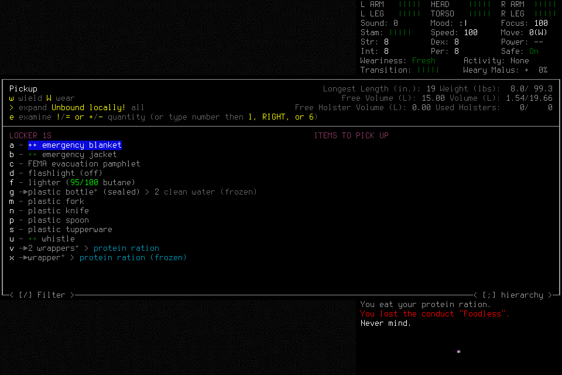
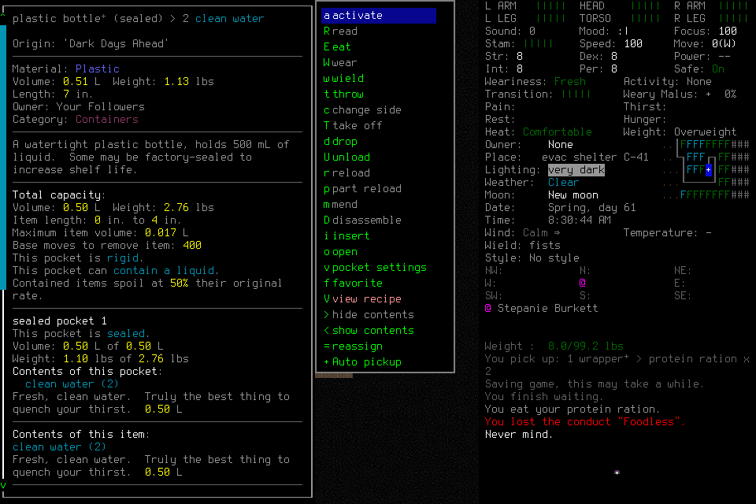
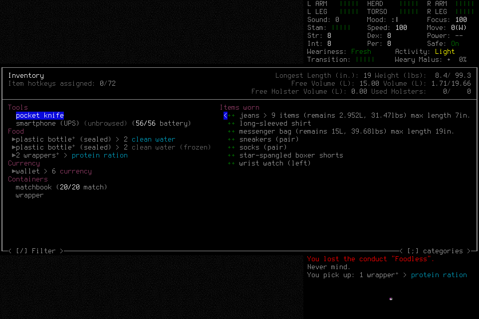

# Discovery learning: normal fourth run

`discovery-learning-004` supports the next finite fresh seven-day development
assessment. The player resolved ordinary interactions, derived and transferred a
procedure, refined its conditions after a real mismatch, used asynchronous advice
and completed normal save/restart/reload/final shutdown. This is a bounded
functional result. Protected source publication remains a separate CI lane; no
seven-day survival, general learning or causal memory benefit is established here.

The deciding source was `82bdd10efef3da3e4e60e4be026bd31dc8382fcc`, installed native
SHA256 `9828263d32e3bb62a7035c7dca484576841da9f08c53a700b21eb733300fe898`.
Fresh default Evacuee/Survivor, EnactiveLearningFour/Riley, random normal location,
no initial historical library, windowed/background prepared wrapper. One player,
one clean successor and one separately assigned advisory actor used the existing
20-tool MCP path. The lead admitted, observed, orchestrated the registered handoff,
reviewed evidence and closed the controller; it supplied no tactics, procedure
curation or user-input rescue. No visible routine gameplay approval occurred;
hidden host review telemetry remains unavailable.

## Scope of the revision

The [frozen delivery](../changes/057-discovery-learning-campaign.md) requires real
changed-condition evidence leading to narrowed/revised procedure data. Actual
south-locker frozen stock contradicted the successor's intended liquid reserve.
It applied R1's existing stop, canceled, wrote R2 with an earlier full-condition
and locker-direction check, then acquired a ration using R2.

Independent review qualified this result: R1 already stopped on missing targets
and excluded contents usefulness. **No R1 prediction was falsified, and no
correction of an erroneous R1 rule or measured improvement was demonstrated.**
The lead accepts the fixed functional narrowing criterion within that scope;
requiring a deliberately bad rule or unsafe failure would add a different test.
The stronger correction/efficacy claim remains future work under #177. R2's first
direction-check step precedes its open-pickup step, a small advisory sequencing
ambiguity; actual application handled opening, direction, condition, count and
commit correctly. The lead does not rewrite player memory to improve this record.

## Outcome evidence

| Requirement | Actual result and limits |
| --- | --- |
| Supplies/care | `dl004-water-acquire` transferred a locker bottle; inspection `5720983c…` shows **0.50 L liquid**. An initial frozen bottle already existed before this pickup. Two ration wrappers were acquired, one ration eaten responsively after Peckish, and a successor ration acquired. No thirst arose; drinking was not forced. Final inventory retains liquid water, the separate frozen bottle and two filled wrappers, with no observed critical need. |
| Shelter/rest | `bafd8830…` at08:00:10 → `1f936cd9…` at08:30:10 proves1,800seconds sheltered waiting. The player first declined sleep while Fresh, then used the wait activity. |
| Navigation/replan | Six credited steps: `[0,0]→[1,0]→[2,0]→[2,1]`, followed by a three-step return. Unknown connecting terrain caused genuine zero-input route refusals; the player narrowed to known steps and reached supplies. No collision or engineered obstacle is claimed. |
| Discovery/derivation | Actual pickup list, focus, unfamiliar quantity editor, typed count and selected-set verification precede a visible bottle transfer. R1 (`dl004-pickup-procedure-memory`, memory54) joins six original requests and three source images. |
| Distinct reuse | `dl004-ration-pickup` selects R1 for two grouped ration wrappers, distinct from one bottle; children inherit the use. Transfer, later inventory and eating verify possession. This is nearby supply/count transfer, not broad generalization. |
| Revision | Frozen-stock cancellation → immutable R1→R2 lineage at memory109 → `dl004-successor-ration-start2` through `dl004-successor-ration-acquire`. Only one wrapper was selected; no unrelated frozen bottle was accidentally acquired. The qualification above applies. |
| Fresh context | For packet `packet-3982d83e…`, the successor separately retrieved all eight required memory and three procedure PNGs before `dl004-successor-claim`; every serialized image payload matches retained bytes. Separate readmission precedes substantive R1 stop/R2 application. Retrieval does not prove attention or causal benefit. |
| Normal lifecycle | Save/owned exit → new child → exact EnactiveLearningFour/Riley reload → `dl004-successor-load-adopt3`; saved/loaded turn both5214645. Final normal save/exit and Finish follow. |
| Quiescence | All three actual host handles reached final completion before controller/storage closure. Both owned native children exited normally; the controller exited0, and no owned process or8766listener remained. |

## Reflection and correction

The fully graphical same-proposal chain is job
`reflection-b5c41f731a5e0768b0d4f2c05f205d53e0d3a63d3fa5ab8aefc7f2b705d6859a`
→ proposal `808713474fa60ae172afbe726d06f2d90aa23f21e6fc2d2ccdd492a7e6a8cbf9`.
Its durable claim23:32:47.754–submit23:33:03.782 UTC contains actual advisory PNG
presentations at23:32:51.425/55.665 and useful player progress: focus No at53.302–55.096,
activate No at23:33:00.196–01.433, returning to normal shelter play while Fresh.
The player read advice at23:33:11.347 and later recorded memory92,
`dl004-advice-disposition-memory10`, keyed to this exact job/proposal. It partially
adopted inventory/volume/rest checks and limited the advisory counting inference.
The image did not establish the asserted container/content distinction; retain
that correction rather than crediting a convincing interpretation automatically.

Job16/proposal891967… separately overlaps a counted pickup and has later
memory116 disposition, but its advisory actor retrieved no job16PNG. Do not combine
these two proposals' proof. All20submissions were timely; two later jobs remained
unreviewed. The20original180-second windows charged3,600seconds; observed
claim-to-submit intervals total182.8303seconds,
median8.6657, range
3.5738–16.0277.
These are elapsed claim intervals, not inference time. An original unknown claim
was collected without another claim charge. No windows, failures or costs reset.

Five claims spent900charged seconds before adoption. Jobs5/10/11 had truncated
host presentations;10/11 recovered selected slices,5 disclosed the limitation.
Source omissions remain explicit in the retained jobs. Scheduling relevance,
bounded presentation and interpretation calibration belong to #178/#177; harm to
later analysis is a hypothesis, not proved by early spending alone.

## Costs and timing

The [bounded machine-readable evidence](../assets/discovery-learning004-evidence.json)
owns counts, intervals, image-byte joins, browser sample scopes and screenshot hashes.
It excludes raw private host reasoning/account metadata.

| Resource | Retained actual |
| --- | --- |
| Primitives |178charged:172returned,6unknown ACKs |
| Requests |148:43completed,85partial,16blocked,4unknown; requests are not model calls |
| Images |467retained /25,411,298bytes /156distinct hashes; all retained files verify |
| Presented image bytes |81player +48successor +17adviser presentations; all146decoded payloads match retained PNGs |
| Game time |5212800→5214645,1,845seconds; no seven-day outcome |
| Effects |All six unknown ACKs retain separate effect proofs; zero unresolved effects does not erase unknown ACKs |

Whole completed MCP skill calls: player n=75, median0.842s,
maximum15.011s; successor n=27, median1.475s,
maximum15.034s. Completion here means tool transport, not gameplay success.
Separate local errors remain in the JSON. Host interval/gap summaries include
the passive preflight turn; skill samples are from actual deciding play. Representative five-input focus3.503s,
eight-input focus7.883s and three-step return2.215s identify batch overhead for
#164, using the accepted #154 integration. Adjacent nonoverlapping MCP gaps have medians
5.154s/player and
4.522s/successor; they include
interpretation, other work and host scheduling, not pure model inference.

Browser setup retains32samples per independent buffer: median status2.5ms,
decode4.85ms, status-to-DOM5.0ms. Terminal buffers have medians6.8/5.25/5.3ms,
but share **zero cycles** and show native disconnected/retained stale frame.
Setup shares five cycles. Do not add these distributions or call them32paired
end-to-end measurements. Animation callbacks are presentation opportunities, not
paint. Native-to-browser, inference, token/quota and causal-effect metrics remain
unmeasured. No throughput or speedup extrapolation to seven days is justified.

## Closure and next assessment

Normal Finish `dl004-successor-finish` reports disposition `stopped` and no
player-claimed completed Work. Independent evidence, rather than that label,
supports the functional findings above. Final owned exit
`dl004-successor-final-exit-yes` returned0; no save edit or exceptional kill was
needed. The engineering lead's initial concurrent read-only result collection hit
the client's known serialization refusal; sequential original collection succeeded.
No gameplay input was replayed. Actual final host completions23:37:38.290,
23:44:48.899 and23:47:20.418 precede controller close23:49:10.446 UTC.

Earlier001/002/003remain closed failures.003used48requests/89primitives/218frames
and had no adopted game-time. Its control child failed by charging source age
against a new30-second allowance; #184 repairs that. Its retained valid ASCII job
was63,815canonical bytes but67,874old spaced wire bytes against67,584client cap;
#185 repairs encoding. Unicode expansion is a separate regression. The exact
failed HTTP body/time is unavailable, so that particular call's cause is unproved.

Deciding82bdd10local full checks passed1,439tests; exact hosted CI failed the
advisory-Finish rollback assertion. #187 independently reproduced and repairs
reversible closure, stale phase publication and late ledger refusal. It was
integrated only after004closed, with protocol migration and240focused tests;
the exact repair checkpoint passed1,448local tests in527.295seconds and the
remaining portable checks. Exact hosted/protected validation is separate. The unchanged native needs no rebuild
for that Python lifecycle repair. Native click/nonunit-geometry qualifications
remain separate lanes; this run does not claim them.

Next: freeze a genuinely fresh seven-day mission, scoped library pins to this
normally closed procedure archive, a coupled forecast from these actual costs,
windowed/background preflight and finite reflective limits. Preserve the
[seven-day requirements](2026-10-21-independent-seven-day-readiness.md), meaningful
survival work, actual handoff/reload/final ending and all prior failures. Optional
paid models, extra tiers and causal efficacy studies are not blanket gates.

Subsequent preparation found#188: the library rejected five authority-blocked
prompts despite undisputed intact history. The reviewed source repair passed77
focused tests; a separate lead read-only check retrieved both revisions and ten
exact sources, all historical/authority-free, with both original pins unchanged.
It changes no004outcome or archive and restores no old input authority.

Images contain CDDA content; upstream licenses remain under [the notices](../../NOTICE.md).
Original harness/documentation licensing does not replace game/tileset licenses.
