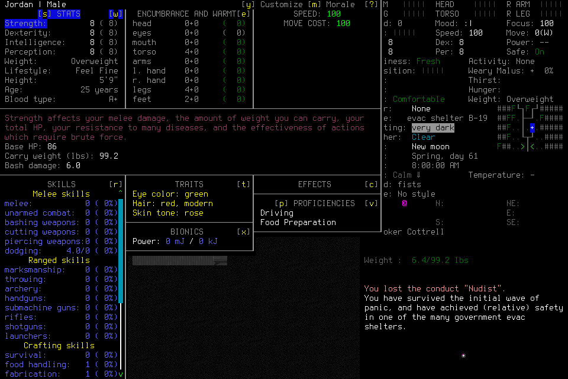

# Fresh seven-day attempt: adoption failure

`independent-seven-day-001` **failed before normal identity adoption**. It created
fresh Jordan in EnactiveSevenDayOne through the ordinary default Evacuee/Survivor
interface. Original scenario/profession/final-description images visibly verify
Evacuee, Survivor, Jordan and random starting location; their joins are retained
in the machine record. A source composition defect prevented the mission from accepting
that identity. No seven-day survival, meaningful survival gameplay, procedure
application, handoff, midpoint reload or normal ending is accepted. The normally
closed [learning004 result](2026-10-21-discovery-learning-fourth-attempt.md) remains
separate evidence; it does not turn this failed attempt into success.

Deciding source `c2b9117b48271e1944eee6373b6f51608d273dab`; installed native SHA256
`9828263d32e3bb62a7035c7dca484576841da9f08c53a700b21eb733300fe898`.
The actual twenty-tool player preflight and separate advisory schema preflight
passed before the original `seven001-admission` at1792627626.423554. Source/native/
windowed-background options, new scenario, normally closed004library pins, update
policy, actor roles, all seven finite caps and protected ending were frozen first.
No visible routine gameplay approval occurred; hidden host telemetry is unknown.

## Failure and retained results

`seven001-char-confirm-001` retained its original unknown ACK. Diagnostic Observe
and same-root `seven001-create-transition-reconcile-001` separately established
the creation effect; `seven001-create-identity-readmit-001` deliberately resumed
provisional identity inspection. The actual PLAYER_INFO image shows Jordan, and
world/character Claims remain source-linked. No uncertain input was replayed.

`seven001-create-adopt-001` then settled blocked:

> Invalid candidate lifecycle evidence: Procedure retrieval requires its admitted library and environment

The live library was mounted. `lifecycle._project` unnecessarily constructed
`CampaignMemory(ledger, store)` solely to call its pure claim-frontier reducer.
That constructor correctly rejects an admitted historical library when no library
object is supplied. Both candidate and committed timeline projection share this
composition fault. Another query or client retry cannot repair it. [#189](https://github.com/CVX-Hull/enactive/issues/189)
owns direct reuse of the pure reducer, retaining memory-library and lifecycle
identity/provenance checks. The isolated regression reproduces the actual failure
before the fix. Independent source review found no findings;108worker focused tests and44reviewer
tests passed. The prior deciding c2b9117passed1,451local tests in531.540seconds and
portable checks, but did not cover this integrated admission configuration. These
source checks and any later fresh graphical assessment remain separate.

| Resource | Actual retained |
| --- | --- |
| Requests |45:9completed,30partial,5blocked,1unknown; these are not model calls |
| Primitives/mappings |91charged:90returned,1unknown with separate settled effect |
| Images |219original PNGs /5,522,697bytes; every file hash verifies |
| Game time |Mission anchor/budget remains **null**, not zero elapsed mission time. First/last observed turn5212800; no adoption accepted. |
| Reflection |6completed original claims/submissions,360conservatively charged seconds; no candidate procedures/adoption. This does not prove useful reflective improvement. |

The [machine-readable record](../assets/independent-seven-day001-evidence.json)
contains original closed ledger/index/journal pins and the exact image join.
Closed copies match their fully closed originals byte-for-byte; SQLite integrity
passes. Raw private host reasoning/account metadata is excluded. No claims about
actual inference/token/quota costs, image attention or memory efficacy follow.

## Closure and next attempt

The player identified the engineering fault without tactical rescue, recorded the
original failure and issued `seven001-player-stop-engineering-001`. Stop settled
at epoch2 with no active operation, lease, lifecycle/activity/prompt slots, native
pending/control slots or unresolved effects. Both actual player and advisory host
handles completed and declared permanent quiescence before teardown. The adviser
finished its already claimed work after explicit stop and made no new claims.

Normal Save/Exit/Finish was unavailable at this unadopted provisional boundary.
The lead verified exact owned child19996/launchbe0f6ecd508a4fc8bf5754a76e08229c,
then exceptionally terminated it; it became defunct under its verified controller.
The controller17484/exec26380 then received INT and exited0. Both exact PIDs and
port8766were absent afterward. The final journal records child returncode0 but
**normal_exit_verified:false**; returncode0 does not establish normal ending.
Shutdown retained a paused ledger at epoch4, distinct from the earlier Stop's
epoch2. No archive, save or immutable request was edited to label it terminal.
Exact actor/PID custody and signal ordering are the lead's tool evidence; the
journal alone does not independently establish that entire sequence.

After the owned source repair, freeze a genuinely new world/character/attempt,
repeat actual source/native/library/tool checks and retain this failed history.
Do not resume Jordan, renew the original deadline, refund these costs or remove
any [seven-day requirements](2026-10-21-independent-seven-day-readiness.md).
The lead remains outside tactics and memory curation; optional efficacy studies,
paid models and new history infrastructure are not blanket prerequisites.

The image contains CDDA content under the [upstream notices](../../NOTICE.md).
