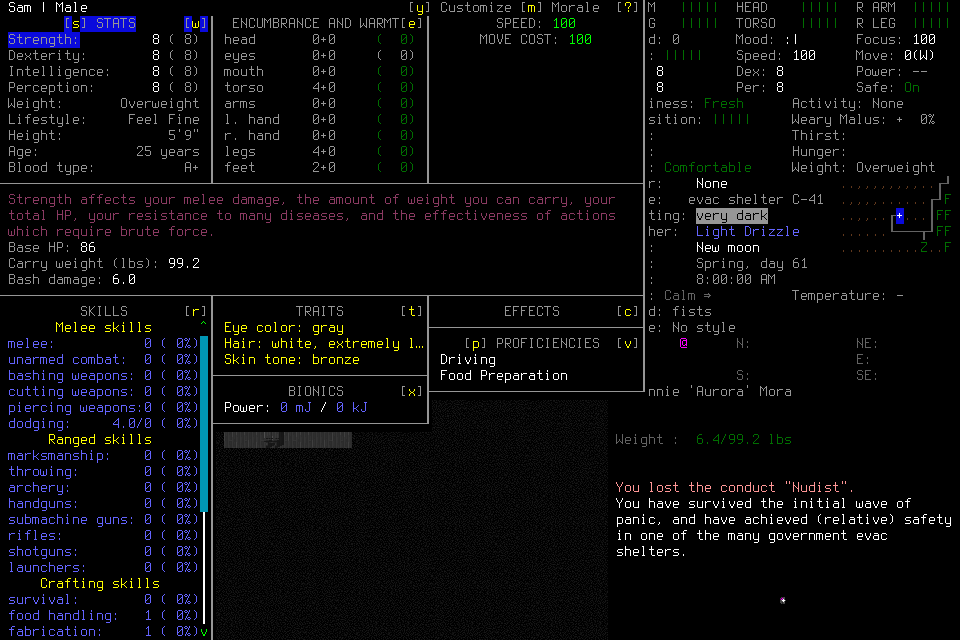
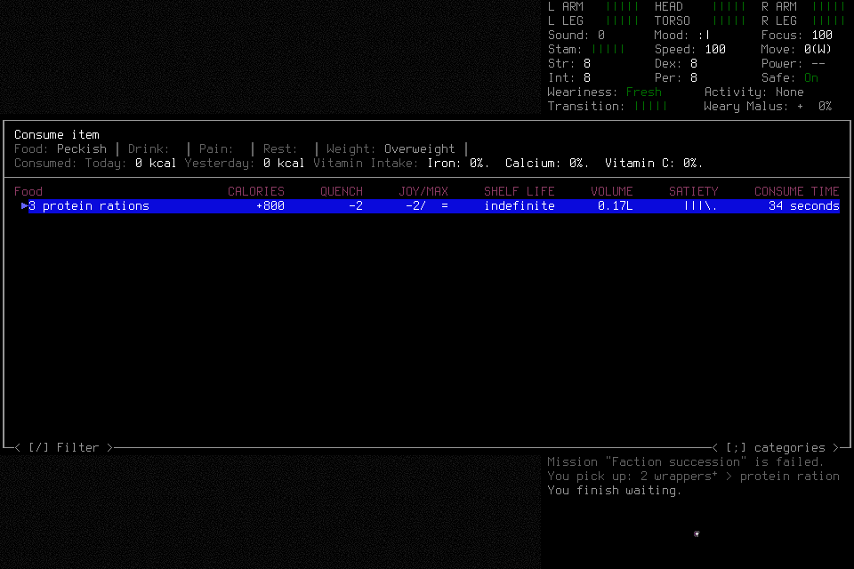

# Independent seven-day campaign: second attempt

**FAILED after normal identity adoption.** The player acquired three protein
rations and waited thirty actual game minutes, then a zero-input semantic request
error revoked its owned consume prompt. No daily milestone, real player handoff,
midpoint reload, normal ending or seven-day survival is credited. The failure,
original unknown acknowledgment and cumulative costs remain unchanged by repairs.

## Frozen scope and actual partial result

Original `seven002-admission` admitted `independent-seven-day-002` at
1792628337.8007731, deadline1792714737.8007731, source
`c57f4a8513e21ce07a2fa4c89310bfa7c3accf93`, installed native SHA256
`9828263d32e3bb62a7035c7dca484576841da9f08c53a700b21eb733300fe898`.
Fresh EnactiveSevenDayTwo/Sam used default Evacuee/Survivor and random start.
The source/native/wrapper/windowed-background options, normally closed004 library
pins, prospective outcome, update policy, coupled resource/ending forecast and
actual twenty-tool player/adviser preflights were frozen before admission.
The prior failed001 was not resumed or imported as world knowledge.

`seven002-adopt-001` completed normal adoption at turn5212800, exercising #189's
library/lifecycle composition repair. Actual last normal turn5214604 supports
1,804 elapsed game seconds. The wait alone advanced from5212804 to5214604:
08:00:04 to08:30:04, exactly1,800seconds. No retained scene reports a hostile.

Pickup images show three selected wrappers and messages for one plus two
wrappers, yielding three protein rations. The final consume screen still shows
three rations, zero consumed calories and Peckish; Drink, Pain and Rest are clear.
Starting clean water was frozen, so a usable liquid reserve is unverified.
Imported R2 selection and inherited pickup linkage are independently verified.
The player reported viewing five historical support PNGs; their host-payload
presentation was not independently audited. No causal memory benefit is claimed.

## Failure and ordinary-input gap

`seven002-eat-select-001` requested menu activation of “3 protein rations” inside
item/consume root `seven002-eat-001`, instead of that adapter's typed selection.
Its exact source was `be5c22fcc6b5cd7008c52e06c6b7b4ac19b1c3b48e6c42c659066420a1b8b386`,
INVENTORY revision188, boundary`1792628512516-63428-1-b64`. The error was:

> ControlError: Item selector confirmation requires its typed quantity/selection step

The request created **zero primitives**. Global exception handling nevertheless
revoked prompt/lease and paused. There was no captured uncertain dispatch to
reconcile; the player could not choose an ordinary Escape under the lost scope
or use the normal saving path. It retained failed Work and completed
`seven002-stop-001`. This is a harness limitation, not evidence that unfamiliar
menus inherently require a new semantic adapter.

[#190](https://github.com/CVX-Hull/enactive/issues/190) repairs healthy zero-input
draft handling, including a player-chosen ordinary Escape under the same root.
[#191](https://github.com/CVX-Hull/enactive/issues/191) tracks the broader ordinary
interaction and CDDA-class portability boundary. Source regressions, including
unfamiliar menus changing after prior steps, are separate from actual gameplay,
model adaptation and cross-game qualification. Neither issue revives failed002.

## Retained costs and uncertainty

| Measure | Actual retained value |
| --- | --- |
| Requests |64:12completed,48partial,3blocked,1unknown |
| Charged primitives/mappings |115:114returned,1unknown |
| Frames |285 PNGs /11,791,285bytes; all original hashes verified |
| Adopted game time |1,804seconds |
| Advisory jobs |4completed;240originally charged seconds |

The creation confirmation `seven002-character-confirm-001` retains its unknown
ACK. A matching separate lifecycle transition reconciled its effect; no replay
occurred and no unresolved effect remained at Stop. Advisory elapsed time is not
model compute; unmeasured tokens, quota, hidden review telemetry and model latency
remain unknown. Original caps and protected ending were not reset or extended.

The [machine evidence](../assets/independent-seven-day002-evidence.json) records
closed ledger/index/journal hashes, exact image joins, turn evidence and scope.
Copies match fully closed originals byte-for-byte; SQLite integrity passes.
Raw host reasoning and account metadata remain private.

## Closure and separate source validation

Both actual player/adviser host handles were FINAL and permanently quiescent,
with no pending input handles or native/control slots. Stop settled paused at
epoch3. Normal Save/Exit/Finish was unavailable from the revoked prompt.
The lead verified owned child PID63428, launch`f0eb65415fe94c54aba75a694b9280fb`,
under controller60318, then sent TERM to that child. It was observed defunct under
its exact parent before controller INT; controller exec63268 returned0. Exact
PIDs and port8766 were absent afterward. The journal records returncode0 but
**normal_exit_verified:false**. The final closed ledger is paused at epoch5,
“Mission runtime closed.” This is exceptional closure, not normal ending.
Actor terminality, exact custody and signal ordering are lead tool observations;
the journal alone does not establish the whole sequence.

The deciding c57f4a8 source passed
[hosted controller CI](https://github.com/CVX-Hull/enactive/actions/runs/39698904090).
Local full validation retained one failure among1,454tests in524.413seconds:
mission-finish test setup refused retirement of an unexpired terminal request.
Independent controlled scheduling reproduced an exchange clock mismatch;
[#192](https://github.com/CVX-Hull/enactive/issues/192) owns the source repair.
Hosted success does not erase that failure. Later source review/focused/full
checks, native qualification and a genuinely fresh campaign remain distinct lanes.
