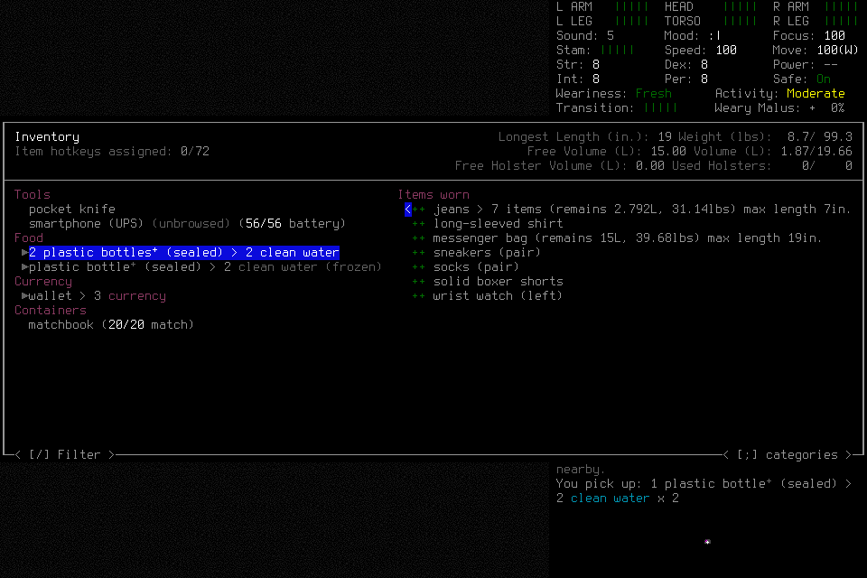
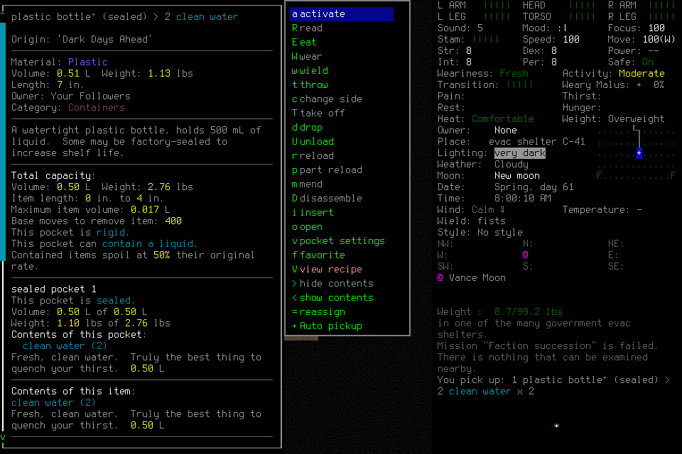
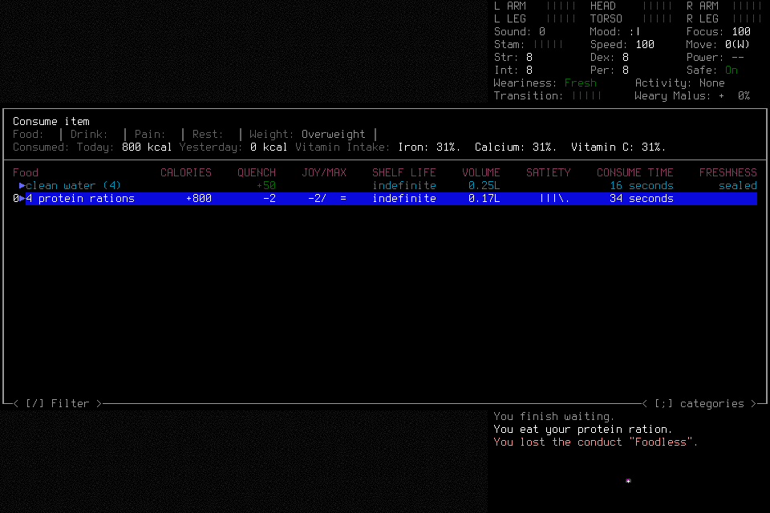
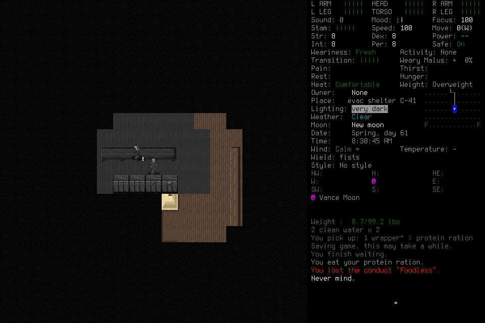
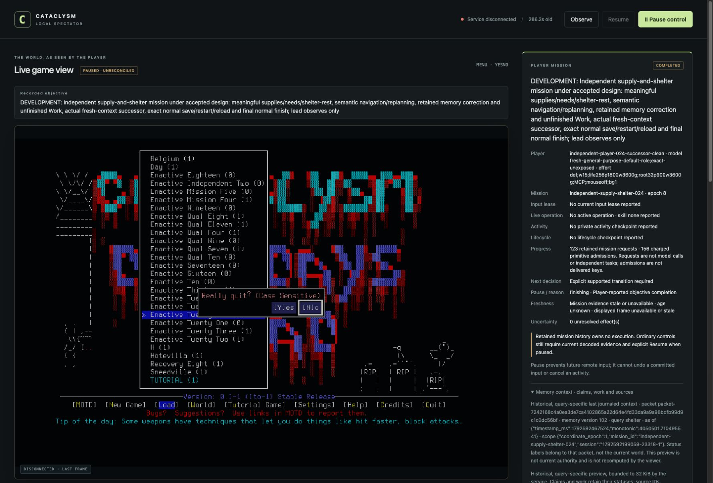

# Independent supply-and-shelter mission024

Alex Enactive completed the original bounded development mission through two
independent player contexts: useful supplies, responsive food care, six purposeful
navigation steps, a genuine replan/correction, thirty actual minutes of shelter
waiting, retained unfinished Work, normal save/restart/exact reload and final
normal save/quit/Finish. The lead provided admission and reference-only successor
orchestration, with no ordinary tactical rescue or live source/memory repair.
Both owned game processes and the controller exited normally. This is one
functional result after23failed development attempts, not an independent seven-day
campaign or proof of memory benefit.

[Bounded result, original image hashes and lifecycle proofs](assets/independent-supply-shelter-024/result.json)
own the selected provenance. The original
[mission criteria](../design/player-owned-mission.md#first-integrated-native-acceptance)
remain unchanged. Gameplay evidence review found no blocking outcome gap;
publication, protected candidate/main validation and #145 readiness remain separate
closeout work. [#144](https://github.com/CVX-Hull/enactive/issues/144) owns integrated
acceptance; [#136](https://github.com/CVX-Hull/enactive/issues/136) remains the wider
player-owned campaign outcome.

## Frozen run and actual outcomes

The deciding source was `502ca0fcb788c98a7021d17efa6071dc5154102e`, native SHA256
`cd031f200748cbbb387011335db15596346dac29607221fac25641ec9a771f1f`:
native4, mission/8, ledger10, archive3, campaign-memory/3 and gameplay/2.
The immutable admission selected1600inputs,10800wall seconds,43200game seconds,
4096frames/1GiB,4096requests and8192primitive mappings. Ending reserves were
100inputs,900wall seconds,256frames and128MiB within those totals. Whole lifecycle
roots selected256primitives/1800wall/3600game seconds; ordinary prompt roots
32/900/3600. Children could only narrow their original root. No live extension,
source change or failed-run resumption occurred.

The player ordinarily created **Enactive Twenty Four / Alex Enactive**, using
Evacuee/Survivor, default8/8/8/8attributes and random location. The identity screen
and registered adoption connect creation to ordinary play. No debug spawn, chosen
map or save edit supplied the outcome.

| Requirement | Actual evidence and scope |
| --- | --- |
| Clean usable water | Inventory distinguishes two liquid bottles from a separate frozen bottle. Bottle details show0.50L clean water; the later consume menu independently lists four0.25L usable servings: **1L**. Frozen stock receives no credit. |
| Food and responsive care | Counted pickup acquired a wrapper containing protein rations. After the shelter wait, the HUD showed Peckish; actual consumption shows800kcal and “You eat your protein ration.” Four rations remain listed afterward. |
| Navigation and replan | Initial locker target `[2,0,0]` was genuinely refused with zero proposals because connecting terrain was not retained. The player chose observed intermediate targets, approached the lockers and returned to the bench area. Exact credits were east,east,south,north,west,west: six steps with direction changes. The return request batched three verified steps. |
| Shelter/rest | Visible evac shelter C-41, turn5212811→5214611, with “You finish waiting”: **1800actual game seconds**. This proves ordinary waiting/rest, not sleep or universal safety. |
| Correction and unfinished Work | The player retained and superseded its actual unsupported navigation assumption. Work `p024-supply-shelter-work` honestly retained unfinished water/food verification, rest and lifecycle obligations before handoff. |
| Final condition | Final normal scene shows C-41 at08:30:45, Comfortable, intact displayed health and no observed critical unmet need. No claim of a fresh post-reload inventory count is made. |

## Actual fresh-context continuity

After issued handoff `p024-handoff`, the predecessor permanently relinquished
control with no pending calls, lease or unresolved effect. A distinct general-purpose
agent was launched with `fork_turns:none`; it received the original objective,
interface/admission and handoff/source/Work references, without a reconstructed
tactical history. These are procedural roles, not security isolation.

The successor retrieved the bound complete required-Work packet
`packet-62ba88dd869b90a3d461ddb96ca64d70fa3c4b4ce790ee801b84fe8e6a4be157`.
The actual host trace contains seven completed source exports and seven image
outputs before claim. Each output's decoded PNG SHA256 matches its corresponding
canonical archived source. This is stronger than a source-read declaration;
mental attention and causal benefit remain unmeasured. No private transcript is
published. `mission_source` events record publication, not individual reads; an
earlier audit attempt using that wrong correlation was retained and corrected.

The one-use `p024-successor-claim` and separate `p024-successor-readmit` completed.
Readmission used the original issued post-Pause source and charged exactly one
returned Resume, retaining the original clock/costs/reserves. The successor then
independently inspected water, acquired food, waited, ate, corrected provenance and
completed lifecycle work. This was substantive continuation, not merely signing
off a predecessor's completion statement.

## Normal lifecycle and preserved uncertainty

`p024s-save-transition` established the first SavedCheckpoint;
`p024s-first-exit-yes` verified normal owned-child exit0. A distinct second launch
then loaded the uniquely selected Alex Enactive from Enactive Twenty Four.
The saved endpoint and first reloaded normal scene both show **turn5214645**.
The successor's initial world Claim cited the character selector instead of the
required owned world menu. Adoption refused before commitment; the player
corrected its source provenance and `p024s-reload-adopt-corrected` succeeded.

`p024s-final-save-transition`, `p024s-final-exit-yes` and
`p024s-finish-scoped` retain final Save/Quit, normal child exit0 and NormalFinish.
A mixed-session completion Work draft and then incomparable progress were refused;
the player independently narrowed the final assertion to its actually supported
scoped endpoint. Those refusals remain failures, not erased attempts.

Six original native acknowledgments remain **unknown**: creation, two saves,
reload and two process exits. Separate visible lifecycle transitions or exact
owned-process exit proofs settled their effects. None was relabeled returned or
replayed. Four mission requests retain unknown status; both normal-exit requests
have separately verified completed outcomes despite their unknown input ACKs.
Zero effects remain unresolved.

The lead verified permanent actor quiescence and both normal child exits before
closing the controller with exit0. Exact owned PIDs and port8766 were then absent.
No game signal or exceptional teardown was used. Saves and evidence remain intact;
reopening historical files grants no input authority.

## Observer, costs and claim limits

The actual spectator retained objective, successor identity, cumulative requests
and charged admissions, historical memory/Work, no lease and zero unresolved
effects. After shutdown it correctly displays Service disconnected/last frame.
It also retains a confusing “PAUSED · UNRECONCILED” frame header and unknown combined
Work view alongside COMPLETED mission state. These are presentation findings for
[#143](https://github.com/CVX-Hull/enactive/issues/143) and
[#164](https://github.com/CVX-Hull/enactive/issues/164), not new live uncertainty or
evidence that the exited game is still running. The unchanged
[actual spectator Pause qualification](2026-10-20-independent-mission-first-attempt.md)
remains scoped evidence for user revocation; no artificial Pause was inserted into
this mission.

The ledger contains **123requests**, **156charged primitives**
(150returned/sixunknown), **408original PNGs/20,541,928bytes** and
**1845canonical game seconds**. All408frame hashes, SQLite integrity/foreign keys,
archive/ledger hashes, selected original pixels and retained lifecycle/memory
records were checked. Request states remain42completed,68partial,9blocked,
4unknown; request counts are neither model calls nor independent tasks.
Start→final Finish request admission was1116.972wall seconds, excluding later
engineering audit/cleanup. Returned native preflight→ACK intervals had
median113.16ms,p95409.81ms,max5622.82ms; six unknowns are excluded. These timings
do not measure whole-skill/model/tool/display latency or establish a speedup.

The result manifest names the full ledger, archive index/frame directory and
post-controller-exit journal snapshot by repository-relative local path, byte
count and SHA256. Those ignored artifacts are retained on the original project
checkout by the lead/integration maintainer under the
[existing retention policy](../runbook.md#evidence-retention-and-cleanup); they are
**absent from a fresh Git checkout**. Selected original PNGs and bounded provenance
are public in Git. Full local forensic reproduction requires the retained local
artifacts; missing local media is not a newly failed probe. The closed journal was
snapshotted without truncating its original or indexing a live append stream.

Failed001–023remain closed:1468charged primitives
(1452returned/14unknown/2rejected) and982requests. Together with024, the retained
independent development series has1624charges and1105requests. Earlier engineering
probes and the supervised seven-day campaign are separate costs. No failed attempt
becomes successful through this later result.

Both actual players used the fifteen project-preapproved structured MCP tools.
Their observed transcripts contain no routine human or automatic approval-review
events. Hidden host review telemetry, complete model/tool usage, token/quota cost
and inference time remain unavailable in the campaign accounting. Harness API
spend was zero. Setup, source review, tests and publication are separate work.

Clean-context independent gameplay review found no blocking original-outcome gap.
The exact deciding-source hosted lane passed1291tests in709.784seconds after
133focused tests, fast checks and independent source review. Native binary
qualification, actual mission evidence, browser presentation, final publication
review and protected candidate/main CI are separate evidence lanes.

This result does not establish unattended survival, a universal shelter policy,
memory's causal benefit, model efficiency or autonomous reusable-procedure learning.
[#176–178](../work.md#campaign-delivery-path) retain mixed interaction, player-learned
procedures and nonblocking reflection. The
[seven-day readiness decision](2026-10-21-independent-seven-day-readiness.md)
uses this functional result without importing optional training/curator studies
as blanket gates. It grants no new live campaign authority.
