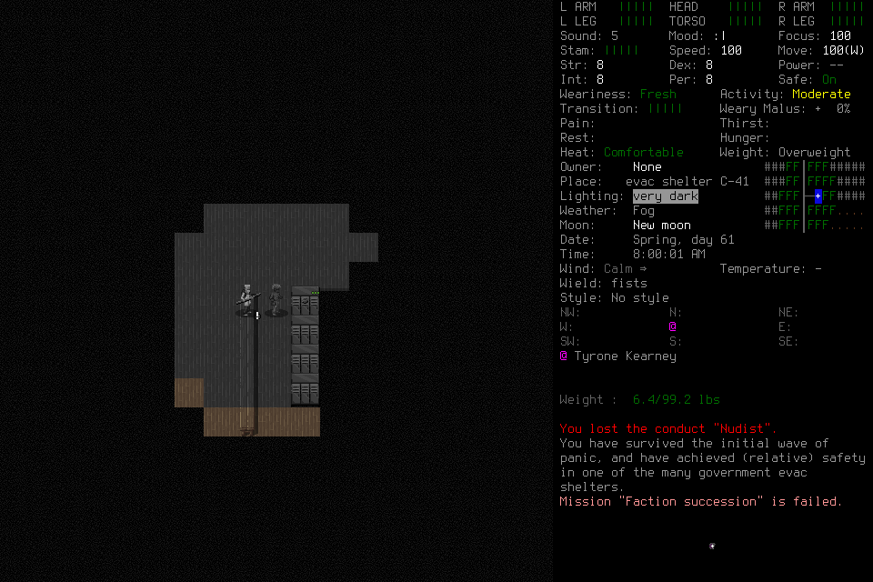

# Discovery learning: fifth attempt failed on native JSON parsing

`discovery-learning-005` is a closed failed attempt. The independent player
created and adopted Morgan, reached the real shelter and moved one tile. Its
first ordinary pickup key then triggered CDDA's JSON diagnostic. No coherent
learning result, eligible procedure library, normal ending or seven-day outcome
is accepted. The lead supplied no tactical input or memory curation; no manual
user rescue was required.

The deciding source was `3f17f7c4898e199fa2beea3fbfb03869063d76a9`, installed native
SHA256 `bbfc8979a0c8b72be6804263e43f5771c45ac32bd4fc668843e9e6b0413d3dce`.
Native6/mission10/ledger12/archive5 ran through the project-local windowed,
background wrapper, fresh EnactiveLearningFive/Morgan, with no initial library.
One designated player and a separate advisory actor used the current twenty-tool
host. The long-lived lead's tool catalogue was old; a fresh engineering registrar
submitted the lead's unchanged frozen admission once, then became terminal.
Read-only ledger verification confirmed those exact terms. It supplied no play.

This original native frame establishes rendering and normal play, not successful
pickup, learning or survival. Raw debug images remain private because CDDA prints
local paths and the claimed request. The diagnostic below is a bounded transcription.

## Failure and retained uncertainty

`dl005-ration-select-01` sent ordinary key `p` in the visible pickup menu, native
UUID `d3ae0940-5e4d-49c5-b554-177b797a9c21`. CDDA reported
**Invalid or misplaced field name "key"**, at a `DEBUG_MSG` boundary without an
ordinary input receiver. The original request timed out, was collected once and
remains unknown; it was never replayed. The player retained the diagnostic and
stopped. One unresolved effect remains. An earlier creation confirmation also
retains its unknown ACK, with a separate observed transition and identity adoption.

Both actual actors became terminal before teardown. The owned native child was
terminated exceptionally, then the controller exited0. No debug-ignore input,
save edit, validation bypass or normal-save claim was used. The retained ledger
still says paused/internal_recovery; external attempt closure does not rewrite
it into a successful terminal state or restore authority.

| Retained cost | Actual |
| --- | --- |
| Requests |53 |
| Primitives |87:85returned,2unknown |
| Images |218 /7,037,379bytes; all original hashes verified |
| Adopted game time |1second |
| Advisory claims |8completed /1,440charged seconds; notes only, zero procedure candidates |

The adviser stopped with no unresolved submitted command. Its last idle-only read
was interrupted; server completion is unknown, with no delivered claim receipt or
permission for further computation. Host termination supplies the quiescence proof.
This run establishes neither procedure derivation nor advisory benefit.

Start to identity-adoption request admission took512.147seconds,43requests and
80primitives. That includes model/orchestration and engine work; the endpoint is
not completion. Repeated setup is a material investigation cost, not a measured
checkpoint-reuse speedup. #175 retains the larger reuse opportunity.

Representative host whole-call intervals were0.9s for launch,2.6s for world-name
editing,0.8s for navigation and15.0s for the failed direct submission before
original-result collection. Initial refreshed-browser medians were5.35ms for
status,4.95ms for decode and5.05ms for status-to-DOM. Those are separate browser
distributions, not paired end-to-end latency or pure inference/native ACK times.
The initially cached old viewer rejected native6 metadata; a viewer-only reload
restored current rendering, without sending game input.

## Root cause, enabling investment and next qualification

The native commit gate reopened the already translated nested input object and
read only its `type`. Pinned CDDA's `TextJsonObject` reports unvisited members
when destroyed. An actual compiled pinned-parser probe reproduced the `key`
diagnostic; complete child consumption and carrying the translated classification
produced none. The fixture parser had not modeled this lifetime behavior.

Independent review found the same API mismatch in the secondary custody-only
refusal reread. A second actual-parser probe reproduced it and verified CDDA's
documented partial-read API, while normal unexpected event fields still produced
diagnostics. The selected repair carries typed click classification and marks
only that secondary custody reread as partial. Primary schema validation,
authority, Pause and click-geometry checks remain strict. A separate controller
repair preserves a known authenticated ACK when later capture revokes custody.

The small actual-parser probes reuse the existing compiled engine objects rather
than creating another parser or test framework. They shorten investigation without
repeating character creation and expose a concrete gap in the synthetic fixture.
They do not execute production input dispatch or establish graphical qualification.
Under P-CHANGE/S-CODE, retain useful reproduction evidence and reassess its upkeep
at an upstream parser/build change. #175 separately owns development checkpoint
reuse; no new snapshot system or campaign prerequisite follows from this failure.

Exact deciding-source CI39723564882 passed1,569tests in827.945s plus portable and
viewer checks. That pass did not catch this native fault and does not qualify the
subsequent repairs. A rebuilt installed binary and a genuinely new finite graphical
learning mission are required before a normally closed current-contract library
can support the fresh seven-day campaign. Never restart005 or relabel historical
native5 learning004 as current input. #176/#191 own native/whole-loop qualification;
#177/#178 retain learning/feedback work, #143/#164 observer/latency and #145 the
fresh seven-day outcome. Their action items remain open.

Images contain CDDA content under the [upstream notices](../../NOTICE.md).
