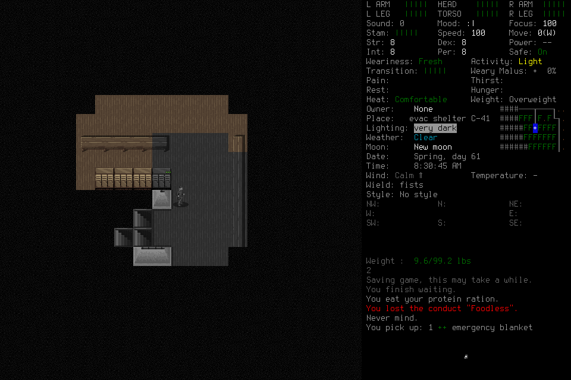
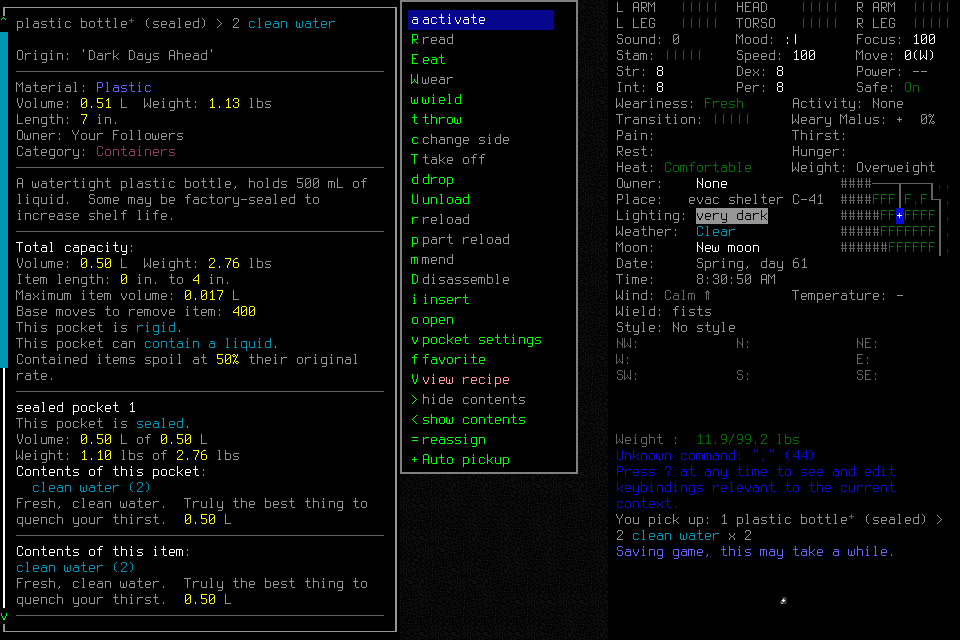
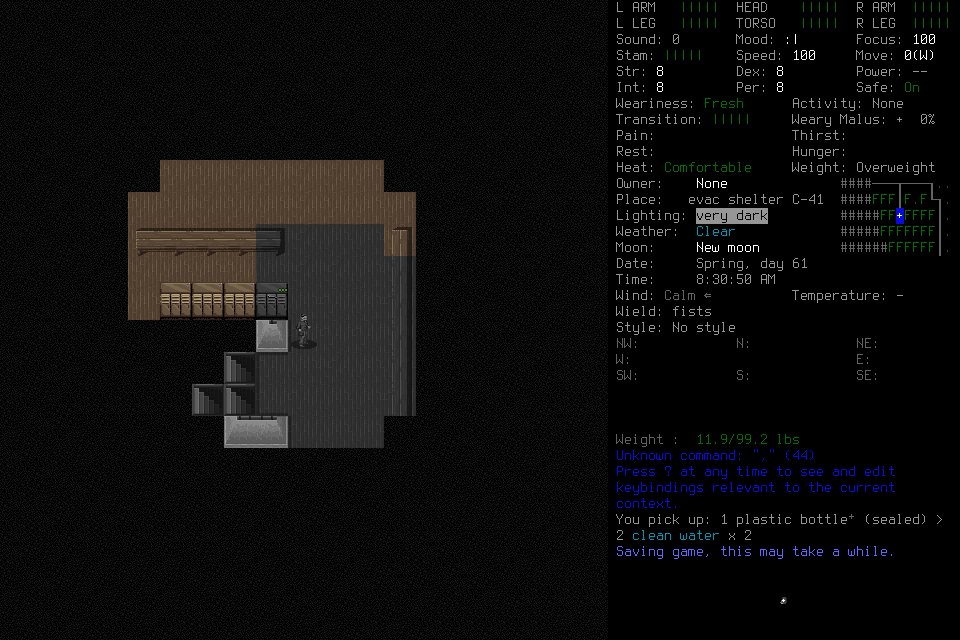

# Discovery learning: normal sixth run

`discovery-learning-006` supplies a current native6 procedure library for the next
fresh seven-day development campaign. Independent closed-run review supports the
bounded functional outcome: ordinary discovery, player-authored procedure reuse
and refinement, actual fresh-context application, useful work during reflection,
supplies/rest and normal exact save/restart/reload/final shutdown. This is not
seven-day survival, correction of an unsafe rule or causal learning efficacy.

Deciding source: `1947b3af107fde4d5f6e87cd1cfcd3627990ef26`; installed native SHA256
`ce810d3a2ee05517c5ead7b56caba7de42b4d4f0c729cea7551a327aaf0ec45e`.
The actual pinned engine was rebuilt and signed after the
[failed fifth attempt](2026-10-22-discovery-learning-fifth-attempt.md).
Exact candidate [CI39728016010](https://github.com/CVX-Hull/enactive/actions/runs/39728016010)
passed1,571tests in823.325seconds plus portable/governance/viewer checks.
Subsequent browser changes require their own checks; protected-main publication
remains separate.

Fresh default Evacuee/Survivor, EnactiveLearningSix/Casey, random normal start,
no initial library, prepared windowed/background wrapper. The six prospective
preparation documents stayed frozen. One original player, a clean successor and
an asynchronous adviser used the20-tool path. Actual host metadata later identifies
all three as `gpt-6.1-sol / medium`; the frozen pre-run record's unavailable host
metadata is preserved. No visible routine gameplay approval occurred; hidden
review telemetry and complete inference/token/quota/spending remain unavailable.

## Outcome and limits

| Frozen requirement | Independently verified result |
| --- | --- |
| Supplies/care/rest | Responsive ration consumption after Peckish:800kcal and cleared hunger.1,800seconds sheltered waiting. Successor inventory retains food and unfrozen clean water; selected carried bottle `7cf6c2ce…` shows0.50L. Final `d9d6d581…` shows full health bars, Fresh, Comfortable and no displayed critical unmet need. No drinking need arose; drinking is not claimed. |
| Navigation/replan | Four credited steps with a direction change. The player narrowed its route after a genuine zero-input refusal caused by insufficient known connecting terrain. Physical impassability is not inferred. |
| Discovery/derivation | Ordinary locker direction/list interpretation, physical selection fallback and actual transfers precede player-authored `dl006-stocked-locker-v1`. Stored procedure payloads match original requests and their cited episode images join the actual results. |
| Distinct reuse | Supply transfer at `LOCKER 1S` followed by the distinct `LOCKER 1NW` blanket transfer. The selected v1 use ID propagates to children; actual before/after images establish the transfer. |
| Changed-condition revision | The second locker opens directly into its list, contradicting v1's assumed direction stage. The player writes immutable child `dl006-stocked-locker-v2`. **V1 already required stopping/reassessment on unexpected prompts**: this is branch refinement, not demonstrated correction of an unsafe rule or measured improvement. |
| Fresh-context application | Successor receives15distinct required source PNGs with matching serialized payload hashes before claim/readmission. `dl006-successor-pickup-003` selects v2; its use-linked children classify the direct list, mark bottles and transfer them. The preceding failed comma command remains retained. Retrieval does not prove attention or causal usefulness. |
| Lifecycle | Normal save/owned exit, new child, exact Casey/world reload and `dl006-successor-load-adopt-001`; saved/reloaded/final turn all5214650. Both distinct native launch IDs have `OwnedNormalExit` returncode0. Final normal save/exit and Finish follow. |

The creation-confirmation ACK was unknown. The player initially stopped rather
than attempting a diagnostic Observe. The lead pointed to the existing protocol's
lifecycle diagnostic/identity procedure, without providing a scene interpretation,
tactic, key, procedure edit, new authority or larger limits. The player then
performed diagnostic Observe, separate effect reconciliation and identity adoption.
This technical contract clarification is retained; **zero assistance or independently
initiated creation recovery is not claimed**. Ordinary interaction, procedure
curation and subsequent tactics were player-owned. The unknown ACK remains unknown.

## Reflection and measured cost

One complete same-proposal chain supports actual overlap:
`reflection-7173527d…` → `proposal-6d9ef294…`. The adviser actually receives image
`5ad8250a…` at05:43:56.262UTC. During that interval the player opens the useful
wait-selector preparation: tool completion05:43:57.546, matching image presentation
05:43:57.552. Adviser submission begins05:44:05.417. Later memories
`dl006-advice-disposition-memory-001` and `dl006-successor-memory-002` dispose that
same proposal. The30-minute wait finishes later; it is not credited inside this
overlap. Host presentation/timestamps establish this bounded execution interval,
not simultaneous inference CPU use, mental attention or causal advice benefit.

All20advisory jobs completed on time. Original180-second claim windows charge
3,600seconds; observed claim-to-submit elapsed intervals total296.295seconds,
median13.523, range6.901–28.361. Omitted sources remain recorded, with no claim
that the adviser reviewed the full trajectory. Its finite budget was exhausted;
later final shutdown has no invented advisory coverage. Scheduling relevance and
budget efficiency remain#178 work.

The [bounded machine-readable evidence](../assets/discovery-learning006-evidence.json)
retains interval summaries, actual tool intervals and original screenshot hashes;
raw private host reasoning/account metadata is excluded.

| Resource | Retained actual |
| --- | --- |
| Requests/primitives |128requests;155charged primitives:149returned,6unknown ACKs |
| Images |409retained /22,190,684bytes /141distinct hashes; all409files verify |
| Actual image delivery |75original-player +53successor +19adviser presentations; all147payload hashes match retained PNGs |
| Game time |1,850seconds; no daily or seven-day survival milestone |
| Effects |All six unknown ACKs retain separate effect reconciliation; zero unresolved effects does not erase those unknown ACKs |

Completed whole MCP skill calls: original player66, median0.771s, max15.009s;
successor22, median1.2945s, max15.017s. These are tool completion intervals,
not pure inference or proof of gameplay success. Adjacent nonoverlapping MCP gaps
have medians8.146s/original and7.199s/successor, including interpretation, other work
and host scheduling. No model-tier comparison or seven-day speed extrapolation follows.

The reused spectator page's setup buffers contain old-session samples. Filtering
to006leaves32status and10frame samples: medians4.4ms status,5.0ms decode and5.1ms
status-to-DOM, with only three shared cycles. Terminal buffers share zero cycles
and retain stale frames after disconnection. These are separate browser monotonic
distributions; animation callbacks are opportunities, not screen-paint proof.
Native-to-browser and end-to-end inference latency remain unmeasured in this run.

## Closure and next use

Final Finish `dl006-successor-finish-001` is `stopped`, with
`completed_work_event_id: null`. The player does not claim objective completion
or finish the retained Work. Independent evidence supports the scoped result above;
the current historical library reader accepts terminal `stopped` archives.
Actual final actor completions05:52:29.807/player,06:04:39.323/adviser and
06:06:49.497/successor precede controller process76684's normal exit0 at
06:08:26.483UTC. Closed storage copies and private actor traces retain their hashes.

The current `ProcedureLibrary` reader separately validates the sealed ledger/index
pins, both revision records and all seven support/counterexample source exports.
V2 is eligible as **scoped advisory branch refinement**, without restoring historical
input authority. The lead does not rewrite player-authored memory. Earlier failed
attempts remain failures; native5 run004 is historical rather than current library input.

The actual terminal observer now distinguishes STOPPED/HISTORY/DISCONNECTED from
current decisions and unresolved effects, but its old last-command timeout banner
still looks actionable. A separate paused no-game restart probe also reproduces
stale browser credentials rejecting Pause. The subsequent#143repair labels recorded
terminal diagnostics and refreshes the normal same-origin page credential without
replaying ordinary actions. Its source/browser evidence is separate from this run.
The#164timing update adds raw clock anchors for future same-host correlation;
it does not retroactively measure this run's native-to-browser latency.

Next: freeze a genuinely fresh seven-day campaign with the current candidate,
native6library pins, coupled costs and finite reflective/ending limits. The
[seven-day requirements](2026-10-21-independent-seven-day-readiness.md), actual
retained-memory handoff, meaningful survival decisions and exact normal lifecycle
remain required. Protected publication and remaining native qualification lanes
are separate; optional paid models or efficacy studies are not blanket gates.

Images contain CDDA content; upstream licensing remains under [the notices](../../NOTICE.md).
