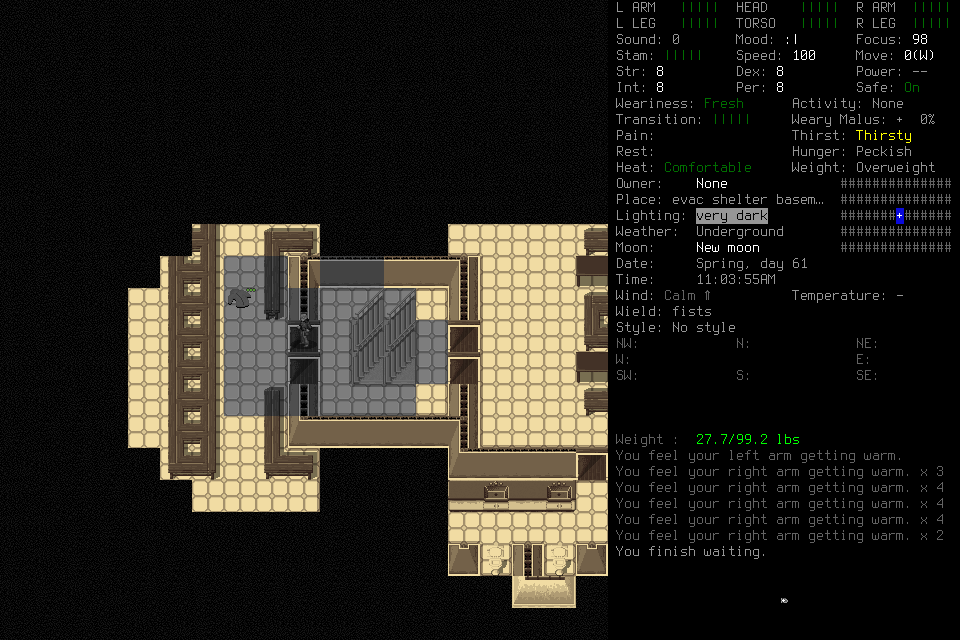
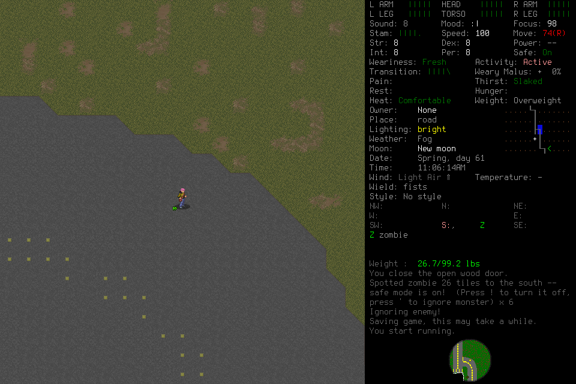

# Independent seven-day campaign: failed eighth attempt

Fresh `independent-seven-day-008` **failed** at 11,174 elapsed game seconds.
No daily milestone, midpoint reload, normal ending, Finish or independent
seven-day outcome is accepted. The player made substantive decisions and completed
a genuine fresh-context handoff. Repeated native refusals then stopped progress;
four unstarted Save decisions also failed on image drift. Original costs and
uncertainty remain. The failed admission, world and procedure data are not reused.

## Frozen setup and actual play

Source `d4fdb9c166af73662c7b25248a4133a5e1777a55`; installed native SHA-256
`ce810d3a2ee05517c5ead7b56caba7de42b4d4f0c729cea7551a327aaf0ec45e`.
Exact [CI39825061888](https://github.com/CVX-Hull/enactive/actions/runs/39825061888)
passed 1,609 tests plus the full portable lane. It was still running in the
immutable pre-run record; its later success has a separate receipt.

Genuinely new default Evacuee/Survivor: EnactiveSevenDayEight / Sam, prepared
windowed/background wrapper and project userdir. Only normally closed
[learning006](2026-10-22-discovery-learning-sixth-attempt.md) supplied procedures.
All nine frozen setup/request files and five external pins remained byte-identical
through closure. Original limits: 8,192 inputs/mappings, 4,096 requests,
8,192 frames/2 GiB, 86,400 wall seconds and 691,200 game seconds, with protected
ending reserves. This failure did not exhaust or renew those allowances.

The lead issued one source-free Start through the existing typed CLI because its
cached MCP Start catalogue was obsolete. The original player and bounded adviser
had actual current 20-tool passive preflight. The registered player launched the
new native child; old007 bridge metadata supplied no new authority. All three
actual actor hosts report `gpt-6.1-sol / medium`.

The creation-confirmation ACK was unknown. The player independently used diagnostic
observation, separate effect reconciliation, readmission and identity adoption;
the input was not replayed. Subsequent play included shelter supplies, ration and
water consumption, basement exploration and one-hour warming/rest, inventory
assessment, an outdoor survey and separation from a visible zombie. Final normal
images show full health bars, Comfortable and Slaked. This is bounded partial
play, not a demonstrated day of survival.

## Memory, handoff and reflection

The original player issued registered `sd008-clean-handoff-001`, then became
actually FINAL/permanently quiescent. A new clean-context deciding player retrieved
its bound packet. Actual model input-image blocks at successor host lines 56,
64 and 80 contain all eight required current images and seven eligible procedure
support originals, byte-for-byte matching canonical PNGs and adjacent observations.
All precede Claim's actual start; its single successful Claim completes at line86
and separate charged Readmit at line91. The original cumulative costs/deadline
remain. Retrieval/presentation does not establish attention or causal memory benefit.

Ten selected procedure roots name learning006's scoped `dl006-stocked-locker-v2`.
The adviser completed 40 on-time jobs, charging 2,400 seconds of finite claim
allowance. Its job7 proposed `sd008-consume-verified-v1`; retained records contain
no adoption or selected use of that candidate. Twenty-seven jobs declare source
omissions, totaling 772 nonunique omission occurrences. Job4 additionally records
truncated middle trajectory output. No complete-trajectory review, continuous
advice coverage, new learned procedure or causal advice benefit is claimed.

The lead performed admission, engineering, passive evidence checks and publication
work, without tactical scene interpretation, game keys or memory curation for the
players. No manual user rescue or visible routine gameplay approval occurred;
complete hidden host review telemetry remains unavailable.

## Three distinct refusal lanes

The reviewed source repair supplied a real bounded result in
`sd008-s1-field-east-2`: one returned direct primitive followed by a charged
`not_dispatched` primitive with no native request or ACK. Explicit
`sd008-s1-field-capture-reassess` closed its awaiting-observation lineage; the
player chose a different new root with four returned primitives. This qualifies
that ordinary direct delivered-prefix path, not semantic wait START or navigation.

Four later distinct fresh choices received native rejected ACKs:
`sd008-s1-northeast-gap`, `sd008-s1-east-segment-replan`,
`sd008-s1-walk-mode-open` and `sd008-s1-needs-reassessment`. The first retained two
returned primitives before its rejection. The native error was “fresh matching
rendered boundary and deadline required.” This composite gate covers capture
identity/context, original capture/presentation age and request deadline. The
request/ACK receipts do not identify its particular failed predicate or which
gate invocation failed. No exact native cause is certified from that text alone.

Save root `sd008-s1-partial-ending-save` and three new same-root choices each
returned a known zero-input image-change refusal. At revision815/turn5223974,
all four adjacent canonical image pairs differ in exactly 13 decoded RGB pixels,
within exclusive bounding box `[777,626,782,631]` on 960×640 images. Exported
session, boundary and native state match. This is actual pixel drift, not merely
different PNG encoding. Its exact animation trigger is unproved. Preserving a
healthy root and allowing a new decision did not establish Save liveness.

The player retained failed Work and completed Stop; no normal Save input, owned
normal exit or Finish followed. The [next boundary design](../changes/058-capture-provenance-action-preconditions.md)
separates native-issued capture provenance from operation-specific image
preconditions. This failed run supplies no acceptance of that later repair.
[#176](https://github.com/CVX-Hull/enactive/issues/176) and
[#195](https://github.com/CVX-Hull/enactive/issues/195) own its source/native follow-through.

## Costs and measured latency

| Retained quantity | Actual |
| --- | --- |
| Game time | 5,212,800 → 5,223,974: 11,174 seconds |
| Requests | 247: 52 completed, 176 partial, 18 blocked, 1 unknown |
| Primitive admissions | 385: 379 returned, 4 native-rejected, 1 not_dispatched, 1 unknown |
| Images | 994 PNGs / 102,214,097 bytes; all byte hashes, PNG signatures, chunk CRCs and IEND verify |
| Player host tool events | Original175:171 completed/4 failed; successor125:125 completed |
| Adviser host tool events | 282:281 completed/1 failed; distinct from its40jobs |

All five host tool failures remain: original create-schema and memory-schema
validation, identity-claim validation and an exact-source poll refusal; the adviser
initially requested an unsupported 30-second queue wait. Subsequent supported waits
used 15 seconds. Four additional completed player calls were refused before ledger
admission. These are not pending operations or delivered game inputs.

Recursive tool-result decoding joins 246 terminal operation IDs/results exactly
to 246 ledger rows; the source-free Start is outside both player traces. Four
operations initially returned running; durations begin at their original tool
submission and end at the first observed terminal result, including collection.
Four other initial collection responses were uncertain with no response body
(successor trace437/472/517/752); later exact results resolved those response
losses. They remain distinct from running responses and the unknown creation ACK.
Terminal includes partial, blocked and unknown outcomes, not semantic success.

| Whole-request interval, milliseconds | Original n; min / median / max | Successor n; min / median / max |
| --- | --- | --- |
| Direct | 83; 687 / 1,968 / 8,893 | 53; 2,082 / 4,065 / 22,771 |
| Inspect | 5; 473 / 814 / 1,982 | 4; 2,421 / 2,658 / 3,198 |
| Observe | 9; 133 / 389 / 806 | 23; 671 / 1,060 / 1,535 |
| Navigate | 2; 292 / 339.5 / 387 | 2; 830 / 1,004 / 1,178 |
| Activity | 4; 365 / 704 / 2,013 | 1; 2,422 |
| Save | none | 4; 722 / 812.5 / 1,092 |

All four semantic navigation requests were blocked with zero proposals/verified
steps; their timings are refusal costs, not successful travel. Physical movement
used ordinary input. Of136direct requests,58text roots account for234primitives
(1–11 per root);78key roots have one each. Two editor roots type21and3characters
plus their clear primitive. These counts do not establish a batching speedup.

Adjacent nonoverlapping player MCP gaps: original173samples, median9,891ms,
max38,436ms, excluding the separately documented282,446ms preflight-to-activation
gap; successor124samples, median9,914.5ms, max43,730ms. Keep actors separate.
Gaps include interpretation, memory, scheduling and other work; they do not
isolate inference, token cost or billing.

The separate rolling browser prefix has14exact archive-to-DOM capture joins and
18missing joins: capture-to-DOM83–304ms, median218.5ms under unchanged shared-host
epoch clocks. Status RTT32samples:2.8–24.5ms, median5.9ms. DOM attachment is not
paint. This sequential prefix differs from the closed player interval; do not
add medians or infer a causal decomposition or seven-day throughput guarantee.
The [bounded evidence summary](../assets/independent-seven-day008-evidence.json)
retains numerical tables and exact selected image provenance without private hosts.

## Exceptional closeout and next use

Actual task-complete follows the last MCP event on all three hosts: original
1344→1353, successor908→918, adviser1599→1610. No pending input/claimed job remained.
After preserving raw copies the lead requested SIGTERM for owned native5303,
then interrupted controller95020/exec92262(exit0). Immediate process inspection
still saw the child; final controller custody records native returncode−9,
an exceptional forced exit. Both exact PIDs and the port8766listener were later
absent. Teardown advances paused epoch3→5 without new input charges; it is not a
normal ending. Pre-teardown copies remain beside the exact post-teardown copies.

The failed world's49files were archived and every member hash verified before
active-menu retirement. Archive892,024bytes, SHA-256
`4379e070199731f709b4ce93f9e6986133555c1b3d72947a6a9bd8d62463481b`.
All191accepted-world files remain unchanged. The local archive/manifest, original
ledger/index/journal and private actor traces remain intact; raw host reasoning,
account telemetry and saves are excluded from public artifacts.

Next: review and repair the coherent capture/action boundary, qualify actual
ordinary input and normal lifecycle on the rebuilt native, then admit a genuinely
new finite full campaign. All original survival, memory/handoff, midpoint reload
and final-ending requirements remain. Candidate and protected-main publication
are separate from source, native and gameplay acceptance; no issue closes here.

Images contain CDDA content; upstream licensing remains under [the notices](../../NOTICE.md).
