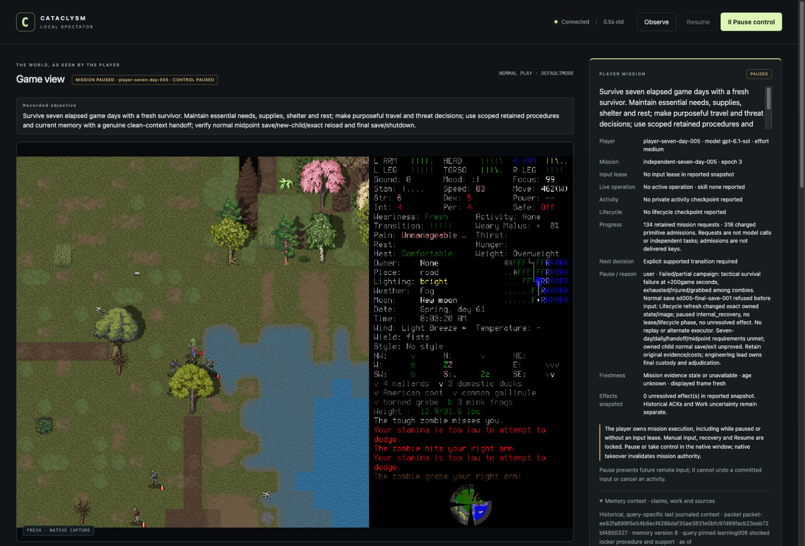

# Fifth fresh independent campaign: tactical failure and blocked normal save

**Failed and closed.** Morgan in EnactiveSevenDayFive survived only 200 elapsed
game seconds. The independent player reported an overbroad shoreline movement
batch, changing terrain, a zombie grab and progressively depleted stamina,
injury and pain. It chose normal save/quit rather than seek tactical rescue.
The save then refused before input because a lifecycle refresh found a different
image. No day milestone, clean player handoff, midpoint reload, normal final
ending or seven-day success is accepted.

The screenshot is the original spectator JPEG after the supported Stop. It shows
the actual native frame, reported paused ownership and failure reason. It is not
a screenshot of a normal ending. The independent player and adviser finished all
handles and permanently quiesced; the verified owned native was then exceptionally
terminated with SIGTERM. The controller exited 0 and its localhost listener closed.
Native exit code 0 does not establish an ordinary Save/quit; the process journal
explicitly records `normal_exit_verified:false`. Existing saves were preserved.

## Frozen configuration and actual evidence

Deciding source was `c76e55333c1f70ca25313133a2223467dde7d99f`; installed native
`ce810d3a2ee05517c5ead7b56caba7de42b4d4f0c729cea7551a327aaf0ec45e`.
The prepared English windowed/background wrapper and project userdir were used.
All six prospective preparation files remained byte-identical. The original
source-free Start was submitted exactly once and its full admission matched the
frozen proposal. Actual preflight host metadata reported gpt-6.1-sol/medium for
the player, adviser and registrar; this is not inference/token/quota measurement.

| Closed accounting | Verified result |
| --- | --- |
| Retained requests | 134: 21 completed, 109 partial, 3 blocked, 1 unknown |
| Charged inputs/mappings | 318: 317 returned, 1 unknown |
| Archived PNGs | 761 hash-verified images; 92,880,610 bytes |
| Game turns | 5212800→5213000; 200 elapsed seconds |
| Advisory work | 17 completed jobs/submissions; 1,020 conservatively charged seconds |
| Final ledger |Paused/epoch 5 after controller close; not Finished |

Independent clean-context review checked all six closed artifact hashes, the six
frozen preparation pins, every archived PNG and read-only SQLite accounting.
The actual controller-handle exit and post-close process/listener inventory are
separate lead-owned tool receipts, not facts inferred from those six files.
Actor finals occur after their last tools. Fourteen pending player envelopes were
later collected as settled results for their original operation IDs.

The creation confirmation ACK remains historically unknown. Its effect was
separately reconciled through the supported lifecycle/identity adoption path,
without replay or a lead technical pointer. That does not convert the ACK into
known delivery. Every later primitive returned; intended game effects still
require interpretation. No primitive is silently refunded or reclassified.

## Distinct tactical and substrate failures

The player attributed the tactical failure to a movement batch that was too broad
for changing terrain/threats. The retained final frame supports substantial
injury, depleted stamina and adjacent threats. This is a real player failure,
not proof that a different model, smaller batch, remembered rule or adviser
would have prevented it. [#164](https://github.com/CVX-Hull/enactive/issues/164)
owns assessment of progress-aware batching with general, revisable feedback;
there is no new CDDA-specific threat handler or per-key critic.

The separate normal-save failure is precise. `sd005-final-save-001` has **zero
primitive rows** and blocked with `EvidenceError: Lifecycle refresh changed the
exact owned state/image`. Its informing and refreshed observations have identical
exported native metadata except ID, timestamp and frame filename: same session,
revision 586 and turn 5213000. The two actual 960×640 PNGs differ at 72 RGB pixels in
the minimap area. The exact animation trigger is unproved; neither image equality
nor a completed save follows from equal exported state.

Lifecycle refresh ingests the capture before checking exact PNG equivalence.
That advanced current evidence without advancing its private phase; generic fault
handling then revoked the lease. A catch-only change would strand the next
Observe/decision. [#195](https://github.com/CVX-Hull/enactive/issues/195) owns the
whole-loop design, original-root accounting and source/native requalification.
[#194](https://github.com/CVX-Hull/enactive/issues/194)'s ordinary capture-name
refusal repair is distinct; this run did not exercise its nonpublication branch.
The failed admission is never renewed, replayed or patched.

## Memory, reflection and timing limits

Host image presentations hash-match 135 fresh005 images and seven explicit006 library
images. The adviser presented 29 original allowlisted images and submitted 17 results,
all `late:false`: one candidate revision and 18 notes. Omissions summed across
windows are 10 requests, 580 sources and one procedure; these are not distinct-object
counts. One early advisory presentation was truncated and disclosed as incomplete.
Observed claim-to-submit intervals span 11.150–28.402 seconds, not model compute.
The player fetched one advice result and recorded one advice-linked Claim; no new
procedure memory row was committed. Complete advice consumption, attention,
procedure adoption and tactical efficacy are unproved.

A passive observer checkpoint retained 32 status and 32 frame samples, which are
separately bounded buffers rather than 32 paired end-to-end observations. Status
round-trip median 4.25ms (range 3.4–16.7); decode median 3.70ms (range 3.3–45.7).
Eleven exact native/archive/DOM joins, including PNG hash verification, span
148–308ms (median 245). Epoch comparison assumes an unchanged shared host wall clock;
these are not painted-frame, player/model or full-skill latency measurements.
The other 21 passive displayed captures were not fabricated into archive joins.

Normally closed current-native learning006 remains the only eligible procedural
library. Failed005 is retained failure evidence, not a normal-closure library.
Actual direct clicks/non-unit geometry, activity interruption, navigation recovery
and full independent survival keep their separate unqualified scopes.

Exact c76e553 CI39765776174 passed 1,582 tests/full portable checks. That source lane
did not prevent this real failure and is not a native, campaign or protected-main
acceptance result. New repair/graphical evidence and the full original outcome
remain required under [delivery057](../changes/057-discovery-learning-campaign.md)
and [campaign#145](https://github.com/CVX-Hull/enactive/issues/145).
