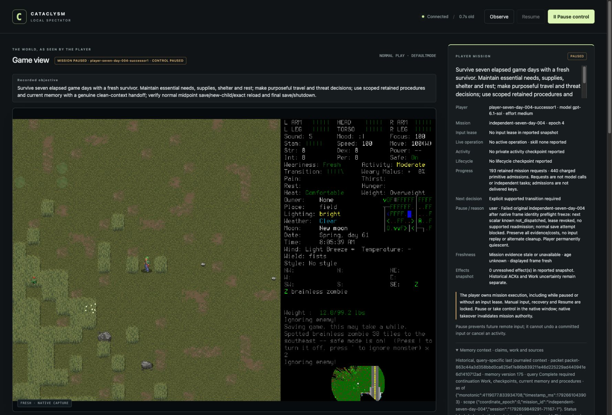

# Independent seven-day campaign: fourth attempt

**FAILED after339game seconds.** Riley remained alive and visibly unhurt, but a
capture-identity preflight refusal revoked gameplay ownership and blocked supported
normal save. One scalar was known not dispatched; it was never replayed. All
actors and owned processes are closed. No daily milestone, midpoint reload,
normal ending or seven-day success is credited. A repair requires a new admission.

## Frozen run and actual failure

Original Start `sd004-start-original` admitted `independent-seven-day-004` on
source `73c3d8495c520b27e94482659db2294fada71bcc`, installed native SHA256
`ce810d3a2ee05517c5ead7b56caba7de42b4d4f0c729cea7551a327aaf0ec45e`.
EnactiveSevenDayFour/Riley used fresh default Evacuee/Survivor and a random normal
start. The windowed/background preparation, source/native/configuration, eligible
normally closed learning006 library, all ten original outcome requirements,
finite resources and coupled forecast were frozen before admission. All six
preparation files retained their original byte counts and hashes through closure.
Exact73c3CI later passed1,575tests/full portable checks; its status at admission
remains the originally frozen pending status, not retroactively rewritten.

The player normally created/adopted Riley, acquired supplies, explored and made
independent threat/travel decisions. A clean successor used the registered
retained-memory handoff and continued. These partial outcomes do not demonstrate
adequate long-term supplies or a general survival policy.

`sd004-s1-field-south-005` returned its first scalar, with actual movement to
[-37,88,0] at turn5213139. Its second scalar was `not_dispatched`, `published:false`,
with null native request ID and no native ACK. The error was
“Native frame identity changed during final preflight.” The preflight source had
revision821, boundary b104 and frame suffix2153. Full native-state equality had
passed before the filename comparison failed. The exact replacement filename and
trigger were not logged; passive capture/status refresh is plausible, not an
established cause. There is no evidenced physical takeover.

The controller revoked its lease and paused epoch3. Normal save
`sd004-s1-final-save-attempt-001` was blocked on lost ownership. Failed Work and
explicit Stop completed; the player permanently quiesced. A filename difference
proves neither semantic change nor pixel equality. It also grants no permission
to send input with a stale capture.

[#194](https://github.com/CVX-Hull/enactive/issues/194) preserves all capture/native
gates. The selected repair uses existing known unpublished refusal feedback for
ordinary direct input only after every current owner, state, receiver, Pause,
pending-work, original age and deadline guard passes. Healthy ownership permits
explicit Observe and a distinct new intent; no retry, retarget, refund, authority
renewal or failed004 continuation follows. An initial proposal to relax only the
host filename check was rejected: native `ordinary_gate` still enforces the
current filename. A permissive fake bridge would not prove native support.

## Narrow handoff and cache qualifications

The original player actually terminated before the distinct clean-context
successor was spawned. Registered `sd004-handoff-001`, context/image retrieval,
`sd004-s1-claim-001` and separate `sd004-s1-readmit-001` preserved the original
deadline/costs and charged one returned Resume. Independent review matched all
four required current images and seven procedure images before claim. Substantive
continuation included use/pickup/travel over27game seconds. Host metadata supports
`agent_type=default`, `fork_turns=none`; retained spawn text is encrypted, limiting
independent inspection of its exact wording. The lead passed frozen instructions
and registered references, without tactical coaching. Image presentation and
continuation establish neither mental attention nor causal memory benefit.

Before the later failure, actual native/controller normal-source publication
continued beyond the old512-coordinate map limit. Starting at the exact returned
readmission after-source, the reviewed continuous epoch2 prefix contains345
publications/344distinct observations projecting530coordinates. The old source's
offline projection first fails at515coordinates/revision790; original native
publication continues through807. Current73c3 offline projection processes that
prefix with peak/final512cached coordinates. An initial selector included an
earlier pre-handoff observation; independent review caught it and the analysis
was corrected using the exact readmission anchor, retaining the mistake.

This narrowly qualifies native observation beyond the old bound. Offline replay
is not direct instrumentation of live cache contents; it does not qualify route
usefulness, recovery, click/geometry, normal ending, seven-day survival or causal
learning. Later epoch3 failure and final epoch6 shutdown are separate, retained
states after the analyzed revision807 cutoff. [#193](https://github.com/CVX-Hull/enactive/issues/193)
owns this bounded cache result; it cannot turn the campaign into a success.

## Costs, efficiency and closure

| Measure | Retained actual value |
| --- | --- |
| Requests |193 |
| Charged inputs/mappings |440:436returned,2rejected,1unknown,1not_dispatched |
| Archive |1,054hash-verified PNGs /140,181,435bytes;1blocked reference,0disputed |
| Adopted game time |339seconds |
| Advisory jobs |38completed,2,280charged seconds; no renewal/refund |
| Campaign day milestones |None |

The original creation ACK remains unknown despite separate adopted-effect proof.
The adviser submitted38confirmed results, all `late:false`, with notes and no new
procedure candidate. Truncation/omissions remain explicit. The lead supplied no
ordinary tactics or memory curation. Model/token/quota and isolated inference
costs remain unavailable; no efficacy or model-tier comparison follows.

One returned24-scalar movement batch moved11tiles, then spent13returned inputs
without further position or game-turn change while safe-mode warnings
remained visible. These are known returned inputs, not unknown replay. [#164](https://github.com/CVX-Hull/enactive/issues/164)
tracks progress-aware batching using declared/revisable expectations and general
feedback, without a game-specific warning handler or mandatory per-key critic.
A successor observer sample joined21actual native/archive/DOM frames at44–297ms,
median179ms. This measures those frame joins, not paint latency, model inference,
whole-campaign throughput or a demonstrated optimization benefit.

After deciding/advisory actors actually terminated, the exact owned native child
was exceptionally terminated with SIGTERM. This was not normal Save/Quit. The
owned controller then exited0. A separately retained subsequent check found the
exact owned PIDs absent and no listener on port8766. No save edit or source,
native, configuration or budget patch occurred during deciding play. All saves,
original receipts, failed requests and costs remain. Shutdown's epoch6 paused
state does not replace the original failure receipt.

Private closeout retains byte-identical closed ledger, index, journal and three
host traces with six hashes, plus the six frozen preparation pins, handoff/cache
reviews and selected image provenance. The indexed original frame files were
independently read and hashed. The public screenshot is an inspected observer
capture, not proof of a normal ending. Raw host traces contain private host
metadata and are not public artifacts. Only normally closed learning006 remains
eligible as a procedure library; failed004 is evidence only.

The full independent seven-day outcome, new repair qualification and protected
publication remain outstanding under [#145](https://github.com/CVX-Hull/enactive/issues/145)
and [delivery057](../changes/057-discovery-learning-campaign.md).
