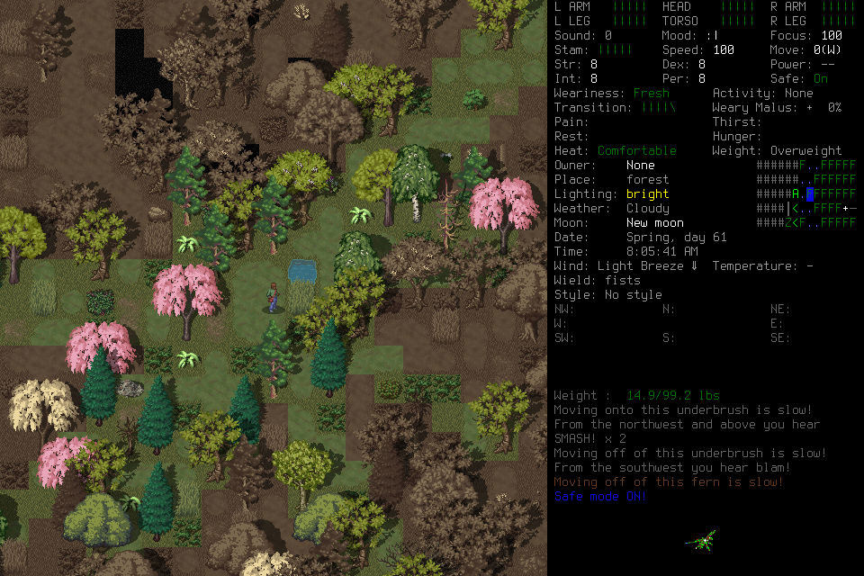
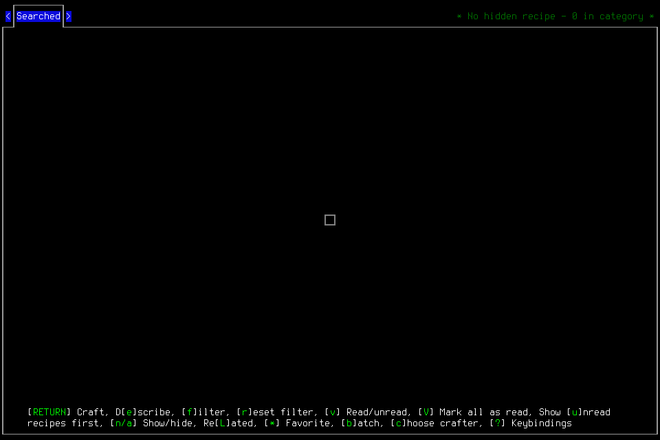

# Independent seven-day campaign: failed ninth attempt

Fresh `independent-seven-day-009` **failed after 341 game seconds**. A correlated
ready ACK was durably retained, then publication of current observation failed.
No day, registered fresh-context handoff, midpoint reload, normal ending or
independent seven-day outcome is accepted. The failed admission is closed and
never renewed. Its world and procedure data are not imported into another attempt.

## Frozen setup and actual play

Source `b10ebd87e1ff86a247cd3fafcb95e83a8267dde2`; installed native SHA-256
`40acb88b75cabf50a1b8a1134336c210d3f20503dcedd910fa2463019bdbcd56`.
Exact [CI39849384624](https://github.com/CVX-Hull/enactive/actions/runs/39849384624)
passed the full portable lane, including 1,610 tests in 863.411 seconds.
Native/runtime implementation matches the separately qualified
[capture001](2026-10-22-native-capture-preconditions.md) source; the intervening
commit changed documentation. That qualification did not prove this campaign.

Genuinely new default Evacuee/Survivor: EnactiveSevenDayNine / Rowan, using the
windowed/background prepared wrapper and project userdir. Only normally closed
[learning006](2026-10-22-discovery-learning-sixth-attempt.md) supplied procedures.
All nine frozen setup/request files and five external pins remained unchanged
through closure. Original limits: 8,192 inputs/mappings, 4,096 requests,
8,192 frames/2 GiB, 86,400 wall seconds and 691,200 game seconds. Protected ending
reserves were 256 inputs, 768 frames/192 MiB and 1,800 wall seconds. No extension,
refund, authority renewal or live patch was applied.

One deciding player and one bounded adviser operated on actual
`gpt-6.1-sol / medium` hosts. The player gathered shelter supplies and murky water,
traveled and avoided distant zombies. Retained normal observations span turns
5,212,800–5,213,141. Purification success is not established.

The character-creation confirmation retained an unknown ACK. Its separate
`EffectReconciliation` uses a `LifecycleTransition`; the original input was not
replayed or relabeled returned. Subsequent adoption does not erase that uncertainty.

## Known delivery and failed publication

`sd009-clean-water-filter-confirm` sent Enter. Its correlated ready ACK has
native ID `6c59ebfe-4dee-4f63-b7f2-12ee7fb441a6`, revision 757 and boundary suffix
`b97`. The primitive is durably **returned**, with `source_after`
`45a0e8c45b4ad34d1a94bb0606f14b77e9b9cc6b6378eedd3f7ae2ab96e61c25`.
The containing request is blocked:

> Current observation unavailable after known ACK: EvidenceError: Source differs from the exact live controller observation

The actual second snapshot/live comparison at failure was not retained. The
archive contains the revision 755 preflight and revision 757 terminal capture;
a later paused controller status at revision 758 cannot establish the earlier
comparison's state. A deterministic test of the real controller/runtime/archive
components reproduces the same stop when a valid newer menu appears between
ingestion and binding. That proves a source defect, not the precise native race.

[Design059](../changes/059-observation-custody-and-applicability.md) separates
immutable captured-source custody from semantic action applicability. It covers
Observe, binding, refresh, status and late preflight together. Changed visible
state must not be mistaken for lost custody; genuine source, clock, ownership and
delivery faults remain stopping conditions. Its implementation and subsequent
qualification cannot retrospectively pass this run. [#176](https://github.com/CVX-Hull/enactive/issues/176)
owns the repair and [#145](https://github.com/CVX-Hull/enactive/issues/145) retains
the unchanged full campaign outcome.

## Memory, reflection and independence

One selected procedure root names learning006's scoped `dl006-stocked-locker-v2`.
The player host actually presented its seven original support images. Retrieval
and presentation do not prove attention, correct application or causal benefit.
No registered fresh-context replacement occurred; host context compaction does
not count as the required handoff.

The adviser completed 27 on-time jobs, charging 1,620 seconds of finite claim
allowance, and presented 27 allowlisted images. It proposed one fallible procedure
candidate and 23 notes. Reported omissions total 788 overlapping occurrences,
not 788 distinct sources. Reviews 005/014 also retain host-output truncation.
Job 28 was offered and became unreviewed at teardown; no outstanding claimed job
is hidden. No complete-trajectory coverage or causal advice benefit is claimed.

The lead performed admission, engineering, passive evidence work and exceptional
cleanup, without choosing gameplay keys, tactics or memory content. Actual actor
commands show supported Enactive tools and technical read-only inspection; no
observed source/save mutation or alternate input route. The copied actor hosts
encrypt incoming activation/stop message bodies, so the independent closed review
verified their timing/count but could not independently read that wording. No
later incoming player message appears after activation. No manual user rescue or
visible routine gameplay approval occurred; complete hidden review telemetry
remains unavailable.

## Closed costs and latency

| Closed measure | Observed result |
| --- | --- |
| Requests | 158: 12 blocked, 21 completed, 124 partial, 1 unknown |
| Charged primitives | 407: 406 returned, 1 unknown with separate effect evidence |
| Original PNG archive | 962 frames; 157,498,533 bytes; all hashes and PNG CRCs verified |
| Canonical game time | 341 seconds; no elapsed day |
| Original Start to supported Stop | 2,471.736355 seconds; exceptional teardown is later |
| Skill requests with multiple primitives | 67 of 135 retained skill requests; 403 skill primitives |
| Direct batching | 76 ledger requests /311 primitives; 57 requests have multiple primitives |
| Navigation | 5 requests: 4 blocked, 1 completed, only 1 delivered primitive |

Whole closed actor-host MCP durations are tool-execution intervals, not whole
semantic operations or model inference. Admission filtering excludes historical
preflight calls. Percentiles below use nearest rank; actor intervals overlap.

| Sample | Count | Median | p95 | Maximum |
| --- | --- | --- | --- | --- |
| Player, all tools | 181 | 1.403s | 10.829s | 15.119s |
| Player skill tools | 143 | 2.596s | 11.516s | 15.119s |
| Direct skill tools | 79 | 5.678s | 11.905s | 15.119s |
| Navigation skill tools | 5 | 0.632s | 0.831s | 0.831s |
| Adviser queue polls | 116 | 15.009s | 15.031s | 15.053s |
| Adviser source tools | 27 | 0.007s | 0.011s | 0.013s |
| Adviser submissions | 27 | 0.129s | 3.553s | 6.453s |

Player host statuses are 174 completed/7 failed. MCP completion is not gameplay
success; 143 skill tool calls include seven failed calls and one domain rejection
without a ledger row, explaining their difference from 135 retained skill requests.
Adviser polling predominantly measures waiting, not computation.

All 407 primitive IDs join once to their original journal admission and receipt,
excluding the prior capture001 journal prefix. For 406 correlated ready ACKs,
admission-to-receipt median/p95/max are 77/126/6,909 ms. This is a journal
dispatch-admission proxy, not precise bridge-publication or pure engine latency.
Original preflight-to-ACK monotonic intervals, following
[evaluation definitions](../evaluation.md#latency-budgets-for-interactive-play),
are 556.55/1,342.00/6,945.87 ms and include earlier host/persistence work. The maximum
is world entry. The unknown creation confirmation separately retains a 15,014 ms
timeout and is excluded from successful-ACK percentiles.

Batches do execute multiple inputs: 21 world-name edit primitives (Clear plus
20 characters) reach their last receipt in 2.496 s; 11 ordinary travel inputs
in 6.420 s. An 11-scalar filter batch reaches its last receipt in 27.027 s,
while its initial MCP call returns at 15.119 s with the
operation still active. These last-receipt proxies are not semantic settlement
times. They expose why a tool duration cannot stand in for whole-operation latency.
There is no causal batching speedup or useful navigation throughput claim.

An earlier selected browser prefix has 29 exact retained-frame/clock joins with
capture-to-DOM median 182 ms (45–283 ms); three ring samples lack archive matches.
It is not whole-campaign display latency or browser paint latency. Host token
telemetry exists (201 player/178 adviser records), but aggregate totals are not
reconciled. No model inference, billing or token-cost total is claimed.

## Closure, custody and reproducibility

The supported `sd009-integrity-fault-stop` completed before teardown. Both actual
actor FINAL records follow their last MCP calls. After retaining closed copies,
the lead signaled only owned native PID 13901 with SIGTERM and interrupted its
controller PID 95258 normally. Controller exit 0, native returncode 0 and absent
exact PIDs/port8766 were recorded. The shutdown record explicitly states
`normal_exit_verified:false`: these codes do not establish normal Save/exit or
Finish. No SIGKILL was sent and no supported ending was credited.

The opaque failed-world archive contains 78 member-hash-verified files:
`.runtime/save-retirement/2026-10-22-campaign009/failed-world.tar.gz`,
1,566,725 bytes, SHA-256
`49c84bf02debbc1d17ac1896ce5841787e91838a2d24170613cac74eaa23102a`.
All 191 accepted-world files remained byte-identical. Only then was the failed
world removed from the active menu. No save contents, global environment or engine
outcome was edited. The archive grants no renewed authority.

Private evidence remains under
`.runtime/campaigns/independent-seven-day-009/closed-evidence/`: before/after SQLite,
archive indices and journals; original actor traces; controller status; closure,
process and archive receipts. Both SQLite copies pass integrity checks; requests,
primitives, memory and reflection commands match across teardown. The later
journal preserves the earlier prefix and adds only stop/shutdown records.
Independent closed review verified those facts, all 962 PNGs, 14 frozen pins,
actual actor command/image records and terminal ordering. The lead separately
verified archive members, accepted saves and process absence. Raw host traces
and machine/account paths stay private. The two public PNGs above are unchanged
original game captures; their hashes match the retained source references.

Learning006's bounded result remains separate. This failed campaign supplies
repair and efficiency evidence, not independent survival acceptance. A subsequent
attempt must have a new finite admission, source freeze and genuinely fresh world.
