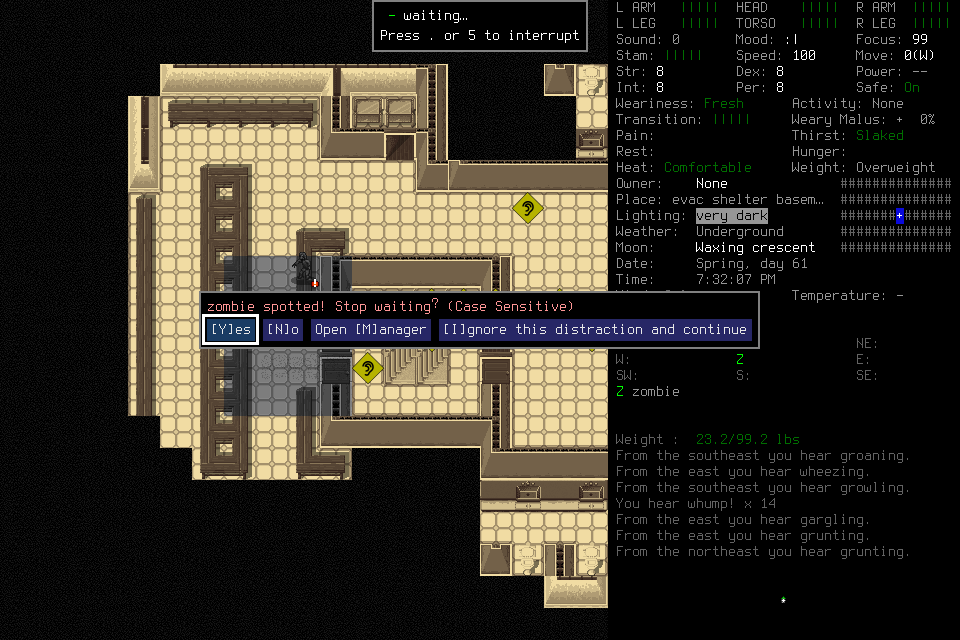
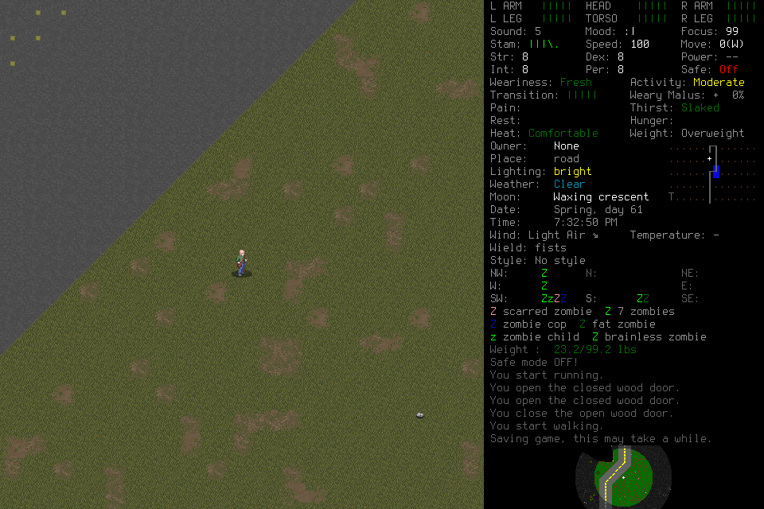

# Independent seven-day attempt007: semantic capture refusal

The fresh campaign **failed after 41,570 game seconds (11h32m50s)**. Avery was
alive and uninjured at the last observed normal scene, but no completed day,
midpoint reload, normal ending or seven-day outcome is accepted. A semantic wait
START was never published; treating changed preflight frame identity as a fatal
controller fault removed the player's ordinary Observe/choose-again path.
Later repairs cannot renew this campaign or change its outcome.

## Frozen conditions

Deciding source was `39a4a65f6cc1c394021ca8bad27b6f44227f6d41`, native6/mission10/
ledger12/archive5, procedure2 and reflection2. Installed native SHA-256 was
`ce810d3a2ee05517c5ead7b56caba7de42b4d4f0c729cea7551a327aaf0ec45e`.
Fresh `EnactiveSevenDaySeven` / Avery used ordinary English Evacuee/Survivor
creation through the windowed background project-local wrapper and userdir.
Only the normally closed [learning006 library](2026-10-22-discovery-learning-sixth-attempt.md)
was eligible; failed campaigns supplied no library or execution authority.

One original Start established the admission. Its nine preparation/request files
and five external pins were unchanged at close. The frozen setup receipt SHA-256
is `264a6675166a9b751db45ebf45eb0cacec39eb69006006fb7e72fdf610d4e8f0`.
Limits were 8,192 inputs/mappings, 4,096 requests, 8,192 frames/2 GiB,
86,400 wall seconds and 691,200 game seconds. Protected ending reserved 256 inputs,
1,800 wall seconds and 768 frames/192 MiB. The coupled forecast included ordinary
play, handoff, observation, reflection and ending; it was prospective rather than
a calibrated throughput model. No limit, cost or deadline was renewed.

Actual player, successor and adviser host metadata reports gpt-6.1-sol/medium.
Exact-source [hosted CI](https://github.com/CVX-Hull/enactive/actions/runs/39810885173)
passed 1,602 tests plus portable checks. The original freeze's pending-CI statement
is preserved; the later result is a separate receipt, not campaign acceptance.

## Actual play, memory and handoff

The player acquired supplies, ate two meals totaling 1,600 kcal, consumed three
clean-water units, explored a basement, prepared/waited, encountered sound and
zombie interruptions and chose an escape followed by field/threat assessment.
Last retained stock was 21 rations and nine usable clean-water units. Those are
observations from this failed world, not facts available to a fresh campaign.
Initial/final observed turns were 5,212,800 → 5,254,370.

This prompt was handled through ordinary visible input. It does **not** qualify
the separately owned typed request_interrupt/exact-owner answer path in #152.

The predecessor completed a registered quiescent handoff. A genuinely fresh
successor received six current-mission and seven pinned procedure-support images,
claimed the bound packet and paid for separate Readmit under the original limits,
then performed substantive play. All 13 actual model-input PNGs were byte-equal
to their canonical sources and preceded successful Claim. A private prefix proof
incorrectly labelled host line87 as successful Claim; it was a failed schema call
(`wait_seconds=30`, maximum15). Successful corrected Claim is line93. The original
proof remains intact alongside an explicit correction; all images precede both.

The player selected and reused scoped locker-v2 data with current-world
applicability. Useful play overlapped claimed adviser work. Candidate-v3 advice
was not persisted or adopted as a procedure. Presentation, retrieval, a plausible
proposal and overlapping play do not prove attention, causal memory benefit,
correct learning or autonomous seven-day survival. The lead supplied no tactical
keys, escape plan, procedure curation or live repair. Encrypted host assignment
blocks limit independent reconstruction of their exact hidden wording; actual
tool calls, image outputs, ledger and original lead records remain available.
Technical admission used the existing source-free Start CLI when the lead's cached
tool catalogue was obsolete. One passive lead snapshot call also failed response
validation; its exact parsing cause was not diagnosed and the error is retained.
Neither supplied gameplay input or
tactics, and the observer error caused no restart or input retry.

## Failure and truthful delivery

`sd007-s1-field-nightfall-wait` was semantic `activity`, operation `wait`,
**step START at normal play**, with no phase/perception. It emitted ordinary
`ControlIntent(kind=action, value=wait)` through execute_mission. It was not a
paused ActivityIntent or recover_mission operation.

Its single prepared charge settled **not_dispatched**, `published=false`, with
null native request/id/ACK and no after-source. The reason was “Native frame
identity changed during final preflight.” The deciding controller reaches that
check after complete native-state comparison passes; this establishes neither
equal pixels nor input authority. It then fatally froze/revoked custody, leaving
no supported reconciliation/readmission or normal ending. The successor recorded
failed Work and supported Stop and permanently quiesced. No retry, alternate
transport or revived authority was used.

The visible “Saving game” message is not evidence of the required normal
save/owned-exit/new-child reload sequence or final ending.

One earlier ordinary `sd007-s1-run-to-stairs-001` had an actual native **rejected**
receipt (“fresh matching rendered boundary and deadline required”). It is distinct
from this final host-side unpublished refusal and is not delivered movement.
The creation-confirmation ACK remains **unknown**, with its separately verified
lifecycle effect reconciliation; reconciliation never rewrites ACK history.

Seven host/pre-input failures also remain retained: original-player context byte
limit, incompatible direction draft, missing mission_id on a result request and
invalid successor-role string; successor context byte limit, the failed Claim
above, and unsupported procedure.use_id on a skill draft. Corrections before
ingress are not native input replay. No failed call was silently counted as success.

## Costs, latency and uncertainty

| Retained measure | Actual value |
| --- | --- |
| Requests | 248: 63 completed, 173 partial, 11 blocked, 1 unknown |
| Primitive charges | 369: 366 returned, 1 unknown, 1 native rejected, 1 not dispatched |
| Canonical PNGs | 970; 96,957,894 bytes; 438 distinct byte hashes |
| Reflection | 35 completed jobs; 2,100 original charged advisory seconds |
| Accepted daily milestones / midpoint reload / normal ending | 0 / none / none |

A retained successor prefix contains 158 host calls: **155 completed, three failed**,
not 158 completed. All 137 matched settled operations/results equal their copied
SQLite rows. Whole submission-to-first-observed-settlement medians were direct
2,799.5 ms (n=102), navigate 1,086.5 ms (n=8), inspect 982 ms (n=5), menu 1,659.5 ms
(n=2) and activity 2,466 ms (n=2). Direct maximum was 21,978 ms. These include host,
tool, polling and writer time; they do not isolate model inference or native exit.
Median adjacent non-overlapping call gap was 6,995 ms (n=157), maximum 40,760 ms;
reasoning, memory work and scheduling are confounded. Text batching actually
exists: 36 of 106 direct ledger requests in that prefix have multiple primitives,
up to 11. This is neither a per-key-only player nor proof of causal acceleration.

A separate passive 32-frame viewer window produced nine exact native-frame/DOM
joins and 23 explicit omissions. Capture-to-DOM replacement was 122–312 ms,
median 183 ms, assuming shared host epoch clocks; DOM replacement is not paint.
Status RTT median was 7.8 ms over 32 samples. Both windows are sequential live
prefix copies, not atomic whole-campaign samples. Raw per-response token telemetry
and account-wide quota snapshots are retained in the private host traces;
campaign-wide token reconciliation, attributable billed cost, isolated inference
and causal efficacy were not measured. Account-wide quota snapshots are not
campaign spending. Original corrected prefix
adjudications remain private with their source hashes and exclusions.

## Closure, preservation and next evidence

All three actual actor hosts reached FINAL before process teardown. The adviser
needed an explicit stop despite being idle; all 35 jobs and handles settled.
With no pending primitives or unresolved effects, the lead verified the exact
owned native child/parent, terminated only native95316 with SIGTERM and closed
controller94393 with Ctrl-C/exit0. Subsequent exact-PID, exact-native-name and
port8766 checks returned no processes/listener. **This is exceptional cleanup,
not normal Save/Quit.** Runtime shutdown retained a paused closed ledger at epoch 6;
it granted no new input authority.

Closed ledger/index/journal and three actual host traces were copied after
shutdown and verified byte-equal to all six originals. SQLite integrity/foreign
keys, request digests and every PNG SHA/signature/chunk CRC/IEND passed independent
closed-evidence review. No open evidence-integrity or closeout defect remained.
Independent fresh OS absence was unavailable in that review's sandbox; the actual
recorded process-check receipt supports that narrower claim.

All 43 failed-world files were verified in the private ordinary tar archive before
removing the active menu copy; all 191 accepted-world files remained unchanged.
[Environment](../environment.md#user-directed-stale-save-cleanup-2026-10-22) owns
archive/restoration details. Mission evidence and original unknowns remain intact.

The [current contract](../protocol.md#ordinary-discovery-and-procedure-data)
describes the general known-unpublished semantic refusal repair and explicit
Observe/new-intent path. Source tests and a later native run are separate lanes;
they cannot accept007. GitHub [#176](https://github.com/CVX-Hull/enactive/issues/176)
owns the repair and [#145](https://github.com/CVX-Hull/enactive/issues/145) owns the
unchanged full fresh campaign outcome. PRs own publication/CI; no new run is
admitted by this historical report.

The two public PNGs are unmodified canonical archive copies, inspected for private
host/account content. Their source IDs and byte hashes are:

| Image | Observation ID | SHA-256 |
| --- | --- | --- |
| Interruption | `95108673b260ba9040c4ddbe13e9f89b1cff1dc31f1744eada9d52720f53b3e2` | `d09e2e78429ba1bc4b70ad6d0ac07203c9be7549a3c6473c9cc9b418495b8057` |
| Last normal | `72bb1cc1220b747948782c9110b03ae9bf177b2f1fc84859422f7de34383e17a` | `076f6d21612aa3379efd9ebebd0fd140ae84634b5e1a0b0a84aa47ce679b0e9e` |
