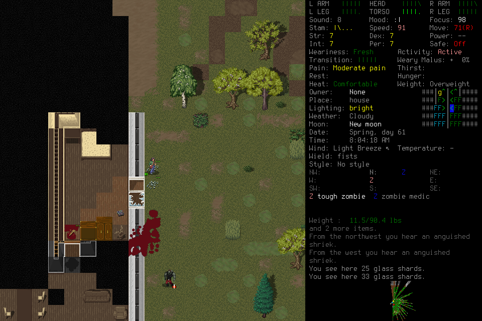

# Independent seven-day campaign: third attempt

**FAILED after independent exploration and a clean player handoff.** An optional
navigation map exhausted its lifetime 512-coordinate allowance during ordinary
observation. The last input was known delivered and its image was retained, but
source publication stopped and revoked gameplay authority. Taylor was alive and
injured after 258 game seconds. No daily milestone, midpoint reload, normal ending
or seven-day survival is credited. Repairs do not resume this failed admission.

## Frozen scope and retained result

Original Start `sd003-start-original` admitted `independent-seven-day-003` on
source `c2245b97c8c4f70505f441c63a63523b08ad83e9`, installed native SHA256
`ce810d3a2ee05517c5ead7b56caba7de42b4d4f0c729cea7551a327aaf0ec45e`.
Fresh EnactiveSevenDayThree/Taylor used default Evacuee/Survivor and a random
normal start. Windowed/background preparation, current native6/mission10,
normally closed learning006 library pins, all ten original outcome requirements,
finite limits and coupled resource forecast were frozen before admission.
All six frozen preparation files remained unchanged through shutdown.

The player normally created and adopted Taylor at turn5212800, independently
reconciled the unknown creation acknowledgment without replay, retrieved the
eligible006 procedure and acquired shelter supplies through actual ordinary
pickup. It explored, assessed observed hostiles and retained source-linked Work.
The successor independently returned to shelter, inspected depleted stock and
searched toward a house. An encounter caused visible injury; the player escaped
the grab and continued outside. The final retained normal image is turn5213058.
This is useful partial experience, not a successful survival strategy or proof
that food, usable water or medical supplies were sufficient.

## Clean context and asynchronous advice

Registered handoff `sd003-clean-handoff-001` followed permanent original-player
quiescence. A distinct clean successor retrieved the complete bound Work/procedure
packet, then actually received all 11 required current images and seven procedure
images before claim. Independent review matched all 2,137,471 presented PNG bytes
against returned references, archive indices and retained files. Required Work
remained explicitly unknown pending reobservation; nothing was promoted to current
authority merely because it was remembered.

`sd003-s1-claim-001` changed the player while paused. Separate
`sd003-s1-readmit-001` used the original issued post-Pause source, verified its
paused pixels and charged one returned Resume, preserving the original deadline
and cumulative costs. Substantive independent continuation followed.
The host confirms `agent_type=default` and `fork_turns=none`; its retained briefing
bodies are encrypted, so the independent reviewer could not inspect their text.
The lead's actual spawn passed frozen instructions, technical constraints and
registered references only. Preserve that independent evidence limit. Actual
image presentation does not establish attention or causal memory benefit.

The separate adviser completed 24 durable claims/submissions, all `late:false`,
with 1,440 originally charged seconds and no renewal/refund. It retrieved 24 original
sources and proposed one procedure candidate plus 29 notes. Coverage omissions and
a truncated trajectory remain explicit. Advice remained candidate data; the
engineering lead supplied neither tactics, routine keys nor memory curation.
These counts alone do not establish useful advice or causal improvement.

## Failure and selected repair

`sd003-s1-direct-49` retained a known delivered scalar and after-source
`cbcb07bf132db9f397511aa811a56ebadbdbb153204b9d1ef42aeb86865934bf`.
Its operation then stopped with:

> Current observation unavailable after known ACK: CapacityError: Observed-map node limit reached; retained evidence was preserved

`MissionRuntime._publish_source` projected every normal observation into
`ObservedMap`, whose 512-node lifetime cap also blocked ordinary input. This
coupled an optional routing aid to the player's base observe/act capability.
There was no unresolved input effect to replay or supported authority recovery.
Failed Work and explicit Stop completed; normal Finish remained ineligible.

[#193](https://github.com/CVX-Hull/enactive/issues/193), under
[#191](https://github.com/CVX-Hull/enactive/issues/191), changes this to a bounded
lossy routing cache. It keeps 512 coordinates, retains the current cardinal
footprint and forgets older candidates without deleting source evidence or
weakening current movement guards. Forgotten routes require reobservation.
The source regression reproduced the old failure at input 171, at 514 projected
coordinates. The repaired whole-runtime test continues through 188 ordinary
requests and a guarded navigation request; 46 navigation and three storage-fault
tests also pass. These are synthetic component results, not new graphical
qualification. Independent source/evidence review found no actionable findings; exact final-
candidate/protected-main CI and a new finite real campaign remain required.

## Retained costs, timing and closure

| Measure | Actual retained value |
| --- | --- |
| Requests |149 |
| Charged primitives/mappings |398: 397 returned, 1 unknown |
| Evidence |924 hash-verified PNGs /138,675,503bytes |
| Adopted game time |258seconds |
| Advisory jobs |24 completed; 1,440 charged seconds |
| Seven-day milestones |None |

The creation confirmation retains its original unknown ACK despite separately
reconciled/adopted effects. The map failure does not change the last scalar's
known acknowledgment into unknown delivery. No source, native, configuration,
save or limit patch occurred during deciding play.

Actual original-player tool records include 61 MCP skill calls with completed tool status, median 0.857s,
range 0.033–10.016s. A separate ledger join matches 86 requests to their first
host-observed settled result, preserving partial/blocked/unknown outcomes;
the unknown creation-result interval is 37.754s. After excluding preflight and
admission idle, 104 inter-tool gaps have median 11.4685s. These include transport,
controller, engine, player and orchestration work; they are not isolated inference
time or successful-intent measurements. Four normal-play native/archive/browser
identity joins measured 101–290ms from capture to DOM replacement; four successor
captures measured 131–277ms. These small samples do not measure screen paint,
semantic outcome, general latency or causal speedup. A handoff capture had no
matching buffered timing frames and supplies no latency claim.

All deciding/advisory host handles were terminal before exceptional child
SIGTERM and controller shutdown. The owned controller exited 0; no normal child
save/exit is credited. Closed SQLite, evidence index, journal and private host
traces retain hashes; all 924 original frame files verify. Saves were not edited.
The observer actually displayed paused failure, then disconnected/stale evidence
with historical Work explicitly labeled; this is separate from normal Finish.

The original exact-source CI 39737790740 remains a failure: a test's shared
`os.fsync` fault also reached its fake-native writer. Its independently reviewed
test-only repair was kept isolated during play and integrated only after closure.
The earlier 6288b5a CI 39735590480 passed 1,571 tests. Neither result is relabeled as
passing CI for the next candidate. Failed003 is not an eligible procedure library;
normally closed006 remains the current scoped library input.
