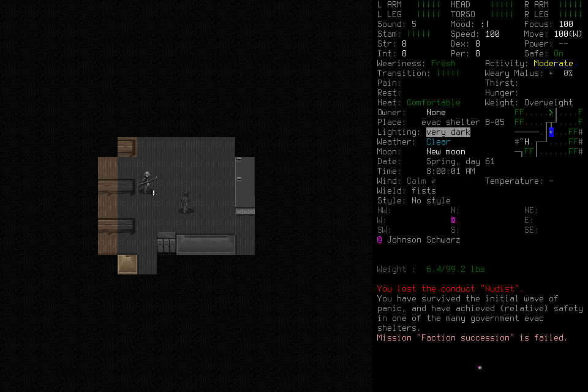

# Native capture-precondition qualification

`native-capture-preconditions-001` completed ordinary graphical input and the
full normal same-character save/reload/ending path on the rebuilt boundary.
Independent closed-evidence and public-report review found no blocking defect.
Both Save starts and provisional normal readmissions succeeded on their first
substantive decision. Their capture names changed, but the checked PNG pairs
were identical. **Persistent pixel drift and the retained-A/newer-B native race
remain unexercised in this run.** The source regression with actual failed008
images supplies separate evidence for persistent drift; it is not native proof.
This technical result does not accept independent seven-day survival or learning.

## Candidate and setup

Committed source `f2fdc621039f241e4fcd3784095e1999b62dbe79`; installed, locally
signed native SHA-256
`40acb88b75cabf50a1b8a1134336c210d3f20503dcedd910fa2463019bdbcd56`.
The existing owned temporary build, bundled dependencies, project app/wrapper and
explicit userdir were reused. Windowed 960×640, background launch, English default
Evacuee/Survivor; no global setup change. The [design](../changes/058-capture-provenance-action-preconditions.md)
owns the action-specific source policy and unchanged stronger checks.

Independent design/source/artifact review and 337 affected tests passed.
The full local portable lane passed 1,610 tests in 719.226 seconds;
[exact candidate CI39844721012](https://github.com/CVX-Hull/enactive/actions/runs/39844721012)
passed 1,610 tests in 903.350 seconds plus portable checks. Build, source tests,
native gameplay and protected publication remain separate evidence lanes.

One source-free Start admitted the frozen finite technical mission. Original
ceilings: 512 inputs/mappings, 384 requests, 2,048 frames/512 MiB, 7,200 wall
seconds and 3,600 game seconds. Ending reserve: 128 inputs, 900 wall seconds,
256 frames/64 MiB. No library or adviser was admitted; no limit was renewed.
The actual operator catalogue exposed 20 current tools and a harmless passive
preflight before activation. Admission model/effort were `unreported`; both actual
host turns identify `gpt-6.1-sol / medium`.

All six frozen files, binary and wrapper remained exact. The options raw pin
changed: the installer writes `TURN_DURATION` as `"0.0"`, while CDDA saves the
same float as `"0.00"` and rewrites JSON formatting. Replacing only that parsed
value and applying the original installer serializer reproduces the exact frozen
38,632-byte SHA-256; all other parsed data match. Independent review confirmed
upstream float parsing/serialization and unchanged disabled realtime behavior.
The original receipt and raw-pin discrepancy remain; no byte-unchanged claim,
configuration mutation, restart or allowance renewal was substituted.

## Actual outcome and limits

Morgan in EnactiveCaptureOne was visibly identified and adopted. Ordinary `i`
opened inventory and Escape returned to play. First Save committed at turn
5,212,800; the owned child exited normally with code 0. A new child loaded the
same character and exact turn, followed by separate readmission, visible identity
claims and adoption. RIGHT then moved `[0,0,0] → [1,0,0]`, reaching 5,212,801.
Final Save committed there; the second child also exited normally with code 0.
`ncp001-finish-01` completed `NormalFinish` with disposition `stopped`.

This unmodified native PNG is source
`ca22f03f1dea59149fc7b06d412032d7d95d8746969b9645af5df5457a50c90d`,
SHA-256 `e74649c8dbe494190812ef7484821b8a92db5c73c449fc713dff6e90f22a3a1a`.
The visible engine message “Faction succession” failed remains part of the
trajectory; no engine validation or outcome was bypassed.

| Boundary | Original → entry-refresh capture suffix | Checked pixels |
| --- | --- | --- |
| Creation normal readmission | 203 → 211 | Identical PNG hashes |
| First Save | 261 → 263 | Identical PNG hashes |
| Load normal readmission | 23 → 30 | Identical PNG hashes |
| Final Save | 59 → 62 | Identical PNG hashes |

Both Save refresh/final-preflight pairs also have equal complete exported state
apart from capture identity. This supports the tested normal lifecycle on the
matching build; it does not prove a changed-pixel decision or the timing of a
newer native capture between final preflight and commit. No wider mouse,
non-unit geometry, takeover, activity interruption or survival claim follows.

## Costs, uncertainty and closeout

67 requests: 26 completed, 33 partial, 4 blocked, 4 unknown. The 72 charged
primitives comprise 66 returned and 6 unknown ACKs. These six are creation
confirmation, two Save confirmations, Load selection and two exit confirmations;
supported transition/owned-exit proofs resolve their effects separately without
rewriting or replaying the inputs. Four blocked drafts remain distinct from
host prevalidation failures.

All 194 canonical PNG hashes and PNG integrity checks pass: 7,648,384 bytes.
Elapsed game time is 1 second; Start through final persisted wall sample is
782.783947 seconds, including setup, interpretation, collection and lifecycle.
It is not an inference or causal speedup measurement.

The actual host retains 91 MCP completion events: 85 completed and 6 failed.
Failures are menu schema, world-claim schema, dismissal-question validation and
three concurrent historical-source read refusals; sequential reads later succeed.
Last MCP completion is host line717, followed by actual final/quiescence at727.
The lead supplied admission/engineering/passive evidence work, no menu keys,
tactics or memory curation. No visible routine approval occurred; hidden host
telemetry remains unavailable.

Owned PIDs2448 and35581 have separate `OwnedNormalExit` proofs and are absent.
The final player snapshot has no active operation, lease, pending/control input,
unresolved effect or process owner. Raw ledger/index/journal/host copies and the
original freeze remain local. The single current controller is retained for the
next genuinely fresh campaign; it grants no old-world authority. The technical
world's51files were hash-verified into a local archive before active-menu retirement;
all191prior accepted-world files remain unchanged. The [environment ledger](../environment.md#user-directed-stale-save-cleanup-2026-10-22)
owns archive hash and restoration details. Protected
publication and the full [#145 outcome](https://github.com/CVX-Hull/enactive/issues/145)
remain separate.

Image contains CDDA content under [the notices](../../NOTICE.md).
