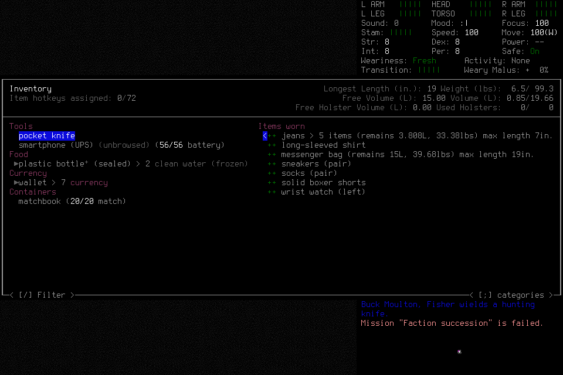
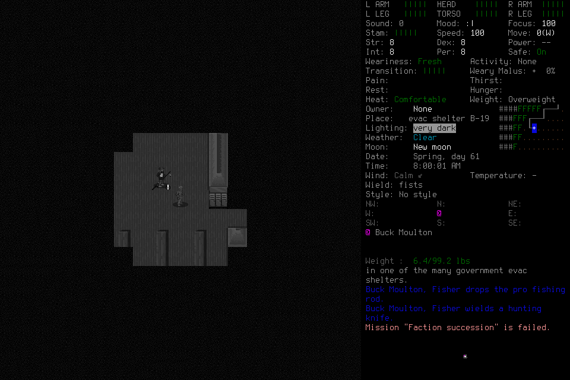
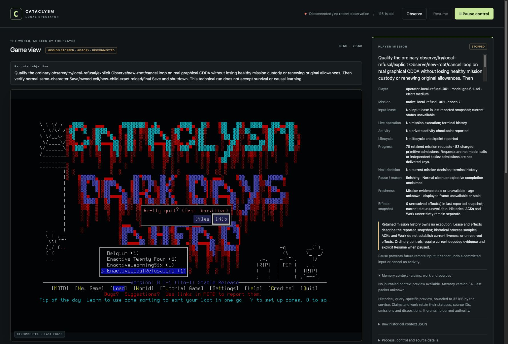
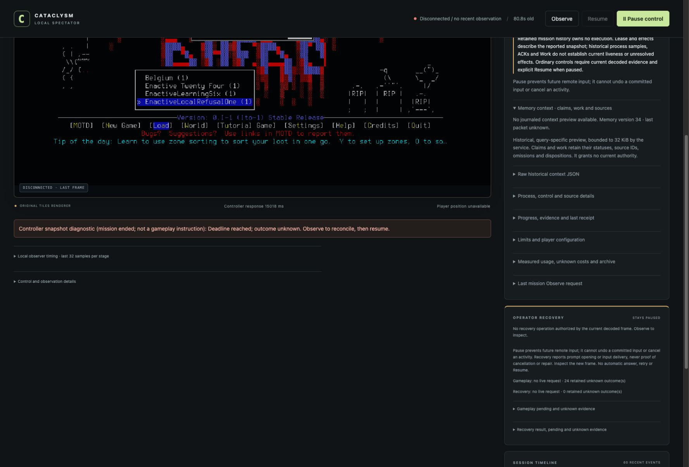

# Local-refusal001: continuing after a spent local request

Taylor in EnactiveLocalRefusalOne completed the real ordinary-input loop that
failed in [fresh006](2026-10-22-independent-seven-day-sixth-attempt.md): an
exhausted child refused without input or loss of healthy mission custody, explicit
Observe closed its original root, and the operator independently chose a new root
to return to normal play. The same character then saved, exited normally, reloaded
the exact checkpoint in a new child, moved and completed final normal shutdown.

This was one prospective technical development qualification, not a seven-day
survival or procedural-learning assessment. The engineering brief deliberately
selected the local-exhaustion boundary; the operator selected the actual menu,
inputs and cancellation from visible evidence. The lead supplied no gameplay
keys, tactics or memory curation. Independent closed-evidence review found no scoped blocker: frozen pins, original
requests, canonical PNGs, actual host image presentation, lifecycle and cleanup
were checked. Exact-source CI/publication receipts belong in PR180; this report
owns the actual run evidence. Review does not substitute for a full source pass.

## Frozen configuration

Source `409b8accd4e6169026a021aac1af9e443b722833`; native
`ce810d3a2ee05517c5ead7b56caba7de42b4d4f0c729cea7551a327aaf0ec45e`.
Prepared English default Evacuee/Survivor, windowed/background project wrapper and
explicit project userdir. No adviser or library. Actual actor preflight host
metadata recorded `gpt-6.1-sol` / `medium`; this is configuration, not isolated
inference time, tokens, quota or spend.

One attempt froze source/native/options, actor, scenario, update policy and limits
before source-free Start `nlr001-start-original`. Ceilings: 512 inputs/mappings,
384 requests, 2,048 frames/512 MiB, 7,200 wall seconds and 3,600 game seconds.
Protect 128 inputs/900 wall seconds/256 frames/64 MiB for ending. No allowance
renewal, source/native/configuration edit or failed-campaign continuation occurred.

The first engineering CLI transport was denied loopback access before delivery;
lead checked mission:null/no ledger before submitting the same original Start
through the approved existing ingress. This was admission setup, not a second
player. Operator gameplay used the structured project-preapproved tools without
visible recurring approval. Hidden review telemetry remains unavailable.

## Actual local refusal and correction

| Original request | Observed result |
| --- | --- |
| `nlr001-local-root` | Ordinary `i` opened INVENTORY under one primitive, 300 wall seconds and 60 game seconds. |
| `nlr001-exhausted-child` | Newly chosen DOWN refused with `macro_exhausted=primitives`; zero child primitive records, unchanged costs/epoch/lease and no native pending input. No old input was replayed. |
| `nlr001-local-close-observe` | Explicit Observe completed `macro_closure` naming the original root and fresh source; it cleared only that exhausted prompt. |
| `nlr001-cancel-newroot` | A separately chosen `phase_id:null` ESC used that fresh source and visibly returned to normal play at turn 5212801. It did not renew the spent root. |

Canonical images, original request digests and immutable results support this
sequence. It qualifies primitive exhaustion in this ordinary root, not every
native deadline race or every interface. Two earlier pre-ingress menu drafts had
schema errors; one accepted horizontal activation draft blocked before input.
The operator corrected those drafts through new decisions; their failures remain.

## Exact normal lifecycle

| Boundary | Actual evidence |
| --- | --- |
| Fresh identity | `nlr001-adopt`: Taylor / EnactiveLocalRefusalOne, initial turn 5212800 |
| Ordinary input custody | A normal wait advanced to 5212801 before the menu qualification |
| First Save | `nlr001-save1-transition`: saved endpoint 5212801 |
| First owned exit | `nlr001-exit1-yes`: normal exit, return code 0 |
| New child and exact reload | `nlr001-launch2`, visible Taylor selection and `nlr001-reload-adopt` linked the original SavedCheckpoint; reloaded turn 5212801 |
| Actual continuation | `nlr001-postreload-step`: RIGHT moved [0,0,0] to [1,0,0], turn 5212802 |
| Final ending | `nlr001-save2-transition` saved 5212802; `nlr001-exit2-yes` exited normally; `nlr001-finish` recorded FinishStopped, without self-accepting an objective |

Six ACKs remain unknown: character confirmation, first Save/exit, character load
and final Save/exit. Original lifecycle transitions and two OwnedNormalExit proofs
separately resolved their effects. Unknown delivery was never relabelled returned
or replayed. Final epoch 7 had no active operation, lease, private phase, native
pending input, prepared/published primitive or unresolved effect.

## Observer and timing

Lead inspection of the real browser after Finish verified STOPPED / HISTORY /
DISCONNECTED, no mission execution/current decision and a controller snapshot
diagnostic labelled “mission ended; not a gameplay instruction.” The stale timeout
text remained visible as diagnostic history. The last frame and reported effects
were explicitly historical, not proof of current process liveness.

The active-run observer export retained 32 status and 32 frame samples. Eight
frames joined exactly to retained session/revision/frame/timestamp evidence with
verified canonical PNG hashes; 24 unjoined frames remain omissions. Joined
capture-to-DOM intervals were 38–195 ms, median 128.5 ms; status round-trip median
was 7.7 ms. These are a selected prefix on one shared host clock, not paint,
isolated model latency, complete-run latency or measured speedup.

## Costs, closure and limits

The closed ledger retains 70 requests, 83 charged primitives (77 returned / six
unknown), 219 original PNGs / 8,452,356 bytes and two elapsed game seconds.
Start-to-Finish shared-host wall span was approximately 819.945 seconds; it includes
reasoning, tooling, loading and lifecycle waits and is not model inference time.

All operator handles settled and the actor permanently quiesced. Both owned game
children exited code 0. The lead then closed controller95433 normally with exit 0
and verified actual native/controller/listener absence. Closed ledger/index/journal
and private host trace copies match originals; all canonical frame hashes remain
verified. No game signal or user intervention was needed.

Standing user-directed cleanup archived the closed technical world before removing
its active copy; the [environment ledger](../environment.md#user-directed-stale-save-cleanup-2026-10-22)
owns the archive receipt. All 191 accepted-world files and mission evidence stayed
intact. Private host traces and saves remain excluded from publication.

Save-image drift correction, native wall-race branches, mouse/non-unit geometry,
takeover, independent seven-day survival and causal learning efficacy are not
qualified by this run. Fresh006 remains failed; this later repair cannot change it.
