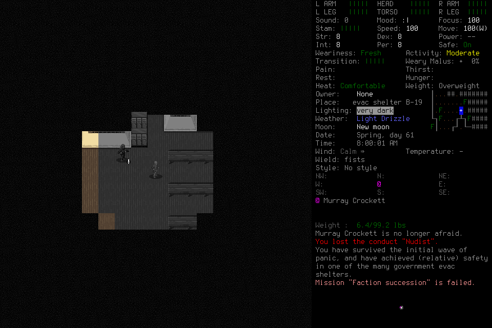

# Observation-custody boundary: bounded graphical result

`native-observation-custody-001` completed organic inventory interaction and a
coherent normal same-character save/new-child reload/ending on frozen `de97c8b`.
Independent closed-evidence review verified that bounded result. **The frozen
candidate is not formally accepted:** its full portable suite failed, and the
subsequent source corrections require their own checks and qualification judgment.
No seven-day survival, learned improvement or native-race outcome is accepted here.

## Candidate, scope and actual behavior

Source `de97c8b11ddba299d978c072ff60b687efd1e2d8`; unchanged signed native SHA-256
`40acb88b75cabf50a1b8a1134336c210d3f20503dcedd910fa2463019bdbcd56`.
The [design](../changes/059-observation-custody-and-applicability.md) separates
immutable captured-source custody from semantic applicability. No new native
build, protocol or persisted format was introduced.

One source-free Start admitted a new finite technical world, EnactiveObservationOne
/ Drew, default English Evacuee/Survivor, using the project wrapper/userdir and
windowed background launch. No library/adviser, paid provider or global change.
All six frozen setup/request files and three external pins remained exact through
closure. Limits: 512 inputs/mappings, 384 requests, 2,048 frames/512 MiB, 7,200 wall
seconds and 3,600 game seconds; ending reserve 128 inputs, 900 seconds, 256 frames/
64 MiB. No extension, refund, pruning or authority renewal.

The sole actual operator used `gpt-6.1-sol / medium`. It established visible Drew
identity/adoption, opened inventory with an ordinary key, opened its filter,
entered `water` and confirmed. The actual screen showed **clean water (frozen)**.
Explicit `noc001-filter-observe` completed; a separately chosen semantic
`noc001-inventory-cancel` returned to normal play. The Observe relation used
`exact_png_bytes`; this successful flow does not establish non-equivalence refusal.

First Save `noc001-save1-reconcile` retained turn 5,212,800 and position [0, 0, 0].
`noc001-exit1-yes` has an owned normal exit proof with code 0. A distinct child
loaded Drew; separate readmission, visible identity and `noc001-adopt2` explicitly
linked the same saved checkpoint. Loaded turn/position remained 5,212,800 / [0, 0, 0].
`noc001-postreload-east` then verified [1, 0, 0] at turn 5,212,801. Final Save preserved
that endpoint; `noc001-exit2-yes` has a second owned normal exit proof with code 0.
`noc001-finish2` completed NormalFinish with disposition `stopped`, without claiming
objective completion.

This original PNG is source
`3369409f3a41d9d4e2b0bf0462fc72c794de944434b233f95c3580c46e721c2e`,
SHA-256 `cc19e6b01bb3453f529bd608de9a5a86a29a508e2ea9f962987d2a3c3b1b87e9`.
The visible engine message that “Faction succession” failed remains evidence;
no engine validation or outcome was bypassed.

Retained-A/newer-B custody race, semantic non-equivalence refusal, late
applicability refusal, text-suffix interruption and changed-pixel Save are **not
established**. No wider mouse, takeover, general game-family or survival result
follows. Source interleaving tests remain a separate evidence lane.

## Costs, uncertainty and source failures

| Closed measure | Actual result |
| --- | --- |
| Requests | 68: 25 completed, 39 partial, 4 unknown |
| Charged primitives | 86: 80 returned, 6 unknown |
| Original PNGs | 224; 8,793,506 bytes; all SHA-256 hashes and PNG CRCs verified |
| Game time | One second: 5,212,800→5,212,801 |
| Start through Finish wall time | 644.679732 seconds; original deadline unchanged |
| Actor MCP calls | 83: 80 completed, 3 failed; 71 presented images |

Unknown primitives remain `noc001-character-yes`, both Save confirmations,
`noc001-load-drew` and both exit confirmations. Four have separate
LifecycleTransition proofs; the exits have OwnedNormalExit proofs. Resolved
effects do not relabel original ACKs. No uncertain input was replayed.

Three adapter calls rejected before admission and were corrected: unsupported
perception `basis`, fractional Claim receipt time, and Finish without a selected
archived source. They produced no ledger rows or charges. Thus “no retries” would
be inaccurate; no uncertain **input** replay is the supported claim.

The source checkpoint passed 142 affected tests, fast checks and independent source
review before this development run. The full local lane then ran 1,619 tests in
737.839 seconds and failed 49 assertions, including cascading cases.
[Exact de97 CI](https://github.com/CVX-Hull/enactive/actions/runs/39861570099)
also failed. Neither is replaced by the successful graphical path.

Independent triage confirmed missing controller progression checks at ordinary
refusal fences, stale unbound source presentation after authority revocation, and
malformed-state validation escaping passive publication. Remaining fixtures also
treated healthy revision advances as fatal or rewrote immutable clocks to simulate
age. The runtime still stopped contradictions before another input; no extra-input
or authority bypass was established. The frozen run finished without a live patch.
Corrections after actual FINAL add the shared clock/revision proof to controller
fences, qualify ordinary source availability through existing binding/custody,
retain private checkpoints and contain the exact passive validation failure.
Fixtures now distinguish healthy change, genuine contradiction, elapsed age and
malformed capture. [#176](https://github.com/CVX-Hull/enactive/issues/176) owns
checks/follow-through; this run cannot qualify corrected source retrospectively.

## Independence, closure and preservation

The lead performed admission, source/evidence work and cleanup; the operator chose
all game input, interpretation and correction. Actual commands show authorized
technical reads, supported Enactive tools and final own-environment ID reads;
no source/save mutation, alternate executor, process control or spawned agent.
Only preflight and activation messages arrived. Their bodies are encrypted in the
copied host, limiting independent wording review; no later incoming gameplay cue
appears. No manual rescue or visible routine action approval occurred; complete
hidden host review telemetry remains unavailable.

Actual FINAL line 582 follows last MCP line 562. The final result has no pending
input/control, unreconciled effect, unresolved custody or running owned child.
Only afterward did the lead interrupt the controller, which exited 0; the project
game and port 8766 listener were absent. No exceptional native signal was needed.
SQLite before/after copies pass integrity checks; operational tables and evidence
indices match. The post journal preserves its original prefix and adds two stop
records. Raw host/account/environment paths remain private under
`.runtime/native-observation-custody-001/closed-evidence/`.

All 43 technical-world files were opaquely archived and member-hash verified before
active-menu retirement. Archive
`.runtime/save-retirement/2026-10-22-observation001/closed-technical-world.tar.gz`:
756,778 bytes, SHA-256
`abee20e0d798405590704e5984310667ede348e67ed8bfb474841e3f87889484`.
All 191 accepted-world files remained unchanged. The adjacent manifest owns hashes
and restoration instructions; restoration requires a new admission and ordinary
Load. No save contents were inspected or edited, and no old authority is restored.
